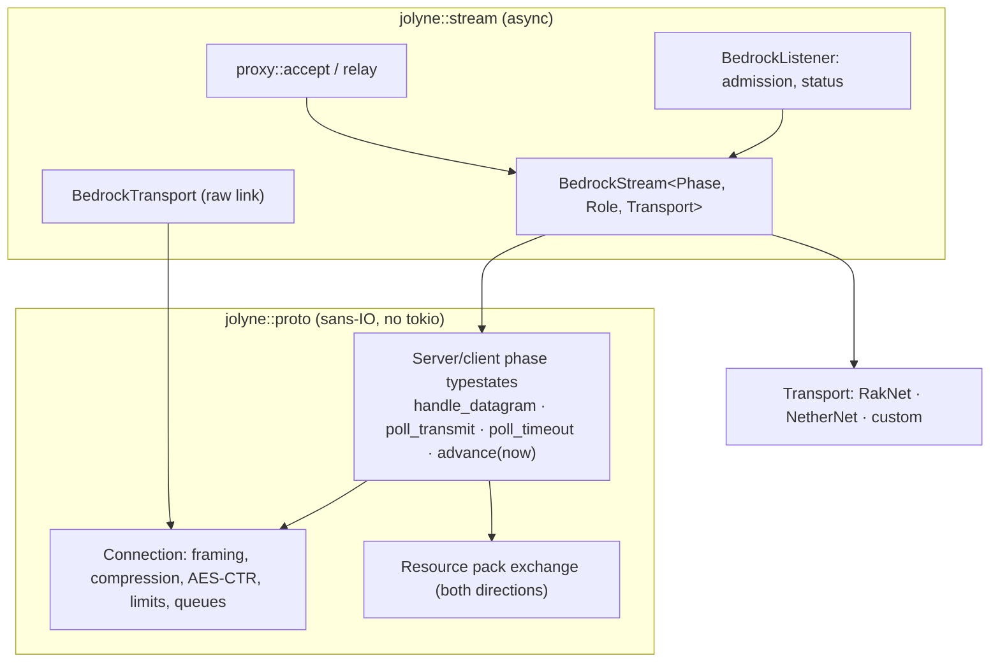

# Jolyne

[](https://crates.io/crates/jolyne)
[](https://docs.rs/jolyne)
[](https://github.com/axolotl-stack/jolyne/blob/main/LICENSE)

**Jolyne** is a robust, low-level Minecraft: Bedrock Edition protocol library for Rust. It provides the core primitives for building high-performance servers, clients, proxies, and analysis tools.

> **Note:** Server implementation logic (world, entities, ticking) is handled by the `unastar` crate. Jolyne focuses strictly on the protocol implementation.

## Architecture

Jolyne is split into a runtime-free protocol core and an async driver.



Library code does not panic on peer input or internal state: `lib.rs` denies
`unwrap`, `expect`, `panic!`, `unreachable!`, `todo!` and `unimplemented!`
outside tests, so every failure is a `JolyneError`. The single documented
exception is `BedrockStream`'s `Option` parts slot (needed to move out of a
`Drop` type), marked `#[expect]` with its invariant.

### `jolyne::proto`: the sans-IO core

Nothing in `proto` performs I/O, spawns tasks or reads a clock; time is an input.

- `conn::Connection` owns one peer's codec state. Inbound `Datagram`s go through
  `handle_datagram` (marker check, in-place decryption when the buffer is
  unique, decompression, unknown-packet policy) into a queue read with
  `next_packet`. Outbound packets are framed straight into the pending batch as
  they are queued and sealed into `Transmit`s (`poll_transmit`).
  Enabling compression or encryption first seals what is pending, so
  `NetworkSettings` and `ServerToClientHandshake` always leave in the old
  format (the vanilla "flush, then switch" ordering falls out of the queue).
- Join phases are consuming typestates (`proto::server`, `proto::client`)
  implementing `phase::Phase`: `handle_datagram`, `poll_transmit`,
  `poll_timeout` (mandatory deadline plus phase timers) and
  `advance(now) -> Result<Step<Self, Next>, Failure<Self>>`. A `Failure` hands
  the phase back, still owning the connection, so a reasoned `Disconnect` or
  `PlayStatus` can be sent.
- Packets arriving before the phase that handles them are deferred (bounded by
  `ConnectionOptions::{max_deferred_packets, max_deferred_bytes}`, default
  4,096 packets / 16 MiB, compacted) and replayed in order into play.

Server phases: `ServerHandshake → ServerLogin → LoginRequest →
Authenticated → [ServerEncryption] → PacksReady → ServerPacksPhase →
WorldReady → ServerSpawn → ServerSession`. Client phases: `ClientSettings →
ClientLogin → ClientHandshake → ClientPacks → ClientSpawn → ClientSession`.

### `jolyne::stream`: the async driver

`BedrockStream<S, R, T>` wraps the core owner of phase `S` for role `R` over
transport `T`. Each step method (`accept_network_settings`, `authenticate`,
`finish_handshake`, `negotiate_packs`, `start_game`; client `request_settings`,
`send_login`, `await_handshake`, `handle_packs`, `await_start_game`) drives one
core phase and returns the next typestate or `Failed<T>` (convertible to
`JolyneError`, with `disconnect()` to tell the peer why). The one-call
`accept_join_sequence` and `join` run every step and handle failures.

In play: `recv_packet_raw` / `recv_packet_borrowed` / `recv_packet`,
`send_packet`, `send_packet_raw`, `send_custom`, `send_batch(_raw)`, `flush`,
`set_flush_mode(FlushMode::{Immediate, Manual, Interval(d)})`, `close`
(drains pending writes), `disconnect(reason, message)`, `metrics`, `latency`.
Dropping a stream sends whatever the transport accepts without waiting.
An inbound `Disconnect` surfaces as `JolyneError::Disconnected` (carrying the
raw packet for proxies). `into_transport()` leaves the typestate for raw I/O.

`Transport` is sink-shaped (`poll_send_ready`/`start_send`/`poll_flush`/
`poll_close`/`poll_recv`, plus `latency`), so a message is never resubmitted
and sends wait on transport capacity (backpressure).

## Feature matrix

Status against the protocol-layer comparison (gophertunnel `80c811b61860` is
the vanilla reference). Tests are in `crates/jolyne` unless noted.

| Feature | Status | Evidence (tests) |
|---|---|---|
| Server listener | ✅ | `tests/raknet_listener.rs::listener_advertises_status_and_enforces_max_players` |
| Client | ✅ | `stream::tests::join_echo_and_typed_disconnect` |
| Proxy mode (relay, encryption terminated per side, unknown IDs forwarded) | ✅ | `stream::tests::proxy_relays_unknown_packets_and_disconnects`; `examples/proxy.rs` |
| RakNet | ✅ | `tests/raknet_listener.rs` (real loopback join) |
| NetherNet (LAN `ServerData` from the status provider) | ✅ | `tests/nethernet_loopback.rs` (real WebRTC loopback join); `listener::NetherNetBuilder::bind` publishes `ServerStatus::lan_server_data` |
| Custom transport | ✅ | `stream::tests` (in-memory `Transport`) |
| Compression: Deflate / Snappy / None, server-selectable; threshold default 1 (BDS `server.properties` and captures; gophertunnel uses 256), configurable | ✅ | `proto::tests::compression_and_encryption_are_active_in_play`, `proto::batch::tests::threshold_selects_marker_and_roundtrips_all_algorithms`, `proto::compression::tests::snappy_output_matches_the_golden_fixtures` (`tests/fixtures`) |
| Encryption (AES-CTR + checksum; ECDH key derivation) | ✅ | `proto::crypto::tests::*`, `proto::conn::tests::checksum_failure_is_terminal_for_the_connection`, `proto::handshake::tests::derive_key_matches_an_independent_vector` |
| Crypto hardening (constant-time compare, cipher invalidated, plaintext zeroized) | ✅ | `proto::crypto::tests::tampering_zeroizes_plaintext_and_invalidates_cipher_permanently` |
| Resource packs, server send (Info → DataInfo/chunks on request → Stack after download → Completed; SHA-256, CDN URL, content keys, paced chunks) | ✅ | `proto::packs::tests::{transfers_verifies_and_orders_stack_after_downloads, chunk_pacing_holds_replies_on_a_timer, server_rejects_out_of_order_unknown_and_refused, stack_finished_before_stack_is_rejected}` |
| Resource packs, client download (bounded window, size caps, SHA-256, stack check, cache hook, veto) | ✅ | `proto::packs::tests::{client_bounds_offers_chunk_size_and_hash, data_info_must_match_the_advertised_size, stack_entries_must_be_downloaded_builtin_or_declined, declined_packs_are_not_downloaded}`, `stream::tests::resource_packs_download_over_the_async_layer` |
| Packet borrowing / zero-copy | ✅ | `proto::raw::tests::compact_copy_detaches_from_batch_allocation`, `RawPacket` slices |
| Custom packets (registry + user codec) | ✅ | `proto::tests::unknown_and_custom_packets_follow_the_configured_policy`, `proto::custom::tests::registry_rejects_valentine_and_out_of_range_ids`, `proto::raw::tests::custom_packets_must_use_free_ten_bit_ids` |
| Unknown packet IDs (reject / skip / passthrough; server default reject) | ✅ | `proto::raw::tests::unknown_policy_rejects_skips_or_passes_through`, `proto::tests::unknown_and_custom_packets_follow_the_configured_policy` |
| Multi-protocol versions | ❌ out of scope | repo policy: Bedrock 1.26.51 / protocol 2193 only (exact check in `proto::server`) |
| Flush control (immediate, manual, 50 ms-style interval) | ✅ | `proto::conn::tests::{flush_modes_immediate_manual_interval_and_auto_seal_limits, switching_to_interval_arms_the_timer_for_pending_packets, failed_encode_keeps_the_pending_batch_intact}`, `stream::tests::manual_and_interval_flush_batch_packets` |
| Bounded queues / backpressure | ✅ | `proto::conn::tests::refused_batch_leaves_the_cipher_in_sync`, `stream::tests::sends_wait_for_transport_capacity` |
| Typed decode packet cap; 16 MiB decompression limit | ✅ | `proto::batch::tests::{typed_decode_enforces_packet_cap, size_guard_covers_compressed_none_and_plain_payloads}` |
| Login timeout (settings → encryption) and per-stage deadlines | ✅ | `proto::tests::{each_stage_has_a_mandatory_deadline, deadline_elapses_exactly_at_login_timeout}` |
| Admission (max players → `PlayStatus` server full; allow hook → Kicked) | ✅ | `proto::tests::server_full_and_admission_refusals_reach_the_client_typed`, `tests/raknet_listener.rs` |
| Disconnect with reason (both sides), typed inbound Disconnect, flushing `close`; failure disconnects send one fixed sentence per reason, never internal error text | ✅ | `stream::tests::{join_echo_and_typed_disconnect, failed_step_keeps_the_connection_and_sends_a_reason, close_and_drop_flush_buffered_packets}`, `proto::tests::failure_disconnects_never_send_internal_error_text` |
| Spawn checks (runtime ID, radius ≥ 1 + server override, BDS packet order incl. `DimensionData?`/`JigsawStructureData`/`VoxelShapes` before `StartGame`, pinned to a recorded BDS 1.26.51 trace; StartGame group and spawn answer as single batches) | ✅ | `proto::tests::{runtime_id_mismatch_is_rejected, chunk_radius_requires_one_and_honours_the_server_override, join_sequence_follows_the_bds_capture, start_game_and_spawn_answers_leave_as_single_batches}` |
| Client: typed `PlayStatus` refusal, ES384-pinned handshake | ✅ | `proto::tests::protocol_mismatch_answers_play_status_and_client_reports_refusal`, `proto::handshake::tests::rejects_non_es384_and_tampered_tokens` |
| Latency / RTT (RakNet ACK RTT, NetherNet SCTP SRTT) | ✅ | `tests/raknet_listener.rs` (`latency()` after a real join), `stream::tests::join_echo_and_typed_disconnect` |
| Server status / MOTD (refreshed every 4 s and on join/leave) | ✅ | `status::tests::pong_matches_gophertunnel_layout_and_unlimited_max`, `tests/raknet_listener.rs` |
| Packet observer hook (zero cost when unset) | ✅ | `proto::conn::tests::observer_sees_both_directions_with_bodies` |
| Metrics (packets/bytes/batches in/out, decode errors, unknown IDs) | ✅ | `proto::conn::tests::enabling_compression_and_encryption_seals_pending_in_the_old_format`, `proto::tests::unknown_and_custom_packets_follow_the_configured_policy` |
| Tracing | ✅ | `#[instrument]` spans on every join step, `close` and `disconnect`; `RUST_LOG=jolyne::wire=trace` logs every batch (wire length, encryption, compression algorithm byte, packet count, plaintext preview) and packet (ID, name, length, first 256 payload bytes in hex); an inbound `PacketViolationWarning` is always logged at `WARN` |
| Typestate phase safety | ✅ | `stream::BedrockStream<S, R, T>` |
| Validated ClientData / identity on the session | ✅ | `BedrockStream<Play, Server, _>::{identity, client_data}`; `stream::tests::join_echo_and_typed_disconnect`; validation in `jolyne::auth` |
| Online identity bound to key possession (no replayed-Login trust; RakNet refuses online without encryption) | ✅ | `proto::tests::{online_identity_is_authenticated_only_after_the_encryption_handshake, replayed_online_login_never_authenticates_and_times_out_at_the_login_deadline, online_mode_without_encryption_is_refused_on_raknet, unencrypted_online_login_trusts_only_a_transport_proven_key}` |
| Client can require encryption (`ClientConfig::require_encryption`; off by default) | ✅ | `proto::tests::client_can_require_encryption` |

### Reusable batch pipeline

Each connection retains a `proto::batch::BatchCodec`. Its compressor,
decompressor, Snappy tables and encode/decode scratch are reused instead of
constructing a compression engine for every batch. DEFLATE uses libdeflate;
levels 1–9 retain their numeric value (higher values clamp to 9), level zero
disables compression, and the transport default remains 7. Cross-implementation
benchmarks use nominal level 6; different compressors need not emit identical
bytes. Building jolyne requires a C compiler for bundled libdeflate.
Decode remembers the previous output length and bounds speculative buffer
growth; batches exceeding the 1 MiB speculative ceiling use a guarded zlib-rs
streaming decoder. The decompressed-size bound (default 16 MiB) is always
enforced; there is no unbounded mode.

Snappy encoding uses a whole-block matcher with input-sized 8/10/12/14-bit
hash tables retained in 64 KiB of lazily allocated per-connection scratch;
DEFLATE-only connections do not allocate this table. It emits only
standard Snappy literal/copy tags, including 32-bit offsets across 64 KiB
boundaries; it does not emit S2 repeat extensions. Decoding remains the
`snap` decoder, with the declared decoded length checked before allocation.
Permanent Go interoperability tests decode checked-in vectors for all four
benchmark batches, a >64 KiB literal and a copy4 offset. The matcher adapts the
BSD-licensed [S2 Snappy search](https://github.com/klauspost/compress/tree/v1.18.1/s2);
its redistribution notice is retained in `src/proto/compression/snappy.rs`.
See [Snappy measurements and interoperability](../bench-compare/snappy-report.md).

For opaque framing, `BatchCodec::encode_frames_into` accepts packet `Bytes`
including the game header but excluding the length prefix. `decode_with`
synchronously borrows each validated frame without constructing a packet vector
or incrementing a reference count per packet. The 1,600-frame limit and the
decompressed-size limit apply to every decode path, typed and raw.

`proto::crypto::BatchCipher` exposes the owned in-place encryption used by the
connection. Construct separate send/receive instances with the session key and
12-byte IV, and call `encrypt`/`decrypt` with the cleartext header length (one
for RakNet, zero for prefix-free batches). Reserve eight spare bytes before
encryption to avoid allocation. Checksums are compared in constant time; a
failed checksum zeroizes the plaintext and permanently invalidates the cipher.

## Usage

Add this to your `Cargo.toml`:

```toml
[dependencies]
jolyne = "0.1"
```

### Example: Simple Bot (Client)

For client instrumentation or caller-supplied identity JWTs, the `Login` state
also exposes `send_login_with_tokens(identity_key, auth_info_json, client_data_jwt)`.
This sends the supplied authentication JSON and signed client-data token without
regenerating their identity fields; `identity_key` must be the key that signed
them (it drives the ECDH handshake). The normal `send_login(&ClientHandshakeConfig)`
continues to generate tokens internally.

Client-generated metadata uses Android `DeviceOS: 1`. BDS 1.26.51 rejects the
retired UWP `DeviceOS: 7` in `ConnectionRequest::isWellFormed`, reporting the
misleading `readNoHeader failed` before authentication. Caller-supplied metadata
must likewise identify a supported platform.

Offline Login uses `AuthenticationType: 2` with a self-signed multiplayer
`Token` (`aud`, `cpk`, `xname`, `leguuid`, and empty account-only claims), matching
the pinned gophertunnel encoder. The identity and client-data JWTs use the same
P-384 key. A top-level legacy `chain` is not a modern BDS identity token.
The client does not implement client-side chunk generation and advertises that
capability as disabled for both offline and provider-token Login.

`ClientHandshakeConfig::credentials` selects the Login authentication
(`auth::client::LoginCredentials`). `ClientHandshakeConfig::with_xbox_live`
takes an `Arc<dyn auth::client::MultiplayerTokenSource>` and sends
`AuthenticationType: 0` with a provider multiplayer token bound to the
connection key, as vanilla clients and gophertunnel's dialer do; jolyne online
servers and BDS 1.26.51 authenticate only this token. jolyne does not depend on
an Xbox client: `examples/simple_client.rs` implements the source with
`axolotl-xbl` (PlayFab-scoped XBL token → `PlayFabClient::login` →
`service_token` → `multiplayer_token`). `auth::client::build_login` produces the
same `(auth_info_json, client_data_jwt)` pair for `send_login_with_tokens`.
The client no longer requests or sends a Mojang-signed legacy chain.
Online envelopes are tested end to end against the jolyne verifier with test
keys; live Xbox authentication is not exercised by the offline harness.

The offline vanilla differential harness lives in
[`tools/client-diff`](../../tools/client-diff/README.md). Its acceptance report
distinguishes successful joins from server-rejected login captures.

```rust,no_run
use jolyne::stream::client::ClientHandshakeConfig;
use jolyne::stream::BedrockStream;
use jolyne::valentine::{McpePacket, RequestChunkRadiusPacket};

#[tokio::main]
async fn main() -> Result<(), Box<dyn std::error::Error>> {
    let addr = "127.0.0.1:19132".parse()?;

    // 1. Connect
    let handshake = BedrockStream::connect(addr).await?;
    
    // 2. Configure (Auto-generate keys/uuid)
    let config = ClientHandshakeConfig::random(addr, "JolyneBot");

    // 3. Join (Handles auth, encryption, resource packs)
    let (mut client, _game_data) = handshake.join(config).await?;
    
    // Send a chunk radius request (could be anything.)
    let req = RequestChunkRadiusPacket {
        chunk_radius: 8,
        max_chunk_radius: 8,
    };
    client.send_packet(McpePacket::from(req)).await?;
    
    Ok(())
}
```

`jolyne::valentine` is pinned to Bedrock 26.51 (protocol 2193). Its canonical
schema label is `valentine::bedrock::version::v1_26_51`.

### Server authentication

`auth::authenticate_login(auth_info_json, client_data_jwt, online_mode,
allow_legacy)` returns `Result<AuthenticatedLogin, AuthError>` with
`AuthenticatedLogin { identity: ValidatedIdentity, client_data: ClientData }`.
`authenticate_login_with` takes an explicit `auth::openid::OpenIdProvider`.
Issuer, audience and temporal failures have distinct `AuthError` variants;
key/signature mismatches are `AuthError::BadSignature`.

| Mode | Accepted | `ValidatedIdentity` |
|---|---|---|
| online | `AuthenticationType: 0` with a provider-signed `Token` carrying an XUID | `Trust::AwaitingKeyProof` from `authenticate_login`; `Trust::Authenticated` (`is_authenticated()`, `xuid()`, `playfab_id()` (`mid`), `title_id()` (`tid`, `20CA2` retail)) once the connection proves the client holds the token's key |
| offline | type 0 with an unverified `Token`; with `allow_legacy`, type 1/2 with a self-signed `Token` or a legacy chain | unauthenticated; `xuid()`, `playfab_id()`, `title_id()` are `None` |

A verified token alone does not authenticate: a captured `Login` can be
replayed. The server phases authenticate the identity when the client
completes the encryption handshake (its `ClientToServerHandshake` decrypts
under the ECDH secret of the token's key). With encryption off, the identity is
authenticated only if the transport proved the same key
(`Transport::proven_peer_key`, NetherNet's DTLS-bound identity) and is
otherwise downgraded to `Trust::Unauthenticated`; on RakNet, which cannot prove
keys, online mode without encryption is refused
(`AuthError::OnlineModeRequiresEncryption`, also at `bind`). The handshake wait
runs under the login deadline. Read the identity after `finish_handshake`
(`authenticate` returns only the stream); admission hooks run before it and see
`AwaitingKeyProof`, so they may refuse on `claimed_xuid()` but must not grant
anything on it.

`ValidatedIdentity` has private fields and no public constructor, so an offline
identity cannot be upgraded or edited. Its offline XUID claim is only reachable
through `claimed_xuid()` and must never key persistent or privileged state. The
UUID is `leguuid`, else the gophertunnel MD5 v3 UUID of the XUID, else random.
Identity claims are validated like gophertunnel `IdentityData.Validate` (int64
XUID, non-nil UUID, display-name length/spacing rules).

Online OpenID trust starts at Minecraft's HTTPS build discovery endpoint for
`1.26.51`, follows the published issuer's OpenID configuration and JWKS, and
enforces issuer, multiplayer audience, expiry/not-before (60-second skew) and
the published RS256/ES384 algorithm allow-list. JWT `x5u`/`x5c` keys and URLs are
never trust sources. The process-wide `OpenIdProvider::minecraft()` caches the
key set without serializing logins: validation clones an `Arc` snapshot and
verifies without holding a lock; refreshes are single-flight and shared by all
waiters (success or failure) and run in a spawned task, so a cancelled login
neither aborts the fetch nor loses its outcome or backoff; an unknown `kid` refreshes at most once per 30
minutes (gophertunnel `refreshingKeySet`); snapshots older than one hour are
revalidated by one caller while the others keep using the cached keys, which
keep serving for up to 24 hours if refreshing fails; failed fetches back off for
30 seconds; each refresh is bounded by 30 seconds (HTTP connect 5 s, request
10 s). `RefreshPolicy` and `KeySetSource` make all of this injectable;
`OpenIdVerifier::from_jwks` builds an explicitly trusted snapshot and its
synchronous `validate` uses the production verification path.

Client data must be ES384-signed by the token's `cpk` identity key, and an
`IdentityPublicKey` echo must match it. It is parsed into the typed
`auth::ClientData` and validated like gophertunnel `ClientData.Validate`
(DeviceOS 1–15, numeric GameVersion, BCP-47 language, UUID/uint64 platform IDs,
skin/cape/animation byte sizes equal to width × height × 4, base64 JSON
geometry and resource patch, non-empty SkinId, UIProfile 0–2, lower-case hex
PlayFabId). Unlike gophertunnel, `ServerAddress` is checked syntactically and
never resolved through DNS.

Online mode rejects Guest/SelfSigned authentication types, including
Mojang-rooted legacy chains, which gophertunnel still accepts. Evidence: BDS
1.26.51's `bedrock_server.exe` contains neither the Mojang root key (base64 SPKI
or DER bytes) nor the `identityPublicKey`, `extraData` or `certificateAuthority`
claim names, while it does contain `cpk`, `xname`, `leguuid` and the
multiplayer audience; vanilla servers therefore only authenticate the `Token`.
Legacy chains are parsed for offline logins only and never authenticate.

Provider discovery and claim conventions follow
[gophertunnel `service/token.go:VerifierContext`](https://github.com/Sandertv/gophertunnel/blob/be557e33fe6f8d0c0db7ef05b5fd068725c325ad/minecraft/service/token.go)
and [`login/request.go:Parse`](https://github.com/Sandertv/gophertunnel/blob/be557e33fe6f8d0c0db7ef05b5fd068725c325ad/minecraft/protocol/login/request.go).


## Roadmap

See [`ROADMAP.md`](ROADMAP.md) for vanilla compatibility gates and acceptance evidence.
