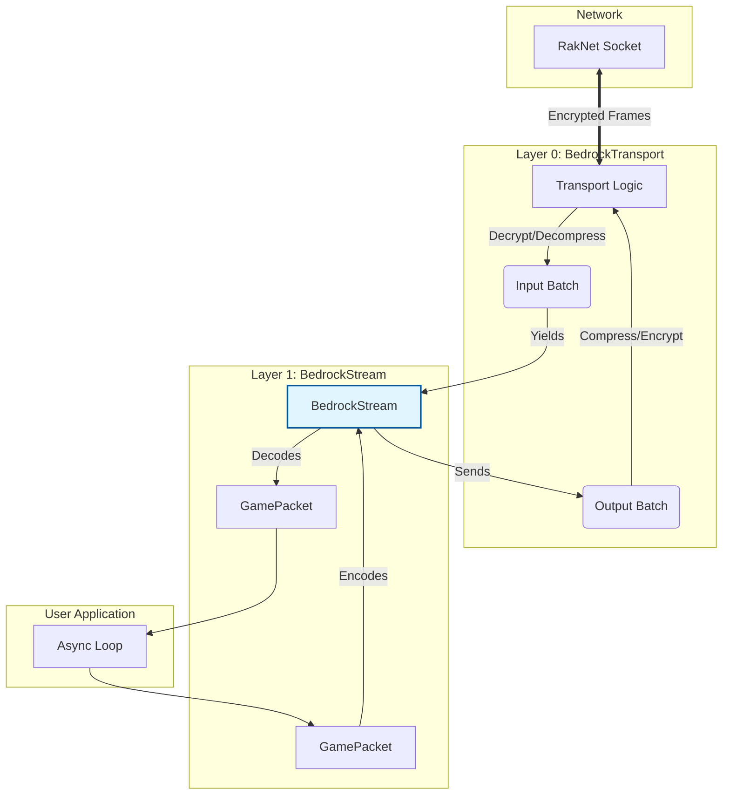

# Jolyne

[](https://crates.io/crates/jolyne)
[](https://docs.rs/jolyne)
[](https://github.com/axolotl-stack/jolyne/blob/main/LICENSE)

**Jolyne** is a robust, low-level Minecraft: Bedrock Edition protocol library for Rust. It provides the core primitives for building high-performance servers, clients, proxies, and analysis tools.

> **Note:** Server implementation logic (world, entities, ticking) is handled by the `unastar` crate. Jolyne focuses strictly on the protocol implementation.

## Architecture

Jolyne adopts a layered architecture to provide flexibility without sacrificing type safety.



### Components

#### Layer 0: `BedrockTransport`
The "pipe" layer. It handles the gritty details of the protocol:
- **Encryption:** AES-256-CTR with Bedrock SHA-256 checksums (managed transparently).
- **Compression:** Raw DEFLATE and raw Snappy, negotiated per connection; thresholds and decompressed-size limits are enforced.
- **Batching:** Decodes raw frames into batches of packets.
- **IO:** Implements `Stream` and `Sink` for raw `Batch` objects.


### Reusable batch pipeline

`BedrockTransport` retains a `batch::BatchCodec` per connection. Its compressor,
decompressor, Snappy tables and encode/decode scratch are reused instead of
constructing a compression engine for every batch. DEFLATE uses libdeflate;
levels 1–9 retain their numeric value (higher values clamp to 9), level zero
disables compression, and the transport default remains 7. Cross-implementation
benchmarks use nominal level 6; different compressors need not emit identical
bytes. Building jolyne now requires a C compiler for bundled libdeflate.
Decode remembers the previous output length and bounds speculative buffer
growth; batches exceeding the 1 MiB speculative ceiling use a guarded zlib-rs
streaming decoder instead of allocating the entire configured maximum.

Snappy encoding uses a whole-block matcher with input-sized 8/10/12/14-bit
hash tables retained in 64 KiB of lazily allocated per-connection scratch;
DEFLATE-only connections do not allocate this table. It emits only
standard Snappy literal/copy tags, including 32-bit offsets across 64 KiB
boundaries; it does not emit S2 repeat extensions. Decoding remains the
`snap` decoder, with the declared decoded length checked before allocation.
Steady-state compression and decompression reuse their existing buffers.
Barely compressible input falls back to a single literal instead of retaining
a tag-heavy parse. Permanent Go interoperability tests decode checked-in
vectors for all four benchmark batches, a >64 KiB literal and a copy4 offset.
The matcher adapts the BSD-licensed
[S2 Snappy search](https://github.com/klauspost/compress/tree/v1.18.1/s2);
its redistribution notice is retained in `src/compression/snappy.rs`.
See [Snappy measurements and interoperability](snappy-report.md) for the
four-fixture size/speed gates and validation commands.

For opaque framing, `BatchCodec::encode_frames_into` accepts packet `Bytes`
including the game header but excluding the length prefix, a `BatchEncoding`
settings value, and a reusable `BytesMut`. `decode_with` synchronously borrows
each validated frame without constructing a packet vector or incrementing a
reference count per packet. The raw packet decode APIs retain zero-copy `Bytes`
slices when frames must outlive the call. Callback delivery is ordered; if a
later frame is malformed, earlier callbacks have already run. The 1,600-frame
limit and configured decompressed-size limit still apply.

`crypto::BatchCipher` exposes the same owned in-place encryption used by the
transport. Construct separate send/receive instances with the session key and
12-byte IV, and call `encrypt`/`decrypt` with the cleartext header length (one
for RakNet, zero for prefix-free batches). Reserve eight spare bytes before
encryption to avoid allocation. CTR state and checksum counters continue
across batches; a failed checksum consumes state and requires closing the
connection. RustCrypto's AES and SHA implementations select hardware support
on capable CPUs; the library does not override workspace compiler flags.

#### Layer 1: `BedrockStream<S, R>`
The "state" layer. A strongly-typed wrapper around the transport that enforces protocol correctness.
- **Generics:**
  - `S: State` - The current handshake state (`Handshake`, `Play`).
  - `R: Role` - The connection role (`Client`, `Server`).
- **Safety:** You cannot send gameplay packets while in the handshake state. The compiler prevents it.
- **Usage:**
  ```rust,ignore
  // Example: Server Accepting a Connection
  let mut listener = BedrockListener::bind("0.0.0.0:19132").await?;
  
  while let Some(handshake_stream) = listener.accept().await {
      // handshake_stream is type: BedrockStream<Handshake, Server>
      
      // Perform handshake (consumes the old stream, returns a new one)
      let mut play_stream = handshake_stream.login().await?;
      
      // Now you can handle game packets
      while let Ok(packet) = play_stream.recv_packet().await {
          // ...
      }
  }
  ```

## Features

- **Strict State Machine:** Typestate pattern prevents invalid protocol transitions.
- **Zero-Copy Networking:** Uses `bytes::Bytes` for efficient packet handling.
- **Modular:** Feature flags (`client`, `server`, `encryption`) let you compile only what you need.
- **Async First:** Built on `tokio` for high concurrency.

## Usage

Add this to your `Cargo.toml`:

```toml
[dependencies]
jolyne = "0.1"
```

### Example: Simple Bot (Client)

For client instrumentation or caller-supplied identity JWTs, the `Login` state
also exposes `send_login_with_tokens(auth_info_json, client_data_jwt)`. This
sends the supplied authentication JSON and signed client-data token without
regenerating their identity fields; the caller must use the matching private
key for `await_handshake`. The normal `send_login(&ClientHandshakeConfig)`
continues to generate tokens internally.

Client-generated metadata uses Android `DeviceOS: 1`. BDS 1.26.51 rejects the
retired UWP `DeviceOS: 7` in `ConnectionRequest::isWellFormed`, reporting the
misleading `readNoHeader failed` before authentication. Caller-supplied metadata
must likewise identify a supported platform.

Offline Login uses `AuthenticationType: 2` with a self-signed multiplayer
`Token` (`aud`, `cpk`, `xname`, `leguuid`, and empty account-only claims), matching
the pinned gophertunnel encoder. The identity and client-data JWTs use the same
P-384 key. A top-level legacy `chain` is not a modern BDS identity token.
The client does not implement client-side chunk generation and advertises that
capability as disabled for both offline and provider-token Login.

`ClientHandshakeConfig::credentials` selects the Login authentication
(`auth::client::LoginCredentials`). `ClientHandshakeConfig::with_xbox_live`
takes an `Arc<dyn auth::client::MultiplayerTokenSource>` and sends
`AuthenticationType: 0` with a provider multiplayer token bound to the
connection key, as vanilla clients and gophertunnel's dialer do; jolyne online
servers and BDS 1.26.51 authenticate only this token. jolyne does not depend on
an Xbox client: `examples/simple_client.rs` implements the source with
`axolotl-xbl` (PlayFab-scoped XBL token → `PlayFabClient::login` →
`service_token` → `multiplayer_token`). `auth::client::build_login` produces the
same `(auth_info_json, client_data_jwt)` pair for `send_login_with_tokens`.
The client no longer requests or sends a Mojang-signed legacy chain.
Online envelopes are tested end to end against the jolyne verifier with test
keys; live Xbox authentication is not exercised by the offline harness.

The offline vanilla differential harness lives in
[`tools/client-diff`](../../tools/client-diff/README.md). Its acceptance report
distinguishes successful joins from server-rejected login captures.

```rust,no_run
use jolyne::stream::client::ClientHandshakeConfig;
use jolyne::stream::BedrockStream;
use jolyne::valentine::{McpePacket, RequestChunkRadiusPacket};

#[tokio::main]
async fn main() -> Result<(), Box<dyn std::error::Error>> {
    let addr = "127.0.0.1:19132".parse()?;

    // 1. Connect
    let handshake = BedrockStream::connect(addr).await?;
    
    // 2. Configure (Auto-generate keys/uuid)
    let config = ClientHandshakeConfig::random(addr, "JolyneBot");

    // 3. Join (Handles auth, encryption, resource packs)
    let (mut client, _game_data) = handshake.join(config).await?;
    
    // Send a chunk radius request (could be anything.)
    let req = RequestChunkRadiusPacket {
        chunk_radius: 8,
        max_chunk_radius: 8,
    };
    client.send_packet(McpePacket::from(req)).await?;
    
    Ok(())
}
```

`jolyne::valentine` is pinned to Bedrock 26.51 (protocol 2193). Its canonical
schema label is `valentine::bedrock::version::v1_26_51`.

### Server authentication

`auth::authenticate_login(auth_info_json, client_data_jwt, online_mode,
allow_legacy)` returns `Result<AuthenticatedLogin, AuthError>` with
`AuthenticatedLogin { identity: ValidatedIdentity, client_data: ClientData }`.
`authenticate_login_with` takes an explicit `auth::openid::OpenIdProvider`.
Issuer, audience and temporal failures have distinct `AuthError` variants;
key/signature mismatches are `AuthError::BadSignature`.

| Mode | Accepted | `ValidatedIdentity` |
|---|---|---|
| online | `AuthenticationType: 0` with a provider-signed `Token` carrying an XUID | `is_authenticated()`; `xuid()`, `playfab_id()` (`mid`), `title_id()` (`tid`, `20CA2` retail) |
| offline | type 0 with an unverified `Token`; with `allow_legacy`, type 1/2 with a self-signed `Token` or a legacy chain | unauthenticated; `xuid()`, `playfab_id()`, `title_id()` are `None` |

`ValidatedIdentity` has private fields and no public constructor, so an offline
identity cannot be upgraded or edited. Its offline XUID claim is only reachable
through `claimed_xuid()` and must never key persistent or privileged state. The
UUID is `leguuid`, else the gophertunnel MD5 v3 UUID of the XUID, else random.
Identity claims are validated like gophertunnel `IdentityData.Validate` (int64
XUID, non-nil UUID, display-name length/spacing rules).

Online OpenID trust starts at Minecraft's HTTPS build discovery endpoint for
`1.26.51`, follows the published issuer's OpenID configuration and JWKS, and
enforces issuer, multiplayer audience, expiry/not-before (60-second skew) and
the published RS256/ES384 algorithm allow-list. JWT `x5u`/`x5c` keys and URLs are
never trust sources. The process-wide `OpenIdProvider::minecraft()` caches the
key set without serializing logins: validation clones an `Arc` snapshot and
verifies without holding a lock; refreshes are single-flight and shared by all
waiters (success or failure); an unknown `kid` refreshes at most once per 30
minutes (gophertunnel `refreshingKeySet`); snapshots older than one hour are
revalidated by one caller while the others keep using the cached keys, which
keep serving for up to 24 hours if refreshing fails; failed fetches back off for
30 seconds; each refresh is bounded by 30 seconds (HTTP connect 5 s, request
10 s). `RefreshPolicy` and `KeySetSource` make all of this injectable;
`OpenIdVerifier::from_jwks` builds an explicitly trusted snapshot and its
synchronous `validate` uses the production verification path.

Client data must be ES384-signed by the token's `cpk` identity key, and an
`IdentityPublicKey` echo must match it. It is parsed into the typed
`auth::ClientData` and validated like gophertunnel `ClientData.Validate`
(DeviceOS 1–15, numeric GameVersion, BCP-47 language, UUID/uint64 platform IDs,
skin/cape/animation byte sizes equal to width × height × 4, base64 JSON
geometry and resource patch, non-empty SkinId, UIProfile 0–2, lower-case hex
PlayFabId). Unlike gophertunnel, `ServerAddress` is checked syntactically and
never resolved through DNS.

Online mode rejects Guest/SelfSigned authentication types, including
Mojang-rooted legacy chains, which gophertunnel still accepts. Evidence: BDS
1.26.51's `bedrock_server.exe` contains neither the Mojang root key (base64 SPKI
or DER bytes) nor the `identityPublicKey`, `extraData` or `certificateAuthority`
claim names, while it does contain `cpk`, `xname`, `leguuid` and the
multiplayer audience; vanilla servers therefore only authenticate the `Token`.
Legacy chains are parsed for offline logins only and never authenticate.

Provider discovery and claim conventions follow
[gophertunnel `service/token.go:VerifierContext`](https://github.com/Sandertv/gophertunnel/blob/be557e33fe6f8d0c0db7ef05b5fd068725c325ad/minecraft/service/token.go)
and [`login/request.go:Parse`](https://github.com/Sandertv/gophertunnel/blob/be557e33fe6f8d0c0db7ef05b5fd068725c325ad/minecraft/protocol/login/request.go).


## 🔮 Future Roadmap

See [`ROADMAP.md`](ROADMAP.md) for vanilla compatibility gates and acceptance evidence.

### Transport Decoupling (Completed)
`BedrockTransport` is now agnostic. `jolyne` supports `NetherNet` (via `tokio-nethernet`), and `Raknet` (via `tokio-raknet`).
- **Status**: ✅ Done. Users can bring their own transport implementation.

### API Stabilization
- **Goal**: stabilize the `BedrockStream` API to minimize breaking changes.
- **Goal**: Improve ergonomics for custom packet handling and batching strategies.


### Vanilla Compatibility Hardening
- Online-mode auth uses provider-discovered trust roots and signed client data.
- Complete resource-pack negotiation, including non-empty pack transfer and `ClientCacheStatus` handling.
- Add login/start-game packet-order integration tests from `docs/LOGIN_SEQUENCE.md`.
- Treat `DefaultWorldTemplate` as a minimal scaffold; vanilla-compatible sessions should inject real registry data from Unastar/data generation.
