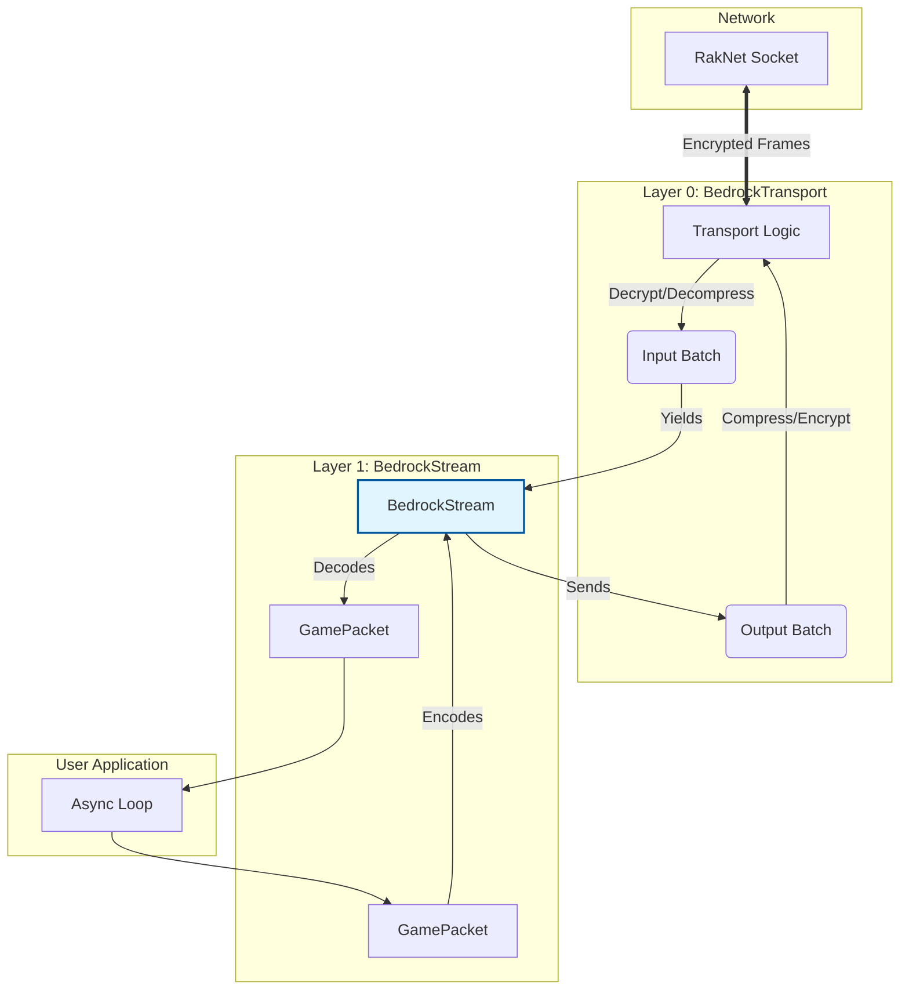

# Jolyne

[](https://crates.io/crates/jolyne)
[](https://docs.rs/jolyne)
[](https://github.com/axolotl-stack/jolyne/blob/main/LICENSE)

**Jolyne** is a robust, low-level Minecraft: Bedrock Edition protocol library for Rust. It provides the core primitives for building high-performance servers, clients, proxies, and analysis tools.

> **Note:** Server implementation logic (world, entities, ticking) is handled by the `unastar` crate. Jolyne focuses strictly on the protocol implementation.

## Architecture

Jolyne adopts a layered architecture to provide flexibility without sacrificing type safety.



### Components

#### Layer 0: `BedrockTransport`
The "pipe" layer. It handles the gritty details of the protocol:
- **Encryption:** AES-256-CTR with Bedrock SHA-256 checksums (managed transparently).
- **Compression:** Deflate/Zlib support; Snappy packets are rejected until implemented.
- **Batching:** Decodes raw frames into batches of packets.
- **IO:** Implements `Stream` and `Sink` for raw `Batch` objects.

#### Layer 1: `BedrockStream<S, R>`
The "state" layer. A strongly-typed wrapper around the transport that enforces protocol correctness.
- **Generics:**
  - `S: State` - The current handshake state (`Handshake`, `Play`).
  - `R: Role` - The connection role (`Client`, `Server`).
- **Safety:** You cannot send gameplay packets while in the handshake state. The compiler prevents it.
- **Usage:**
  ```rust,ignore
  // Example: Server Accepting a Connection
  let mut listener = BedrockListener::bind("0.0.0.0:19132").await?;
  
  while let Some(handshake_stream) = listener.accept().await {
      // handshake_stream is type: BedrockStream<Handshake, Server>
      
      // Perform handshake (consumes the old stream, returns a new one)
      let mut play_stream = handshake_stream.login().await?;
      
      // Now you can handle game packets
      while let Ok(packet) = play_stream.recv_packet().await {
          // ...
      }
  }
  ```

## Features

- **Strict State Machine:** Typestate pattern prevents invalid protocol transitions.
- **Zero-Copy Networking:** Uses `bytes::Bytes` for efficient packet handling.
- **Modular:** Feature flags (`client`, `server`, `encryption`) let you compile only what you need.
- **Async First:** Built on `tokio` for high concurrency.

## Usage

Add this to your `Cargo.toml`:

```toml
[dependencies]
jolyne = "0.1"
```

### Example: Simple Bot (Client)

For client instrumentation or caller-supplied identity JWTs, the `Login` state
also exposes `send_login_with_tokens(auth_info_json, client_data_jwt)`. This
sends the supplied authentication JSON and signed client-data token without
regenerating their identity fields; the caller must use the matching private
key for `await_handshake`. The normal `send_login(&ClientHandshakeConfig)`
continues to generate tokens internally.

Client-generated metadata uses Android `DeviceOS: 1`. BDS 1.26.51 rejects the
retired UWP `DeviceOS: 7` in `ConnectionRequest::isWellFormed`, reporting the
misleading `readNoHeader failed` before authentication. Caller-supplied metadata
must likewise identify a supported platform.

Offline Login uses `AuthenticationType: 2` with a self-signed multiplayer
`Token` (`aud`, `cpk`, `xname`, `leguuid`, and empty account-only claims), matching
the pinned gophertunnel encoder. The identity and client-data JWTs use the same
P-384 key. A top-level legacy `chain` is not a modern BDS identity token.

The offline vanilla differential harness lives in
[`tools/client-diff`](../../tools/client-diff/README.md). Its acceptance report
distinguishes successful joins from server-rejected login captures.

```rust,no_run
use jolyne::stream::client::ClientHandshakeConfig;
use jolyne::stream::BedrockStream;
use jolyne::valentine::{McpePacket, RequestChunkRadiusPacket};

#[tokio::main]
async fn main() -> Result<(), Box<dyn std::error::Error>> {
    let addr = "127.0.0.1:19132".parse()?;

    // 1. Connect
    let handshake = BedrockStream::connect(addr).await?;
    
    // 2. Configure (Auto-generate keys/uuid)
    let config = ClientHandshakeConfig::random(addr, "JolyneBot");

    // 3. Join (Handles auth, encryption, resource packs)
    let (mut client, _game_data) = handshake.join(config).await?;
    
    // Send a chunk radius request (could be anything.)
    let req = RequestChunkRadiusPacket {
        chunk_radius: 8,
        max_chunk_radius: 8,
    };
    client.send_packet(McpePacket::from(req)).await?;
    
    Ok(())
}
```

`jolyne::valentine` is pinned to Bedrock 26.51 (protocol 2193). Its canonical
schema label is `valentine::bedrock::version::v1_26_51`.

### Server authentication

`auth::authenticate_login` retains its existing arguments and
`Result<ValidatedIdentity, JolyneError>` return type. Authentication failures are
typed `JolyneError::Auth(AuthError)` values; issuer, audience and temporal failures
have distinct variants. Key/signature mismatches are `AuthError::BadSignature`.
`ValidatedIdentity::authenticated` is true only for online-verified identities;
offline identities are always false, even if their payload claims an XUID.

Online OpenID trust starts at Minecraft's HTTPS build discovery endpoint for
`1.26.51`, follows the published issuer's OpenID configuration and JWKS, and
enforces issuer, multiplayer audience, expiry/not-before (60-second skew) and
the published RS256/ES384 algorithm allow-list. JWT `x5u`/`x5c` keys and URLs are
never trust sources. JWKS snapshots expire after 30 minutes; expired snapshots
are refreshed before validation and discovery failures fail closed.
`auth::openid::OpenIdVerifier::from_jwks` accepts an explicitly trusted issuer,
algorithm list and JWKS snapshot for deterministic tests; its `validate` method
uses the same verification path as production.

Client data must be ES384-signed by the token's authenticated `cpk` identity key.
A contradictory client identity key is rejected, and client data cannot override
provider-asserted identity fields. Self-signed multiplayer tokens remain supported
offline. The existing `allow_legacy` policy also gates self-signed authentication.
`validate_chain(..., true)` accepts only Mojang-rooted legacy chains, including
the vanilla self-signed prefix delegating to Mojang; subsequent links must verify
against the preceding signed `identityPublicKey`. Online `authenticate_login`
continues to reject Guest/SelfSigned authentication types.

Provider discovery and claim conventions follow
[gophertunnel `service/token.go:VerifierContext`](https://github.com/Sandertv/gophertunnel/blob/be557e33fe6f8d0c0db7ef05b5fd068725c325ad/minecraft/service/token.go)
and [`login/request.go:Parse`](https://github.com/Sandertv/gophertunnel/blob/be557e33fe6f8d0c0db7ef05b5fd068725c325ad/minecraft/protocol/login/request.go).


## 🔮 Future Roadmap

See [`ROADMAP.md`](ROADMAP.md) for vanilla compatibility gates and acceptance evidence.

### Transport Decoupling (Completed)
`BedrockTransport` is now agnostic. `jolyne` supports `NetherNet` (via `tokio-nethernet`), and `Raknet` (via `tokio-raknet`).
- **Status**: ✅ Done. Users can bring their own transport implementation.

### API Stabilization
- **Goal**: stabilize the `BedrockStream` API to minimize breaking changes.
- **Goal**: Improve ergonomics for custom packet handling and batching strategies.


### Vanilla Compatibility Hardening
- Online-mode auth uses provider-discovered trust roots and signed client data.
- Complete resource-pack negotiation, including non-empty pack transfer and `ClientCacheStatus` handling.
- Add login/start-game packet-order integration tests from `docs/LOGIN_SEQUENCE.md`.
- Treat `DefaultWorldTemplate` as a minimal scaffold; vanilla-compatible sessions should inject real registry data from Unastar/data generation.
