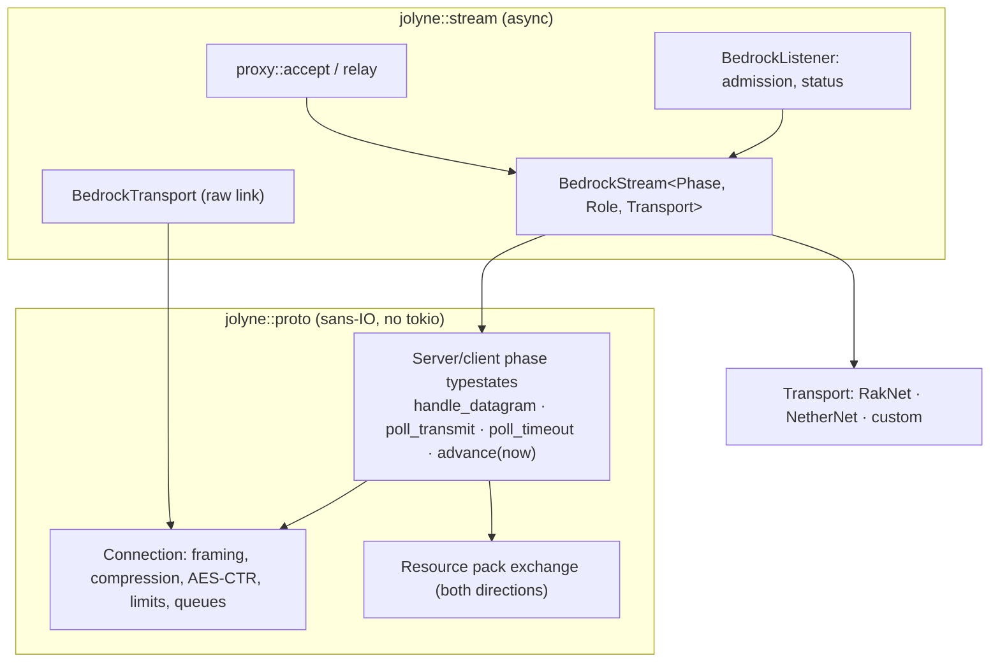

# Jolyne

[](https://crates.io/crates/jolyne)
[](https://docs.rs/jolyne)
[](https://github.com/axolotl-stack/jolyne/blob/main/LICENSE)

**Jolyne** is a robust, low-level Minecraft: Bedrock Edition protocol library for Rust. It provides the core primitives for building high-performance servers, clients, proxies, and analysis tools.

> **Note:** Server implementation logic (world, entities, ticking) is handled by the `unastar` crate. Jolyne focuses strictly on the protocol implementation.

## Architecture

Jolyne is split into a runtime-free protocol core and an async driver.



### `jolyne::proto`: the sans-IO core

Nothing in `proto` performs I/O, spawns tasks or reads a clock; time is an input.

- `conn::Connection` owns one peer's codec state. Inbound `Datagram`s go through
  `handle_datagram` (marker check, in-place decryption when the buffer is
  unique, decompression, unknown-packet policy) into a queue read with
  `next_packet`. Outbound packets are framed straight into the pending batch as
  they are queued and sealed into `Transmit`s (`poll_transmit`).
  Enabling compression or encryption first seals what is pending, so
  `NetworkSettings` and `ServerToClientHandshake` always leave in the old
  format (the vanilla "flush, then switch" ordering falls out of the queue).
- Join phases are consuming typestates (`proto::server`, `proto::client`)
  implementing `phase::Phase`: `handle_datagram`, `poll_transmit`,
  `poll_timeout` (mandatory deadline plus phase timers) and
  `advance(now) -> Result<Step<Self, Next>, Failure<Self>>`. A `Failure` hands
  the phase back, still owning the connection, so a reasoned `Disconnect` or
  `PlayStatus` can be sent.
- Packets arriving before the phase that handles them are deferred (bounded:
  1,600 packets / 16 MiB, compacted) and replayed in order into play.

Server phases: `ServerHandshake → ServerLogin → LoginRequest →
Authenticated → [ServerEncryption] → PacksReady → ServerPacksPhase →
WorldReady → ServerSpawn → ServerSession`. Client phases: `ClientSettings →
ClientLogin → ClientHandshake → ClientPacks → ClientSpawn → ClientSession`.

### `jolyne::stream`: the async driver

`BedrockStream<S, R, T>` wraps the core owner of phase `S` for role `R` over
transport `T`. Each step method (`accept_network_settings`, `authenticate`,
`finish_handshake`, `negotiate_packs`, `start_game`; client `request_settings`,
`send_login`, `await_handshake`, `handle_packs`, `await_start_game`) drives one
core phase and returns the next typestate or `Failed<T>` (convertible to
`JolyneError`, with `disconnect()` to tell the peer why). The one-call
`accept_join_sequence` and `join` run every step and handle failures.

In play: `recv_packet_raw` / `recv_packet_borrowed` / `recv_packet`,
`send_packet`, `send_packet_raw`, `send_custom`, `send_batch(_raw)`, `flush`,
`set_flush_mode(FlushMode::{Immediate, Manual, Interval(d)})`, `close`
(drains pending writes), `disconnect(reason, message)`, `metrics`, `latency`.
Dropping a stream sends whatever the transport accepts without waiting.
An inbound `Disconnect` surfaces as `JolyneError::Disconnected` (carrying the
raw packet for proxies). `into_transport()` leaves the typestate for raw I/O.

`Transport` is sink-shaped (`poll_send_ready`/`start_send`/`poll_flush`/
`poll_close`/`poll_recv`, plus `latency`), so a message is never resubmitted
and sends wait on transport capacity (backpressure).

## Feature matrix

Status against the protocol-layer comparison (gophertunnel `80c811b61860` is
the vanilla reference). Tests are in `crates/jolyne` unless noted.

| Feature | Status | Evidence (tests) |
|---|---|---|
| Server listener | ✅ | `tests/raknet_listener.rs::listener_advertises_status_and_enforces_max_players` |
| Client | ✅ | `stream::tests::join_echo_and_typed_disconnect` |
| Proxy mode (relay, encryption terminated per side, unknown IDs forwarded) | ✅ | `stream::tests::proxy_relays_unknown_packets_and_disconnects`; `examples/proxy.rs` |
| RakNet | ✅ | `tests/raknet_listener.rs` (real loopback join) |
| NetherNet (LAN `ServerData` from the status provider) | ✅ | `listener::NetherNetBuilder::bind` publishes `ServerStatus::lan_server_data` |
| Custom transport | ✅ | `stream::tests` (in-memory `Transport`) |
| Compression: Deflate / Snappy / None, server-selectable, threshold 256 | ✅ | `proto::tests::compression_and_encryption_are_active_in_play`, `proto::batch::tests::threshold_selects_marker_and_roundtrips_all_algorithms` |
| Encryption (AES-CTR + checksum) | ✅ | `proto::crypto::tests::*`, `proto::conn::tests::checksum_failure_is_terminal_for_the_connection` |
| Crypto hardening (constant-time compare, cipher invalidated, plaintext zeroized) | ✅ | `proto::crypto::tests::tampering_zeroizes_plaintext_and_invalidates_cipher_permanently` |
| Resource packs, server send (Info → DataInfo/chunks on request → Stack after download → Completed; SHA-256, CDN URL, content keys, paced chunks) | ✅ | `proto::packs::tests::{transfers_verifies_and_orders_stack_after_downloads, chunk_pacing_holds_replies_on_a_timer, server_rejects_out_of_order_unknown_and_refused, stack_finished_before_stack_is_rejected}` |
| Resource packs, client download (bounded window, size caps, SHA-256, stack check, cache hook, veto) | ✅ | `proto::packs::tests::{client_bounds_offers_chunk_size_and_hash, data_info_must_match_the_advertised_size, stack_entries_must_be_downloaded_builtin_or_declined, declined_packs_are_not_downloaded}`, `stream::tests::resource_packs_download_over_the_async_layer` |
| Packet borrowing / zero-copy | ✅ | `proto::raw::tests::compact_copy_detaches_from_batch_allocation`, `RawPacket` slices |
| Custom packets (registry + user codec) | ✅ | `proto::tests::unknown_and_custom_packets_follow_the_configured_policy`, `proto::custom::tests::registry_rejects_valentine_and_out_of_range_ids`, `proto::raw::tests::custom_packets_must_use_free_ten_bit_ids` |
| Unknown packet IDs (reject / skip / passthrough; server default reject) | ✅ | `proto::raw::tests::unknown_policy_rejects_skips_or_passes_through`, `proto::tests::unknown_and_custom_packets_follow_the_configured_policy` |
| Multi-protocol versions | ❌ out of scope | repo policy: Bedrock 1.26.51 / protocol 2193 only (exact check in `proto::server`) |
| Flush control (immediate, manual, 50 ms-style interval) | ✅ | `proto::conn::tests::{flush_modes_immediate_manual_interval_and_auto_seal_limits, switching_to_interval_arms_the_timer_for_pending_packets, failed_encode_keeps_the_pending_batch_intact}`, `stream::tests::manual_and_interval_flush_batch_packets` |
| Bounded queues / backpressure | ✅ | `proto::conn::tests::refused_batch_leaves_the_cipher_in_sync`, `stream::tests::sends_wait_for_transport_capacity` |
| Typed decode packet cap; 16 MiB decompression limit | ✅ | `proto::batch::tests::{typed_decode_enforces_packet_cap, size_guard_covers_compressed_none_and_plain_payloads}` |
| Login timeout (settings → encryption) and per-stage deadlines | ✅ | `proto::tests::{each_stage_has_a_mandatory_deadline, deadline_elapses_exactly_at_login_timeout}` |
| Admission (max players → `PlayStatus` server full; allow hook → Kicked) | ✅ | `proto::tests::server_full_and_admission_refusals_reach_the_client_typed`, `tests/raknet_listener.rs` |
| Disconnect with reason (both sides), typed inbound Disconnect, flushing `close` | ✅ | `stream::tests::{join_echo_and_typed_disconnect, failed_step_keeps_the_connection_and_sends_a_reason, close_and_drop_flush_buffered_packets}` |
| Spawn checks (runtime ID, radius ≥ 1 + server override, BDS packet order) | ✅ | `proto::tests::{runtime_id_mismatch_is_rejected, chunk_radius_requires_one_and_honours_the_server_override, join_sequence_order_matches_vanilla}` |
| Client: typed `PlayStatus` refusal, ES384-pinned handshake | ✅ | `proto::tests::protocol_mismatch_answers_play_status_and_client_reports_refusal`, `proto::handshake::tests::rejects_non_es384_and_tampered_tokens` |
| Latency / RTT | ✅ NetherNet (SCTP SRTT), 🟡 RakNet | `Transport::latency`; RakNet needs `tokio-raknet` `RaknetStream::rtt()` |
| Server status / MOTD (refreshed every 4 s and on join/leave) | ✅ | `status::tests::pong_matches_gophertunnel_layout_and_unlimited_max`, `tests/raknet_listener.rs` |
| Packet observer hook (zero cost when unset) | ✅ | `proto::conn::tests::observer_sees_both_directions_with_bodies` |
| Metrics (packets/bytes/batches in/out, decode errors, unknown IDs) | ✅ | `proto::conn::tests::enabling_compression_and_encryption_seals_pending_in_the_old_format`, `proto::tests::unknown_and_custom_packets_follow_the_configured_policy` |
| Tracing | ✅ | `#[instrument]` spans on every join step, `close` and `disconnect` |
| Typestate phase safety | ✅ | `stream::BedrockStream<S, R, T>` |
| Xbox auth / ClientData exposure | owned by `jolyne::auth` | see *Server authentication* |

### Reusable batch pipeline

Each connection retains a `proto::batch::BatchCodec`. Its compressor,
decompressor, Snappy tables and encode/decode scratch are reused instead of
constructing a compression engine for every batch. DEFLATE uses libdeflate;
levels 1–9 retain their numeric value (higher values clamp to 9), level zero
disables compression, and the transport default remains 7. Cross-implementation
benchmarks use nominal level 6; different compressors need not emit identical
bytes. Building jolyne requires a C compiler for bundled libdeflate.
Decode remembers the previous output length and bounds speculative buffer
growth; batches exceeding the 1 MiB speculative ceiling use a guarded zlib-rs
streaming decoder. The decompressed-size bound (default 16 MiB) is always
enforced; there is no unbounded mode.

Snappy encoding uses a whole-block matcher with input-sized 8/10/12/14-bit
hash tables retained in 64 KiB of lazily allocated per-connection scratch;
DEFLATE-only connections do not allocate this table. It emits only
standard Snappy literal/copy tags, including 32-bit offsets across 64 KiB
boundaries; it does not emit S2 repeat extensions. Decoding remains the
`snap` decoder, with the declared decoded length checked before allocation.
Permanent Go interoperability tests decode checked-in vectors for all four
benchmark batches, a >64 KiB literal and a copy4 offset. The matcher adapts the
BSD-licensed [S2 Snappy search](https://github.com/klauspost/compress/tree/v1.18.1/s2);
its redistribution notice is retained in `src/proto/compression/snappy.rs`.
See [Snappy measurements and interoperability](snappy-report.md).

For opaque framing, `BatchCodec::encode_frames_into` accepts packet `Bytes`
including the game header but excluding the length prefix. `decode_with`
synchronously borrows each validated frame without constructing a packet vector
or incrementing a reference count per packet. The 1,600-frame limit and the
decompressed-size limit apply to every decode path, typed and raw.

`proto::crypto::BatchCipher` exposes the owned in-place encryption used by the
connection. Construct separate send/receive instances with the session key and
12-byte IV, and call `encrypt`/`decrypt` with the cleartext header length (one
for RakNet, zero for prefix-free batches). Reserve eight spare bytes before
encryption to avoid allocation. Checksums are compared in constant time; a
failed checksum zeroizes the plaintext and permanently invalidates the cipher.

## Usage

Add this to your `Cargo.toml`:

```toml
[dependencies]
jolyne = "0.1"
```

### Example: Simple Bot (Client)

For client instrumentation or caller-supplied identity JWTs, the `Login` state
also exposes `send_login_with_tokens(identity_key, auth_info_json, client_data_jwt)`.
This sends the supplied authentication JSON and signed client-data token without
regenerating their identity fields; `identity_key` must be the key that signed
them (it drives the ECDH handshake). The normal `send_login(&ClientHandshakeConfig)`
continues to generate tokens internally.

Client-generated metadata uses Android `DeviceOS: 1`. BDS 1.26.51 rejects the
retired UWP `DeviceOS: 7` in `ConnectionRequest::isWellFormed`, reporting the
misleading `readNoHeader failed` before authentication. Caller-supplied metadata
must likewise identify a supported platform.

Offline Login uses `AuthenticationType: 2` with a self-signed multiplayer
`Token` (`aud`, `cpk`, `xname`, `leguuid`, and empty account-only claims), matching
the pinned gophertunnel encoder. The identity and client-data JWTs use the same
P-384 key. A top-level legacy `chain` is not a modern BDS identity token.
The client does not implement client-side chunk generation and advertises that
capability as disabled for both offline and provider-token Login.

For modern online Login, acquire a provider multiplayer token bound to the
connection key (for example with `axolotl_xbl::PlayFabClient::multiplayer_token`),
then call `auth::client::encode_with_multiplayer_token` and
`send_login_with_tokens`. This sends `AuthenticationType: 0` and preserves the
provider token; it does not turn self-signed claims into authenticated credentials.
The older `XblCredentials`/Mojang-chain acquisition path is a legacy flow, not
live-verified against 26.51. Online envelope bytes and client signatures are tested;
live Xbox authentication is not exercised by the offline harness.

The offline vanilla differential harness lives in
[`tools/client-diff`](../../tools/client-diff/README.md). Its acceptance report
distinguishes successful joins from server-rejected login captures.

```rust,no_run
use jolyne::stream::client::ClientHandshakeConfig;
use jolyne::stream::BedrockStream;
use jolyne::valentine::{McpePacket, RequestChunkRadiusPacket};

#[tokio::main]
async fn main() -> Result<(), Box<dyn std::error::Error>> {
    let addr = "127.0.0.1:19132".parse()?;

    // 1. Connect
    let handshake = BedrockStream::connect(addr).await?;
    
    // 2. Configure (Auto-generate keys/uuid)
    let config = ClientHandshakeConfig::random(addr, "JolyneBot");

    // 3. Join (Handles auth, encryption, resource packs)
    let (mut client, _game_data) = handshake.join(config).await?;
    
    // Send a chunk radius request (could be anything.)
    let req = RequestChunkRadiusPacket {
        chunk_radius: 8,
        max_chunk_radius: 8,
    };
    client.send_packet(McpePacket::from(req)).await?;
    
    Ok(())
}
```

`jolyne::valentine` is pinned to Bedrock 26.51 (protocol 2193). Its canonical
schema label is `valentine::bedrock::version::v1_26_51`.

### Server authentication

`auth::authenticate_login` retains its existing arguments and
`Result<ValidatedIdentity, JolyneError>` return type. Authentication failures are
typed `JolyneError::Auth(AuthError)` values; issuer, audience and temporal failures
have distinct variants. Key/signature mismatches are `AuthError::BadSignature`.
`ValidatedIdentity::authenticated` is true only for online-verified identities;
offline identities are always false, even if their payload claims an XUID.

Online OpenID trust starts at Minecraft's HTTPS build discovery endpoint for
`1.26.51`, follows the published issuer's OpenID configuration and JWKS, and
enforces issuer, multiplayer audience, expiry/not-before (60-second skew) and
the published RS256/ES384 algorithm allow-list. JWT `x5u`/`x5c` keys and URLs are
never trust sources. JWKS snapshots expire after 30 minutes; expired snapshots
are refreshed before validation and discovery failures fail closed.
`auth::openid::OpenIdVerifier::from_jwks` accepts an explicitly trusted issuer,
algorithm list and JWKS snapshot for deterministic tests; its `validate` method
uses the same verification path as production.

Client data must be ES384-signed by the token's authenticated `cpk` identity key.
A contradictory client identity key is rejected, and client data cannot override
provider-asserted identity fields. Self-signed multiplayer tokens remain supported
offline. The existing `allow_legacy` policy also gates self-signed authentication.
`validate_chain(..., true)` accepts only Mojang-rooted legacy chains, including
the vanilla self-signed prefix delegating to Mojang; subsequent links must verify
against the preceding signed `identityPublicKey`. Online `authenticate_login`
continues to reject Guest/SelfSigned authentication types.

Provider discovery and claim conventions follow
[gophertunnel `service/token.go:VerifierContext`](https://github.com/Sandertv/gophertunnel/blob/be557e33fe6f8d0c0db7ef05b5fd068725c325ad/minecraft/service/token.go)
and [`login/request.go:Parse`](https://github.com/Sandertv/gophertunnel/blob/be557e33fe6f8d0c0db7ef05b5fd068725c325ad/minecraft/protocol/login/request.go).


## Roadmap

See [`ROADMAP.md`](ROADMAP.md) for vanilla compatibility gates and acceptance evidence.
