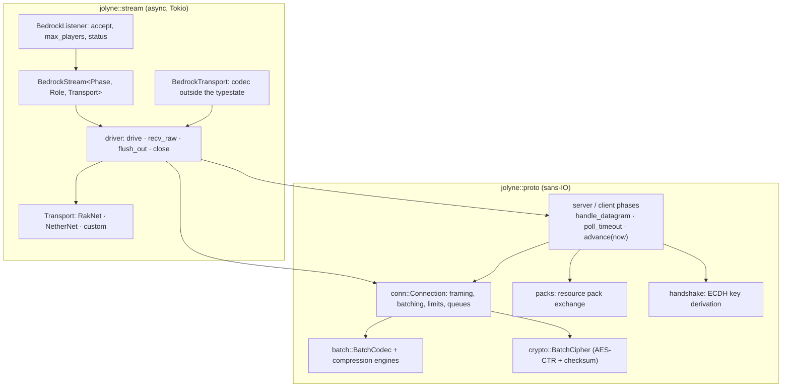
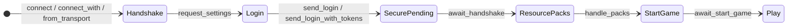

# jolyne architecture

jolyne is two layers. `jolyne::proto` is a sans-IO protocol core: it turns
bytes and instants into packets, phase transitions and bytes to send, and
nothing else. `jolyne::stream` is an async driver that runs the core over a
`Transport` (RakNet, NetherNet or your own) on Tokio. The public API tiers
([API.md](API.md)) sit on top: Tier 1 runs the whole join, Tier 2 exposes each
step, Tier 3 exposes the codec and the core.



## `proto`: the sans-IO core

Nothing in `proto` performs I/O, spawns tasks or reads a clock. Time is an
argument (`now: Instant`), input is a `conn::Datagram`, output is a queue of
`conn::Transmit`s. The same code therefore runs under the async driver, in the
in-memory tests (`proto::tests` joins a server and a client core against each
other with no transport and no clock) and under any runtime you write
(`examples/06_sans_io.rs`).

### The phase contract (`proto::phase`)

Every join step is an *owner*: a struct that owns the `Connection` plus what
the join has learned so far (`phase::Owner`). Owners that wait for packets also
implement `phase::Phase`:

| Method | Role |
|---|---|
| `handle_datagram(datagram)` | Feed one transport message into the connection (decrypt, decompress, split into packets). Errors are terminal. |
| `poll_transmit()` | Pop the next sealed batch to write (from `Owner`). |
| `deadline()` | The mandatory absolute deadline of this phase. |
| `poll_timeout()` | The earliest instant `advance` must run again: the deadline, the connection's interval-flush timer or a phase timer (resource pack chunk pacing), whichever is first. |
| `advance(now)` | Consumes the phase: checks the deadline first, fires due timers, then hands queued packets to `on_packet`. Returns `Step::Wait(self)` (needs more input), `Step::Next(next)` (completed) or `Err(Failure)`. |

A `Failure<S>` carries the error *and the phase that failed*, still owning its
connection, so whoever drives it can still send a reasoned `Disconnect` or
`PlayStatus`.

Owners that wait for the caller instead of the peer do not implement `Phase`;
they expose a consuming method that takes the caller's input. That split is
where the Tier 2 API gets its seams:

| Server owner | Waits for | Next |
|---|---|---|
| `ServerHandshake` (Phase) | `RequestNetworkSettings` (exact protocol check) | `ServerLogin` |
| `ServerLogin` (Phase) | `Login` | `LoginRequest` |
| `LoginRequest` | the caller to verify the login: `authenticated(login, peer, now)` (runs the admission hook) or `refuse_server_full(now)` | `Authenticated` |
| `Authenticated` | the server key: `start_encryption(key, transport_key, now)` | `ServerEncryption`, or `PacksReady` when encryption is off |
| `ServerEncryption` (Phase) | `ClientToServerHandshake` | `PacksReady` |
| `PacksReady` | the pack set: `start_packs` / `start_packs_with` | `ServerPacksPhase` |
| `ServerPacksPhase` (Phase) | the pack exchange to complete | `WorldReady` |
| `WorldReady` | the world: `start_game(WorldJoinParams, now)` or `start_game_streamed(WorldJoinParams, now)` | `ServerSpawn` |
| `ServerSpawn` (Phase) | `RequestChunkRadius`, then `SetLocalPlayerAsInitialized` with the `StartGame` runtime ID; a streamed spawn completes at `RequestChunkRadius` and leaves that check to `Session::next_packet` | `ServerSession` |

| Client owner | Waits for | Next |
|---|---|---|
| `ClientSettings` (Phase; `new` queues `RequestNetworkSettings`) | `NetworkSettings` | `ClientLogin` |
| `ClientLogin` | the caller's tokens: `login(identity_key, connection_request, now)` | `ClientHandshake` |
| `ClientHandshake` (Phase) | `ServerToClientHandshake` (ES384-pinned; may be skipped unless `ClientConfig::require_encryption`), then `PlayStatus(LoginSuccess)` | `ClientPacks` |
| `ClientPacks` (Phase) | the pack exchange to complete | `ClientSpawn` |
| `ClientSpawn` (Phase) | `StartGame`, `ItemRegistry`, `ChunkRadiusUpdated`, `PlayStatus(PlayerSpawn)` | `ClientJoined` (`ClientSession` + `GameData`) |

Both roles end in a `proto::session::Session`: the connection plus the runtime
ID and chunk radius agreed while spawning. A streamed spawn's session starts
before `SetLocalPlayerAsInitialized` (see `docs/LOGIN_SEQUENCE.md`): until it
arrives, `Session::next_packet` and the async play receive path check its
runtime ID and the spawn deadline.

### Deferred packets

Clients send packets before the phase that handles them (for example
`ClientCacheStatus` during pack negotiation, or play packets right after
spawning). Phases that may see them keep a `phase::Deferred` buffer: each such
packet is compacted (copied out of its batch so it does not pin the whole
allocation) and kept in arrival order. `Deferred::replay_into` puts them back
in front of the connection's inbound queue, so the next owner sees them first.
The server carries one buffer from the encryption handshake through spawn and
replays it into the play session; the client replays at each phase boundary.
The buffer is bounded by `ConnectionOptions::{max_deferred_packets,
max_deferred_bytes}` (default 4,096 packets / 16 MiB); overflowing it fails the
phase with `ProtocolError::DeferredOverflow`.

### Batching, compression and encryption (`proto::conn::Connection`)

`Connection` is one peer's codec state; every owner wraps one.

- **Outbound.** `queue_packet` / `queue_raw` / `queue_custom` frame the packet
  (varuint length + header + body) straight into the pending batch buffer.
  Sealing the batch (`flush`) runs it through the retained
  `proto::batch::BatchCodec` (compression once negotiated and the batch reaches
  the threshold; the private `proto::compression` engines do the work), then
  `proto::crypto::BatchCipher` (AES-CTR plus checksum, in place), and pushes a
  `Transmit` onto the outbound queue (bounded by `max_queued_bytes`; a batch
  that would exceed it fails with `ProtocolError::WriteBufferFull` and leaves
  the connection consistent).
- **When a batch is sealed.** `FlushMode::Immediate` seals every queued packet;
  `Manual` waits for `flush()`; `Interval(d)` arms a timer at the first queued
  packet (`poll_timeout` / `handle_timeout`). In every mode the pending batch is
  also sealed when it reaches `max_packets_per_outbound_batch` (812) or
  `max_pending_bytes` (4 MiB), and before compression or encryption is enabled:
  `NetworkSettings` and `ServerToClientHandshake` therefore always leave in the
  old format. `send_batch` / `send_batch_raw` seal what is pending and then send
  their packets as one batch (split only at the per-batch limits).
- **Inbound.** `handle_datagram` checks the RakNet `0xFE` marker (or none for
  `Framing::Unprefixed`), decrypts in place when the buffer is unique,
  decompresses under `BatchLimits` (16 MiB decompressed, 1,600 packets per
  batch), applies the unknown-packet policy and custom packet registry, and
  queues `RawPacket`s (header parsed, body still the wire bytes) for
  `next_packet`. A checksum failure permanently invalidates the cipher.
- `proto::handshake` derives the session key (`SHA256(salt || ECDH(P-384))`,
  IV = first 12 bytes) shared by both roles; `proto::packs` holds both sides of
  the resource pack exchange; `proto::observe` holds `PacketObserver` and
  `ConnectionMetrics`.

## `stream`: the async driver

### The typestate

`BedrockStream<S, R, T>` holds a transport `T`, the core owner of phase `S` for
role `R` (`PhaseOf<R>::Owner`), and a player seat. Phase markers and roles are
sealed. Each step method consumes the stream, drives one or more core owners
through `stream::driver`, flushes what the step queued within the step's
deadline, and returns the next typestate, or `Failed<T>`.

Server (`stream::server`):

```mermaid
stateDiagram-v2
    direction LR
    [*] --> Handshake: listener.accept() or from_transport
    Handshake --> Login: accept_network_settings
    Login --> SecurePending: authenticate
    SecurePending --> ResourcePacks: finish_handshake(key)
    ResourcePacks --> StartGame: negotiate_packs / negotiate_packs_with
    StartGame --> Play: start_game(WorldJoinParams)
```



| Stream phase | Server owner | Client owner |
|---|---|---|
| `Handshake` | `ServerHandshake` | `ClientSettings` |
| `Login` | `ServerLogin` | `ClientLogin` |
| `SecurePending` | `Authenticated` | `ClientHandshake` |
| `ResourcePacks` | `PacksReady` | `ClientPacks` |
| `StartGame` | `WorldReady` | `ClientSpawn` |
| `Play` | `ServerSession` | `ClientSession` |

The intermediate server owners run inside a step: `authenticate` drives
`ServerLogin`, takes a player slot, verifies the login (`LoginRequest`, under
the login deadline) and runs the admission hook; `finish_handshake` drives
`ServerEncryption`; `negotiate_packs` drives `ServerPacksPhase`; `start_game`
and `start_game_streamed` drive `ServerSpawn`.

Client (`stream::client`):



`await_start_game` also returns the `GameData` collected while spawning.
Tier 1 is these chains run back to back: `accept_join_sequence(&world, &key)`
on the server, `join(ClientHandshakeConfig)` on the client.

### `Failed` and reasoned disconnects

Every step returns `Result<_, Failed<T>>`. `Failed` holds the error and the
connection (`BedrockTransport<T>`: transport, codec state and seat), so the
caller decides what the peer sees:

- `Failed::disconnect()` queues a `Disconnect` with the reason mapped from the
  error, drains, closes and returns the error. The message is one fixed
  sentence per reason, never the error's text, so token, signature and decode
  details stay in the server's logs:

  | Error | Reason | Message |
  |---|---|---|
  | `JolyneError::Auth` | `Notauthenticated` | "Authentication failed." |
  | spawn timeout | `Loadingstatetimeout` | "Timed out while joining the world." |
  | other timeouts | `Timeout` | "Connection timed out." |
  | resource pack errors | `Resourcepackproblem` | "Resource pack negotiation failed." |
  | unknown packet ID | `Unknownpacket` | "Received an unknown packet." |
  | other protocol / decode errors | `Badpacket` | "Received an invalid packet." |

  Transport errors, a closed or disconnected peer, a protocol mismatch and
  refusals send nothing more: the failing phase already queued the answer
  (`PlayStatus` for a protocol mismatch or a full server, `Disconnect{Kicked}`
  for an admission refusal).
- `into_parts()` keeps the connection for custom handling; `into_error()` (or
  `?`, via `From<Failed<T>> for JolyneError`) drops it after sending only what
  was already queued.

`accept_join_sequence` calls `disconnect()` on failure; the client's `join`
closes the transport. In play, an inbound `Disconnect` surfaces as
`JolyneError::Disconnected` (carrying the raw packet, so proxies can forward
it), and `disconnect(reason, message)` / `close()` drain pending writes before
closing (bounded by a 5 s close timeout).

### Player seats (`stream::slots`, `max_players`)

A listener owns a `PlayerSlots` counter sized by
`BedrockListenerConfig::max_players` (0 = unlimited). Every stream carries a
crate-private `Seat`:

- `Uncounted`: connections built with `from_transport` and all clients.
- `Pool(slots)`: accepted by a listener, not yet counted.
- `Held(slot)`: counted. `authenticate` takes the slot when `Login` arrives,
  before any verification work, so a full server answers
  `PlayStatus(LoginFailedServerFull)` cheaply.

The seat moves with the connection through every typestate, into
`BedrockTransport` (`into_transport`) and into `Failed`; the slot is released
when the connection is dropped. Each join or leave wakes the listener, which
republishes its status (MOTD player count) while `accept` is awaited, as well
as every `status_refresh` (default 4 s).

### The driver loop (`stream/driver.rs`)

`driver::drive(transport, phase)` runs one `Phase` to completion:

```text
loop {
    match phase.advance(now()) { Next(n) => return n, Wait(p) => phase = p, Err(f) => return Err(f) }
    flush_out_by(transport, phase.connection(), phase.deadline())   // write what advance queued
    wake = phase.poll_timeout()                                       // deadline or timer
    match timeout_at(wake, transport.poll_recv()) {
        datagram => phase.handle_datagram(datagram)?,                 // then loop to advance
        elapsed  => {}                                                // advance sees the timer/deadline
    }
}
```

In play, `recv_raw` does the same for the bare `Connection`: fire a due
interval flush, drain output, return a queued packet if there is one,
otherwise wait for a datagram until the flush timer. `after_send` drains the
transmits a `send_*` call produced; this is where transport backpressure
reaches the sender.

- **One clock.** `driver::now()` reads Tokio's clock and converts it to a
  `std::time::Instant` for the core, so the instants the core compares agree
  with the Tokio timers the driver sleeps on, including under
  `tokio::time::pause` in tests.
- **Cancel safety.** A transmit is taken from the connection only after
  `poll_send_ready` reported capacity, so a cancelled write loses nothing; a
  receive is a single `poll_recv`. `recv_packet*` is cancel-safe: output is
  drained before a packet is taken from the queue, and nothing is awaited
  between taking and returning it. A `send_*` queues its packet before its
  first await, so retrying a cancelled send queues it twice. Join steps own
  their stream: cancelling one drops that connection (and releases its seat).
- **Drop.** Dropping a `BedrockStream` or `BedrockTransport` seals pending
  packets and sends what the transport accepts right now, without waiting.

### Deadlines

Every phase has a mandatory deadline, checked first in `advance`, and every
write and await of a step is bounded by it (`flush_out_by`, `timeout_at`),
so a peer that stops reading or answering cannot hold a join open.

| Side | Deadline | Covers |
|---|---|---|
| Server | `login_timeout` (30 s), from accept | network settings, login, authentication (including any OpenID key fetch), admission, encryption handshake |
| Server | `resource_pack_timeout` (5 min), from `negotiate_packs` | the pack exchange |
| Server | `spawn_timeout` (60 s), from `start_game`/`start_game_streamed` | `StartGame` to `SetLocalPlayerAsInitialized` (for a streamed spawn, enforced by the play receive path) |
| Client | `join_timeout` (120 s), from `from_transport` (after connecting) | every phase, including building login tokens |

A missed deadline is `ProtocolError::Timeout(HandshakePhase)`; huge configured
timeouts (`Duration::MAX`) are capped rather than overflowing `Instant`.

## Transports

`stream::Transport` is sink-shaped: `poll_send_ready` before each `start_send`
(a committed message is never resubmitted), `poll_flush`, `poll_close`,
`poll_recv`, plus `peer_addr`, `latency` and `proven_peer_key` (NetherNet's
DTLS-bound identity key, which lets an online login authenticate without
Bedrock encryption). `Transport::FRAMING` picks `Framing::RakNet` (`0xFE`
prefix) or `Framing::Unprefixed`. `RakNetTransport` and `NetherNetTransport`
are provided; `listener::RawListener` lets a `BedrockListener` accept from any
transport source.
