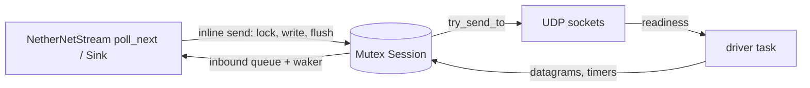

# tokio-nethernet transport design (sans-IO `rtc` stack)

Status: replaces the webrtc-rs 0.12 `RTCPeerConnection` data path. Signaling,
discovery, endpoint/Xbox signaling, identity assertions and message framing
keep their wire behaviour.

## Why

Pinned loopback probes (logical CPUs 16-23, eight Tokio workers) put the
webrtc-rs 0.12 floor, without any NetherNet code, at 230 µs (32 B), 650 µs
(4 KiB) and 7.7 ms (64 KiB) per reliable echo, above cinnabar-mc/nethernet
(130 / 391 / 3,728 µs) and go-nethernet. Its data path crosses ~6 tasks per
direction (UDP mux, ICE, DTLS, SCTP read/write loops, data-channel callbacks)
behind async mutexes. A peer connection also drags in SDP/media negotiation,
interceptors and SRTP setup we never use.

NetherNet needs exactly one ICE component, one DTLS association, one SCTP
association and two fixed data channels. go-nethernet already builds this from
pion's ORTC pieces (`dial.go:Dialer.startTransports`). This crate now composes
the same layers from the sans-IO `rtc` 0.21 crates (rtc-ice, rtc-dtls,
rtc-sctp, rtc-datachannel, rtc-stun, rtc-turn) and owns the I/O.

## Module layout

```text
src/transport/
  mod.rs          Connection handle shared by driver and stream; constants
  config.rs       TransportConfig: local interface/IP policy, UDP4/UDP6
  sdp.rs          NetherNet description encode/parse (go-nethernet parity)
  certificate.rs  DTLS certificate + upper-case SHA-256 fingerprint
  ice.rs          ICE agent, host sockets, STUN srflx and TURN relays
  session.rs      Sans-IO session: ICE -> DTLS -> SCTP -> DCEP -> segments
  driver.rs       One Tokio task per connection: sockets, timers
src/framing.rs    Segment encode/reassembly (unchanged contract)
src/stream.rs     NetherNetStream over transport::Connection
src/dialer.rs     Offer side: description, ICE controlling, DCEP opener
src/listener.rs   Answer side: validation, ICE controlled, DCEP acceptor
```

`identity.rs` keeps signing/verifying SDP text; its parser moves from
`webrtc::sdp` to `rtc-sdp` (same API).

## Wire parity (go-nethernet `conn.go`, `dial.go`, `listener.go`)

- SDP is emitted in `description.encode` order: session `group:BUNDLE 0`,
  `extmap-allow-mixed`, `msid-semantic: WMS`, optional `identity`; one
  `m=application <port> UDP/DTLS/SCTP webrtc-datachannel` section with inline
  candidates (non-trickle), `ice-ufrag/pwd`, `ice-options:trickle`,
  upper-case `fingerprint:sha-256`, `setup`, `mid:0`, `sctp-port:5000`,
  `max-message-size:262144`. The `m=`/`c=` default candidate follows
  `description.defaultCandidate`.
- Parsing follows `parseDescription`: exactly one media section; required
  `ice-ufrag`, `ice-pwd`, first `fingerprint`, `setup`, `max-message-size`
  (> 1); candidates from session and media.
- Roles: dialer is ICE controlling and offers `actpass`; listener is ICE
  controlled and answers `active` to `actpass` (`answererRole`). DTLS client
  is SCTP client. The dialer opens both channels by DCEP on its parity of
  stream IDs (DTLS client even, server odd) and does not wait for the ACK;
  the listener validates label/ordering/reliability exactly as
  `MessageReliability.Valid` and rejects anything else; the dialer rejects
  peer-opened channels.
- DTLS offers SRTP profiles because pion fails a data-channel-only
  connection without one (`dtlstransport.go:completeStart`); no SRTP keys are
  ever derived, so the webrtc-srtp AES-256 key-length panic cannot recur.
  Client certificates are required and checked against the SDP fingerprint
  (case-insensitive) inside the handshake.
- Max message size is 262144 both ways (segment payload 262143), so the
  webrtc-rs 65535 receive-buffer deviation is gone. Outbound segments use
  the remote `max-message-size - 1`.

## Task and locking model



- `Connection { core: parking_lot::Mutex<Session>, sockets, wake }` is shared
  by the stream and its driver. Nothing holds the lock across an `.await`.
- **Send** runs inline in `start_send`/`poll_flush`: lock, segment, write to
  the SCTP streams, drain SCTP -> DTLS -> ICE transmits straight to the
  socket with `try_send_to`. If the earliest timer moved earlier the driver is
  woken; WouldBlock datagrams stay queued for the driver.
- **Receive**: the driver awaits socket readiness and timers, feeds every
  datagram through the session, and pushes completed NetherNet messages into
  a bounded queue, waking the reader. When the queue is full it stops draining
  SCTP streams, so the advertised receive window applies backpressure.
- Timers: `min(ice, stun/turn, dtls, sctp)` deadline per loop.
- Peer-triggered panics inside `rtc` calls are caught at the session boundary
  and fail only that connection (`NetherNetError::DependencyPanic`).

## Candidates

- Host: one UDP socket per allowed local IP (`rtc-shared` interface
  enumeration; loopback excluded unless enabled, UDP4+UDP6 like pion), so each
  datagram's local address is exact.
- srflx: STUN Binding per `stun:` URL through an rtc-turn client; relay: one
  rtc-turn allocation per `turn:` URL (UDP), permissions on demand, outbound
  ICE/DTLS for the relay candidate wrapped by the TURN client.
- ICE acceptance min-waits are zero and the check interval is short so
  nomination never waits on a timer when the first pair succeeds.

## Public API changes

- `setting_engine: Option<webrtc::SettingEngine>` becomes
  `transport: TransportConfig { include_loopback, ip_filter, udp4, udp6 }` on
  dialer and listener configs.
- `ice_servers: Vec<RTCIceServer>` becomes `Vec<signaling::IceServer>` (the
  crate's own type, already used for signaling credentials).
- `NetherNetError::WebRTC` becomes `NetherNetError::Transport(String)`; `webrtc`
  is a dev-dependency only (independent interop peer in tests).
- jolyne/axelerator use defaults and are unaffected; bench-compare switches its
  loopback `SettingEngine` to `TransportConfig`.
