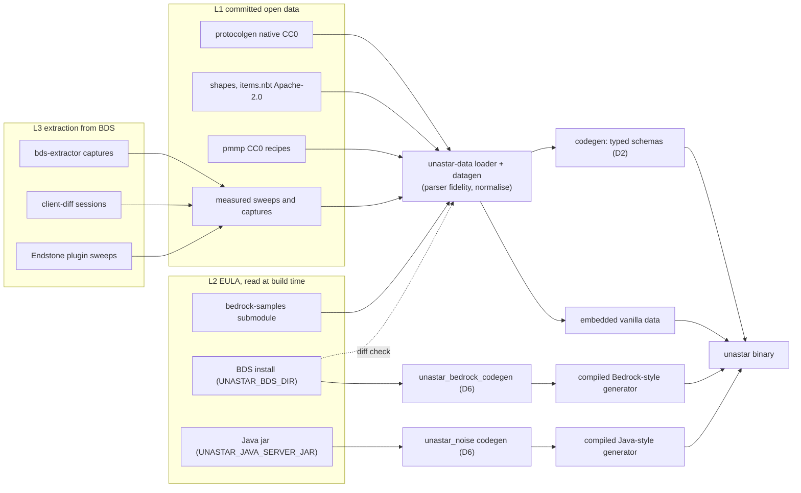
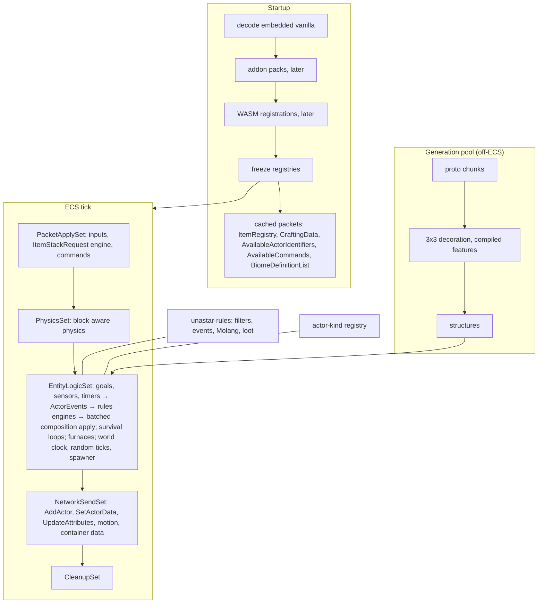

# Data-driven gameplay architecture (2026-10-24)

Status: plan. Combines the four area research documents into one architecture under the
owner's decisions D1-D8 (`thoughts/shared/plans/2026-10-24-data-driven-decisions.md`,
binding) and the entity model the owner confirmed on 2026-10-24. Inputs:

| Area | Research | Slice ids |
|---|---|---|
| World (worldgen, ticking, spawning) | `thoughts/shared/research/2026-10-24-data-driven-world.md` | W1-W14 |
| Entities (definitions, rules engines, physics, AI) | `thoughts/shared/research/2026-10-24-data-driven-entities.md` | E0-E12 |
| Items (items, containers, recipes, loot, inventory) | `thoughts/shared/research/2026-10-24-data-driven-items.md` | I1-I16 (doc §5 numbers 1-16) |
| Survival (health, hunger, damage, death, commands, rules) | `thoughts/shared/research/2026-10-24-data-driven-survival.md` | S1-S6 (defined in §8 from doc §1, §3, §5) |
| Copied oddities | `thoughts/shared/research/bds-quirks.md` | — |

## 1. Goals and principles

1. **BDS 1.26.51 is the truth (D3).** unastar copies BDS behaviour exactly, including
   permissive and odd behaviour; every copied oddity is a row in `bds-quirks.md`.
2. **Data drives parameters, Rust drives behaviour.** This is how BDS itself is built and
   is the owner's entity model: hand-written Rust ECS systems that behave exactly like
   BDS and run on the same pack data. There is one Rust implementation per component
   kind, filter test, event action, AI goal, item component, feature type and surface
   builder. Kinds BDS hard-codes get explicit registries: actor kinds (items, falling
   blocks, TNT, XP orbs, projectiles, vehicles, player) and item classes (bucket, bow,
   armour, tools, …). Outside those registries, no code branches on an identifier.
3. **Parser fidelity.** The pack loader accepts, normalises and rejects exactly what BDS
   does: `format_version` upgrade paths, compact and readable filter spellings with every
   operator/subject alias, case-insensitive Molang names and `q./v./t./c.` aliases,
   legacy component spellings, malformed vanilla data that BDS tolerates (silverfish
   `become_angry`), unknown keys logged but not fatal, whole-file override by identifier.
   The rules live next to the loader (entities research §4.7) and are proved by
   crafted-pack tests against BDS plus golden tests. The runtime only sees normalised data.
4. **Two data forms.** Gameplay families follow D2: generated typed schemas, vanilla data
   embedded and decoded once at startup into registries that freeze. Worldgen follows D6:
   compiled ahead of time end to end into straight-line Rust.
5. **Measured, not authored (D4).** Facts BDS keeps in code (armour, tool tiers, drops,
   fuels, knockback, game-rule defaults, command syntax) are captured or swept from BDS
   and stored as data with provenance. Wiki and dragonfly values are only cross-checks.
6. **Vanilla now, extensible later (D5).** Registries are keyed by identifier and accept
   extra or overriding rows until they freeze; hooks are explicit events and registries.
7. **Licensing.** Only openly licensed data is committed (CC0, Apache-2.0, MIT). Mojang
   EULA data (bedrock-samples, BDS packs, Java jar assets) is read at build time and never
   committed as files. Derived artefacts are open decision O6.
8. **Evidence rule.** Repo text cites captures, sweeps, install files, public Mojang
   documentation, public data sets and open-source code, nothing else.
9. **Performance by construction.** No JSON after startup; frozen registries shared by
   `Arc`; items are values in stacks, not entities; entity composition changes batched per
   tick; worldgen off-ECS on a bounded pool with per-chunk ratchets (D8).

## 2. Three-layer data pipeline

| Layer | Contents | How it reaches the build |
|---|---|---|
| L1: committed open data | protocolgen native 1.26.51 tables (CC0: block states, per-state data, block/item properties, tags, biomes); protocolgen registry `items.nbt` and per-state shapes (CloudburstMC/Data geometry, Apache-2.0, pin a commit that matches 1.26.51); pmmp BedrockData user-data recipes and multi-recipe UUIDs (CC0); AllayMC 1.26.50 (CC0) as cross-check; measured sweep and capture outputs (L3) | In-repo files, read by `unastar-data` datagen/codegen |
| L2: EULA data, read at build time | bedrock-samples 1.26.50.4 submodule (`crates/unastar-data/data/vanilla_bp`: entities, items, recipes, loot, trading, spawn_rules, biomes, `player.json`, command metadata, resource-pack `.lang`); BDS install via `UNASTAR_BDS_DIR` behind the off-by-default `bedrock-worldgen` feature (features, feature_rules, layered biomes, structures, the 1.26.51 layer stack for diff checks, the 99 block loot tables of 1.26.50); Java server jar via `UNASTAR_JAVA_SERVER_JAR` behind the off-by-default `java-templates` feature of `unastar_noise` (structure templates) | Build scripts; missing input fails the feature's build with a message naming the variable; tests that need it skip with a message |
| L3: extraction from BDS for missing facts | `crates/bds-extractor` captures (AvailableActorIdentifiers, ItemRegistry, CreativeContent, BiomeDefinitionList, StartGame; to add: CraftingData, AvailableCommands per permission level, StartGame game rules, VoxelShapes, TrimData); `tools/client-diff` scripted sessions; Endstone native-plugin sweeps on loopback BDS (block drops per tool × enchantment × seed, break times, per-state and neighbour-dependent shapes, random-tick and replaceable flags, armour/attack/enchantability/burn time, furnace timing, fall multipliers) | Measured artefacts with provenance (BDS version, script, sample count) committed to L1 |

One `.brarchive` reader and pack-stack resolver serve every consumer: the one WG-BEDROCK
wrote (`unastar_bedrock_codegen::{brarchive, packs}`, stack `definitions` < `vanilla` <
`vanilla_<version>` ascending) moves to a small bevy-free crate when the second consumer
(E3, I3) lands, instead of a second copy.

## 3. Data families

| Family | Source (layer) | Form | Owner crate | Consumers |
|---|---|---|---|---|
| Block palette, per-state data, tags | protocolgen native (L1) | schema + embedded (D2) | `unastar-data` | everything |
| `StateTable` (per-state property values) | native (L1) | schema + embedded | `unastar-data` (parked ENTITIES) | placement, physics, random ticks, block entities |
| Per-state collision/outline shapes | protocolgen/Cloudburst (L1); neighbour shapes from sweeps (L3) | schema + embedded | `unastar-data` | physics, placement |
| Items: identity, stack size, native fields, tags, component NBT | native + `items.nbt` (L1); pack item JSON (L2) | schema + embedded; NBT sent verbatim | `unastar-data` | `ItemRegistryPacket`, inventory engine, item behaviour |
| Item classes and built-in item facts (tiers, armour, fuels, bucket sizes) | sweeps (L3) | measured data, embedded | `unastar-data` | combat, mining, furnace, inventory |
| Food | pack `minecraft:food` (L2) | schema + embedded | `unastar-data` | SURVIVAL eat flow |
| Recipes | pack recipes (L2); user-data rows and multi UUIDs (L1) | schema + embedded | `unastar-data` | crafting, `CraftingDataPacket` |
| Loot tables | pack loot (L2); BDS 1.26.50 block tables (L2) | schema + embedded | `unastar-data`; engine in the rules crate | death, equipment, containers, block drops |
| Block drop rule set | sweeps (L3) | measured data | `unastar-data` | block break |
| Actor definitions | pack entities (L2), normalised losslessly | schema + embedded | `unastar-data` | `ActorDefinitionRegistry` |
| Actor identifiers (incl. JSON-less built-ins, `rid`/`bid`) | capture (L3) + definitions | embedded | `unastar-data` | `AvailableActorIdentifiers` |
| Spawn rules | pack `spawn_rules` (L2) | schema + embedded (gameplay, D2) | `unastar-data` (IR shared with the Bedrock codegen) | spawner |
| Trades | pack `trading` (L2) | schema + embedded | `unastar-data` | villagers (E10) |
| Client biome definitions | native (L1) + pack biomes (L2) | embedded | `unastar-data` | `BiomeDefinitionList` |
| Commands | captured `AvailableCommands` per permission level (L3); command metadata (L2) | embedded | `unastar-data` | command registry |
| Game-rule defaults and order | captured StartGame (L3) | embedded | `unastar-data` | `LevelRules` |
| Language keys | resource-pack `.lang` (L2) | test input only | — | death/command feedback tests |
| Java noise, router, surface rules, carvers, features, structures | Java `worldgen_data` + reports (committed today, see O6); templates from the jar (L2) | AOT (D6) | `unastar_noise` | Java-style generator |
| Bedrock biomes (surface builders), feature_rules, features, carvers, structures | BDS install (L2) | AOT (D6) | `unastar_bedrock_codegen` | Bedrock-style generator |
| Block alias/upgrade table | native (L1) + codegen tables | build-time | `unastar_bedrock_codegen` | Bedrock codegen; world upgrades later |

## 4. Runtime architecture

**Registries and the freeze point.** Startup decodes the embedded vanilla rows into
builders keyed by identifier, then (later, D5) applies addon packs in pack order with
whole-file override, then plugin registrations, then freezes. Frozen registries are
`Arc` resources: blocks/`StateTable`, items (`ItemComponents`, `ItemClass`), recipes,
loot tables, actor definitions, actor kinds, filter tests, Molang queries, event actions,
component kinds, spawn rules, commands, game-rule defaults. Packets derived from them are
built once at freeze and cached: `ItemRegistry`, `CraftingData`,
`AvailableActorIdentifiers`, `SyncActorProperty`, `AvailableCommands`,
`BiomeDefinitionList`.

**Actor definition stack** (entities §4.2). An entity carries `ActorIdentity(Arc<ActorDefinition>)`
and a `DefinitionStack` of group adds/removes. One exclusive system per tick folds the
stack (add replaces by type, remove drops the type even if the base defines it), diffs
against the applied set and inserts/removes bevy components in one batch. Attributes,
actor flags, actor data and properties are components whose dirty state feeds
`UpdateAttributes`, `SetActorData` and `AddActor`. Goals live in a `GoalSelector`;
navigation, movement and jump kinds are components chosen by definition.

**Shared rules engines** (entities §4.3, crate `unastar-rules` pending O2). Bevy-free:
filters (82 vanilla tests behind a registry, caller-implemented contexts), event trees
(leaf/sequence/randomize/first_valid → steps the entity layer applies), Molang (one
parser; the runtime evaluates it, the worldgen codegen compiles it to Rust), and the loot
evaluator. Items, blocks and world register their own tests and queries.

**Actor-kind registry.** Per-identifier Rust behaviour for the kinds BDS hard-codes;
custom identifiers fall back to the generic mob kind; `runtime_identifier` selects a
built-in kind. Every non-player actor is sent through the parked `ActorViewers`.

**Item and container validation engine** (items §2.5-2.6, §4.3). One transfer
algorithm, a static validator table per `ContainerEnumName`, an allowed-container set per
screen `ContainerType`, item data from `ItemComponents`; per-request staging, BDS
response ordering, global stack net ids, a 5 s request-id cache. Block entities are bevy
entities created from `blockEntityType`.

**World generators** (world research, D6-D8). One `Generator` trait and chunk pipeline
(proto chunk → noise/aquifer/veins → 3D biomes → surface → carvers → 3×3 decoration →
structures) on a bounded pool, off-ECS and deterministic per (seed, chunk). `kind =
"java"` (Java Edition parity, first) or `"bedrock"` (BDS 1.26.51 parity) selects the
compiled generator; flat and void stay.

**World ticking.** `WorldClock` (synced with `SyncWorldClocksPacket`), random-tick
scheduler and `RandomTickBehaviour` per block tag/identifier, periodic autosave of dirty
chunks, spawner evaluating spawn rules and calling the ENTITIES spawn API.

**Survival loops.** `DamageRequest` pipeline for every entity with health (cooldown,
armour, resistance, knockback), hunger/exhaustion from `player.json` values, environment
damage, death and respawn, `LevelRules` (difficulty, game rules, weather), commands with
data-driven syntax and Rust executors.

## 5. Cross-area contracts

| Contract | Owner | Rule |
|---|---|---|
| `StateTable`, `BlockEntry::state_value`/`with_state_value` | ENTITIES (parked branch, lands in E2) | One copy; WORLD, ITEMS and physics consume it |
| `spawn_item_drop(world, DVec3, ItemStack, Option<Entity>) -> Option<Entity>` | ENTITIES | Used by ITEMS (drop, destroy, container break), SURVIVAL (death drops, `/give` overflow), block drops |
| `LevelRules` (difficulty, game rules, weather) | SURVIVAL | Defaults and order from the captured StartGame; WORLD reads `do_daylight_cycle` and `random_tick_speed` |
| `WorldClock` | WORLD (W10) | `SyncWorldClocksPacket` at join and on change; no `SetTime` (0 in 14 BDS sessions); SURVIVAL's `/time` calls `set_time`/`add_time`; the parked survival clock is replaced |
| Loot engine | ENTITIES E0 creates it in the rules crate from the parked evaluator; ITEMS I11 completes it (26 functions, 20 conditions, BDS draw order, MT19937) | Entry points: ENTITIES (death, equipment, interact, goals), ITEMS (containers, `/loot`), block drops (rule set + block tables) |
| Molang, filters, events | ENTITIES (E4) | One parser for runtime and worldgen codegen (WG-BEDROCK's `molang` module and E4 converge on one); ITEMS uses `repair_amount`; spawn rules use the filter AST |
| Food data | ITEMS (data) / SURVIVAL (`Hunger::eat`) | Gameplay rows from pack `minecraft:food`; `ItemRegistryPacket` sends `items.nbt` data verbatim; a test checks both agree |
| Join sequence (`join.rs`) | SURVIVAL sequences it; each packet's content belongs to its family owner | Order fixed by the BDS join capture (`crates/jolyne/src/proto/testdata/bds-1.26.51-join-s2c.txt`): StartGame (rules, clock, difficulty), …, CreativeContent → TrimData → InventoryContent ×4 → PlayerHotbar → CraftingData (ITEMS) → AvailableCommands (SURVIVAL); plus `SyncWorldClocks` (WORLD), `SetCommandsEnabled`, `UpdateAttributes` ×2, `SetHealth`, `Respawn` ×3, `SyncActorProperty` (ENTITIES); each packet sent once |
| `AvailableCommands` | SURVIVAL | Syntax from the captured packet per permission level; executors in Rust; plugin commands appended before freeze |
| `DamageRequest` | SURVIVAL | ENTITIES' `damage_sensor`/`hurt_on_condition` feed it for every mob |
| Block-entity NBT (chunk payload, LevelDB key 0x31) | ITEMS with the world storage owner | Unknown keys round-trip |
| BDS sweep harness | shared (lane T) | One harness serves E9 = I12 (drops, mining), I5 (armour), I10 (fuels), S4 (combat, falls) |

## 6. Extension points (D5)

- **Addon packs:** the same loader runs at startup on `packs/*` after vanilla and before
  freeze: whole-file override by identifier, parser-fidelity rules, unknown components
  kept as `Unknown { name, json }` and logged once, custom actors on the generic mob kind
  or a `runtime_identifier`. Custom items, recipes, loot, blocks and spawn rules use the
  same family decoders.
- **WASM (wasmtime plugins):** explicit hooks only, never per-entity code: existing
  `on-player-item-use`, `on-player-interact-block`, `on-player-swing`; proposed
  `on-actor-event` (before/after, cancellable), custom filter tests, Molang queries, event
  actions, component kinds with ticks, commands. WIT growth needs the coordinator's
  approval; no slice below depends on it.
- **Worldgen overlay:** vanilla stays compiled (D6); extra features/rules from packs or
  WASM go through an interpreted overlay consulted before the compiled set, frozen before
  generation starts.

## 7. Verification strategy

| Kind | What it proves | Examples |
|---|---|---|
| Golden / round-trip | Loader loses nothing; packets match byte for byte | every entity definition round-trips; `ItemRegistryPacket` equals `items.nbt`; `AvailableActorIdentifiers` equals a capture |
| Captures | Packet content and order | join payloads (F1), `/summon` `AddActor` snapshots (E6), inventory replays (I4), containers (I9), death/respawn (F6), clock (F8) |
| Crafted packs | Parser fidelity and engine semantics | one pack per fidelity rule; group shadowing; event ordering; run on loopback BDS and in unastar ECS tests |
| Sweeps (D4) | Built-in facts | drops and break times (E9/I12), armour/attack (F3), fuels, falls/drowning/void (F5), random ticks (W11) |
| Fixtures + ratchets (D8) | Generator parity and speed | BDS seed-12345 and Java 1.21.11 seed-12345 fixtures; terrain/surface/biome/histogram floors; ms/chunk and allocations |
| Coverage ratchets | Long-tail progress | entities fully implemented, filter tests and queries implemented, item components implemented |
| Quirks log | Every copied oddity is reviewable | `bds-quirks.md` |

Exactness is stated per test: byte-exact (registries, packets), structural (inventory
responses ignoring absolute net ids), statistical (unseeded loot, drops, decoration
before W14). One BDS and one Java server at a time, loopback only.

## 8. Roadmap

Survival slices defined here (from survival research §1, §3, §5): **S1** land the parked
branch (D2 food family, clock handed to W10, deviations recorded); **S2** join fixtures
F1/F7/F8 replace the hand-written game rules, command overloads and join sync; **S3**
death and respawn (F6); **S4** D4 combat tables (F3, F5); **S5** eat flow with I13 (F4);
**S6** player definition with E11. Lane T is the shared extraction tooling: **T1**
bds-extractor captures (CraftingData, AvailableCommands, StartGame rules, VoxelShapes,
AvailableActorIdentifiers at 1.26.51); **T2** Endstone sweep harness.

| Wave | Slice | Size | Depends on | Lane |
|---|---|---|---|---|
| 1 | I1 wire defects (UUID order, ContainerType ordinals, CraftRecipeAuto layout) | S | — | Items |
| 1 | I2 items data (component NBT, typed fields, tags; delete name heuristics) | M | — | Items |
| 1 | E3 loader + lossless `actor_definitions`, parser fidelity, shared brarchive reader | M | — | Entities |
| 1 | E1 per-state shapes from protocolgen | M | — | Entities |
| 1 | T1 bds-extractor captures | S-M | — | Tooling |
| 1 | T2 sweep harness | M-L | — | Tooling |
| 1 | W12 autosave | S | — | World |
| 2 | E4 rules crate: filters, events, Molang (+ one parser with WG-BEDROCK) | M | E3, O2 | Entities |
| 2 | E0 loot to D2, evaluator becomes the rules crate's loot module | M | O2 (crate home), O4 | Entities |
| 2 | E5 definition and identifier registries, `AvailableActorIdentifiers` | S | E3, T1 | Entities |
| 2 | I3 brarchive diff check (pin already bumped by D1) | S | E3 reader | Items |
| 2 | I4 inventory engine | L | I2 | Items |
| 3 | E2 land parked ENTITIES behind registries; X4/X5 fixes; motion captures | M | E0, E1, O4 | Entities |
| 3 | I6 recipes + `CraftingDataPacket` | M | I3, T1 | Items |
| 3 | I11 loot completion + MT19937 | M-L | E0 | Items |
| 3 | I8 block entities (factory, NBT, payload) | L | I2, world storage | Items |
| 4 | S1 land parked SURVIVAL | M | E2, O5 | Survival |
| 4 | E6 definition stack, attributes, flags, properties, metadata keys | M | E4, E5 | Entities |
| 4 | I5 armour/offhand · I7 crafting execution · I9 container windows · I15 pick block | S/M-L/M/S | I4 (+I6, I8) | Items |
| 5 | W10 world clock + `SyncWorldClocks` | S-M | S1 (`LevelRules`) | World |
| 5 | S2 join fixtures replace hand-written tables | M | S1, T1 | Survival |
| 5 | S3 death and respawn | M | S1, E2 | Survival |
| 5 | W11 random ticks | M | E2 (`StateTable`), S1, T2 sweep | World |
| 5 | E9 = I12 drops and mining sweeps replace authored tables | L | T2, I11 | Entities/Items |
| 5 | S4 combat tables (F3, F5) | M | T2, S1 | Survival |
| 5 | I10 furnaces · I13 item components (with S5 eat flow) · I16 brewing | M each | I6, I8, I9 / I2, E4 | Items |
| 5 | E8 goal selector, top 20 goals, navigation, pathfinder (first mobs per O3) | L | E6, E2 | Entities |
| 5 | E11 = S6 player from `player.json` + built-in player kind | M | E6, S1 | Entities/Survival |
| 6 | E7 spawn path, built-in events, XP, death loot, despawn | M | E6, S3 | Entities |
| 6 | E10 remaining goals, sensors, rideable/breedable/tameable, projectiles | L | E8 | Entities |
| 6 | I14 item classes | L | I13, sweeps | Items |
| 6 | E12 addon packs and WASM hooks | M | E5, E4 | Entities |
| 7 | W13 spawn-rule family + spawner | L | E7, E4, W2 | World |

A slice starts once everything it depends on (all in earlier waves) has landed; slices in
one wave run in parallel.

**Parallel lanes.** Entities, Items, Tooling and World ticking start together in wave 1;
the only early cross-lane edges are E3 → I3 (reader), E0 → I11 (loot), E2 → S1/W11
(`StateTable`, `spawn_item_drop`), T1 → E5/I6/S2 and T2 → E9/S4/W11. Critical path:
E3 → E4 → E0 → E2 → S1 → S3 → E7 → W13 (natural spawning of mobs that die and drop loot).

**Worldgen (in flight, not repeated above).** WG-CORE (`Jviguy/stab-wg-core`) has the
generator trait, chunk pipeline with 3×3 region, bounded pool and 3D biome storage (W5),
Java RandomState seeding (W1), the Java multi-noise biome source (W2), Java 1.21.11
reference fixtures with ratchets, and owns W3, Java surface rules, Java carvers, the
benchmark and the SuperFlat cache bug. WG-JAVA-DECOR (`Jviguy/stab-wg-java-decor`) has
the Java feature IR and AOT emitter, decoration contract, biome climate, structure IR and
template embedding from the jar, and owns Java features and structures. WG-BEDROCK
(`Jviguy/stab-wg-bedrock`) has the brarchive reader and pack stack, block alias table,
Molang subset compiler, typed IR for biomes/feature rules/features/spawn rules, emitter
for rules/scatter/composition/single_block/ore and the decoration driver (W6, W7 started),
and owns W4, W7-W9, Bedrock structures and W14. Other lanes reuse these: no second
brarchive reader, Molang parser, alias table or chunk pipeline.

## 9. Parked branches and how each lands

| Branch | Holds | Lands |
|---|---|---|
| `Jviguy/stab-vanilla-entities` | block-aware physics, item actors with `spawn_item_drop`, loot-driven block drops, mining time and tool wear, placement rules, falling blocks, swing relay, `StateTable`, 1.26.50 block loot rolls | Per O4: E0 on the branch (loot to D2), merge main, record deviations X1/X2 of entities §1.5 (Java-derived drop tables, unmeasured mining constants) in the decisions doc's known-deviations table (the branch already adds it), then merge as E2; X1/X2 are removed by E9 |
| `Jviguy/stab-vanilla-survival` | damage, hunger, environment, melee, attributes, `LevelRules`, commands, clock and spawn points, player list and skins, relays, food family, WIP `death.rs` | After E2 (needs `spawn_item_drop`). Before merging: food family to D2, `WorldClock`/`SetTime` replaced by W10, dragonfly/wiki combat values and hand-written command overloads recorded as known deviations (O5) until S2/S4. Swing relay exists on both parked branches; keep one |
| `Jviguy/stab-vanilla-items` | research doc (landed here) and WIP `db31cda` client-diff `inventory-moves` scenario | The scenario lands with I4 once it has run against BDS (the shared runtime's Endstone environment lacks the `endstone_client_diff` plugin) |

## 10. Decisions (resolved by the owner, 2026-10-24)

| # | Question | Decision |
|---|---|---|
| O1 (entities Q1) | Entity data truth source | bedrock-samples 1.26.50.4 (the `vanilla_bp` submodule) with a check that diffs it against the BDS install's layered packs where the install exists |
| O2 (entities Q2) | Shared engines | Separate bevy-free `unastar-rules` crate for filters, events, Molang and loot |
| O3 (entities Q4) | Mob order | zombie, skeleton, creeper, spider, cow, pig, sheep, chicken first, then by component coverage |
| O4 (entities Q5) | Parked ENTITIES branch | Merge after E0, with the D4/D2 deviations recorded as known deviations; E9 removes them |
| O5 (survival) | Parked SURVIVAL branch | Same as O4: merge after E2 with the unmeasured combat values and hand-written command overloads recorded as known deviations; S2/S4 remove them |
| O6 (licensing) | EULA-derived artefacts in the repo | Artefacts derived from bedrock-samples (`unastar-data/output/{entities,biomes}.kdl` and successors) are generated at build time from the submodule; only manifests (hashes, counts) are committed. The Java worldgen data (`unastar_noise/worldgen_data`) stays committed so default builds work without a local jar |

Also resolved and not reopened: D1-D8; entities Q3 (one Rust implementation per component
kind, filter test, event action and AI goal, plus the actor-kind registry; parser
fidelity); items D1-D5 (answered by the owner's D1-D5); world WD1-WD5 (WD3 superseded by
D6). The remaining survival questions are fixture questions (F1, F2, F8), not owner
decisions.
