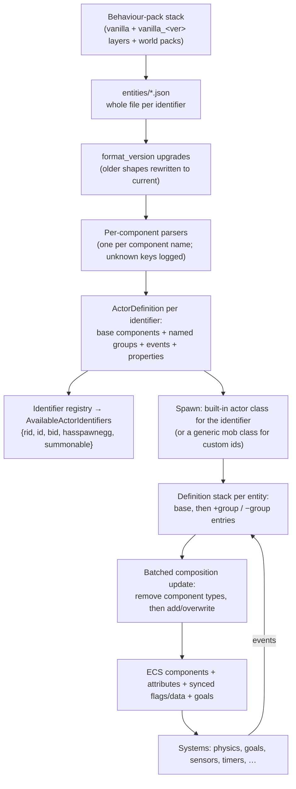

# Data-driven entities: how BDS builds actors from pack data, and how unastar should

## 0. Summary

- **BDS is data-driven in parameters, not in behaviour.** Every vanilla entity is an entity JSON file in the behaviour-pack stack (`behavior_packs/vanilla` plus versioned `vanilla_<ver>` layers), loaded once when the world loads, with whole-file replacement per identifier. But the behaviour behind each component is built into the server: one implementation per component name (about 370 component names in 1.26.51, 170 of them `minecraft:behavior.*` goals), one per filter `test` (82 used by vanilla), one per event action, plus dedicated code for most entity kinds (items, falling blocks, TNT, XP orbs, minecarts, boats, projectiles, the player) and per-mob quirks. "Data-driven" for unastar therefore means: **generic component, event, filter and Molang engines driven by the shipped JSON**, with each component's behaviour written once in Rust and keyed by its identifier. A mob is "free" once all of its components exist.
- **What is free once the engines exist:** component groups and events (`add`/`remove`/`sequence`/`randomize`/`first_valid`/`trigger`/`set_property`), every filter-driven sensor (`environment_sensor`, `damage_sensor`, `hurt_on_condition`, `interact`, …), entity properties and their client sync, attributes (`health`, `movement`, `attack`, `follow_range`, …, one generic parser), synced flags (`is_baby`, `can_fly`, …), variants, `type_family`, `experience_reward` (Molang), loot (`minecraft:loot` → the shared loot engine).
- **What is not free:** 170 AI goals (91 used by one mob each), seven navigation and ten movement-control kinds plus a pathfinder, projectile/rideable/breeding/taming/trading logic, the physics of the hard-coded actor kinds, and all player gameplay loops.
- **Today unastar uses almost none of the entity data.** `unastar-data` ingests the 128 bedrock-samples entity files (1.26.50.4 since main's D1 bump) into `entities.kdl` and generates about 2.7 MB of per-entity Rust (bundles, spawn functions, enum names), but loses event bodies, group contents, goal priorities and array fields on the way, and invents defaults (health 20 on arrows). The runtime consumes only identifier/spawnable/summonable/size, for the `AvailableActorIdentifiers` packet.
- **Proposed design (decisions in §7):** an `actor_definitions` data family per D2 (typed schema codegen, vanilla JSON embedded and decoded at startup into an `ActorDefinitionRegistry` that addon packs can extend before it is frozen, per D5); a per-entity *definition stack* applied in batches like BDS; components as bevy components inserted and removed by that stack; one shared filter, event and Molang crate used by entities, items, blocks and world; data-driven parameters plus Rust behaviour per component identifier; and parity tests against BDS captures and the planned BDS sweeps.
- **The ENTITIES gameplay branch is parked until E0 completes** (approved landing gate: D12 and combined architecture §10, O4). It holds block-aware physics, real item entities, loot-driven block drops, mining time, placement rules, falling blocks and swing relay (§1.4). Its D2/D4 deviations are recorded in §1.5 and in the plan (§5, slices E0/E9); approval does not waive E0 or the parity checks.

## 1. Current unastar state

Paths are relative to the repo root. Line references are to `main` at `19c1629` unless they name the parked branch.

### 1.1 Entity data pipeline

| Stage | Where | What it keeps | What it loses |
|---|---|---|---|
| Input | `crates/unastar-data/data/vanilla_bp/behavior_pack/entities/*.json` (bedrock-samples **1.26.50.4**, 128 files; bumped from 1.21.130.3 on main for D1) | — | BDS 1.26.51 has 129 (adds `agent`); its 1.26.51 layer changes no entity file, so the pack should match BDS; E3 diffs the BDS layer stack to prove it |
| Ingest | `datagen/src/ingest/vanilla.rs:10-240`, `ir.rs` | identifier, `is_spawnable`, `is_summonable`, `spawn_category`, components and groups as raw JSON, events (partly) | `format_version` (read, unused), `is_experimental`, `aliases`, `animations`, `scripts`; non-scalar property types; invents `(0,100)` int and `(0,1)` float ranges when missing |
| Merge | `datagen/src/merge.rs:28-41`, `data/overrides/_defaults.kdl` | — | Adds unmeasured defaults to every entity (health 20, movement 0.25, attack 2, inventory 5, collision 0.6×1.8): `minecraft:arrow` gets health and an inventory |
| KDL emit | `datagen/src/emit.rs:117-380` → `output/entities.kdl` (28,549 lines) | components, group names, event `add`/`remove`/`trigger`/`randomize` weights | event `sequence`, `set_property`, event `filters`, `randomize` add/remove bodies, trigger targets, keys of arrays nested under objects |
| Codegen | `codegen/src/entities.rs`, `component_schemas.rs` → `src/entities/{components,definitions}` (≈250 component files, one definition file per entity, ≈2.7 MB) | typed component structs from the Blockception schema; per entity a marker, a bundle with base components, a `spawn_*` function with the data as Rust literals, group/event name enums, enum properties | group contents, event bodies, every `behavior.*` `priority` (106 component types generate an empty struct), array fields such as `projectile.offset` and `impact_damage.damage`; int/float/bool properties |
| Runtime | `crates/unastar/src/registry/entity.rs:51-121` | `ALL_ENTITIES` (identifier, spawnable, summonable, category, height, width) → `AvailableActorIdentifiers` with only `id` per entry | Every generated component, bundle, spawn function and enum is unused; `EntityRegistry` is not kept as a resource |

Conflicts with the 2026-10-24 decisions: the generator emits per-entity Rust code (D2), invents defaults (D3/D4) and has no runtime registry that packs could extend (D5). D1 is done on main (pack 1.26.50.4). The older plan `thoughts/shared/plans/2026-01-05-unastar-entities-gen.md` made "no runtime pack loading", "events are enums, not an event loop" and "BP files are patches on C++ defaults" explicit goals; this research replaces those premises.

### 1.2 Entity runtime (main)

| Item | State |
|---|---|
| Spawned entity kinds | Players; item drops and falling blocks only with the parked branch; no mobs |
| `Health`, `Speed`, `Effects`, `AirSupply`, `OnFire` | Hand-written components (`entity/components/living.rs`), defaults never read from data; `tick_air_supply` is a stub |
| `Mob`, `MobType`, `AiState`, `MobBundle`, `LivingBundle`, `ProjectileBundle` | Defined, never spawned |
| `EntityMetadata` key constants | `entity/definition/metadata.rs` uses SCALE 56, WIDTH 54, HEIGHT 55, MAX_AIR 59, MARK_VARIANT 60, CONTAINER_* 61-63; the 1.26.51 keys are 38, 53, 54, 42, 43, 44-46 (the parked branch already sends 53/54 for falling blocks). Flag bits (baby 11, climb 19, fly 21, collision 48, gravity 49, fire-immune 50) are right |
| `AvailableActorIdentifiers` | Only `id`; BDS sends `rid`, `id`, `bid`, `hasspawnegg`, `summonable` per entry (capture to confirm field order) and lists actors that have no JSON (`item`, `falling_block`, `painting`, `leash_knot`, …) |

### 1.3 What the vanilla pack contains (counted on bedrock-samples 1.21.130 before the D1 bump; BDS 1.26.51 figures where noted)

| Measure | Count |
|---|---|
| Entity files | 126 (BDS 1.26.51: 129, adds `agent`, `cushion`, `sulfur_cube`) |
| Distinct component names | 356 (BDS 1.26.51: 372); 4,516 uses, 2,726 in base `components`, 1,790 in 797 groups |
| `minecraft:behavior.*` goals | 170 distinct, 953 uses; 91 used by one entity only; 36 entities have no goal (projectiles, vehicles, xp_orb, tnt, armor_stand, player, …) |
| Coverage | the 100 most common components fully cover 34 entities; 200 cover 77; all 356 are needed for all 126 |
| Events | 790; action keys add 1,114, remove 403, trigger 128, sequence 111, randomize 109, set_property 81, set_home_position 19, first_valid 10, play_sound 10, emit_vibration 9, execute_event_on_home_block 2, drop_item / reset_target / emit_particle / stop_movement 1; `queue_command` 0; nesting ≤ 4 |
| Component-embedded event references | 551 `{event, target}` objects in 67 component types (targets: self 525, baby 24, block 2) |
| Filters | 1,703 tests, 82 distinct `test` names, 60 holder contexts under ~21 field names (`filters`, `event_filters`, `entity_filter`, `on_damage`, …); groups `all_of` 341, `any_of` 135, `none_of` 9, depth ≤ 4; subjects other, self, target, block, player, damager; operators `==`/`equals`/omitted, `!=`/`not`, `<`, `<=`, `>`, `>=` |
| Top filter tests | `is_family` 494, `has_equipment` 155, `has_biome_tag` 140, `has_component` 104, `in_lava` 89, `hourly_clock_time` 70, `in_water` 51, `enum_property` 47, `is_sneak_held` 41, `rider_count` 35, `bool_property` 32, `is_daytime` 27 |
| Molang | 134 strings (BDS: 157): `experience_reward` 114, `rideable.rotate_rider_by` 9, `ambient_sound_interval.condition` 4, `anger_level` 2, one each in a property default, a `set_property`, `behavior.eat_block`, `heartbeat`, a navigation tag list. No `variable.*`, `context.*` or `temp.*` |
| Molang identifiers | `math.random` 91, `query.last_hit_by_player` 84, `query.equipment_count` 24, `query.has_any_family` 9, `query.is_baby` 7 (15 in BDS), `query.anger_level` 5, `math.die_roll` 3, `math.clamp` 2, `math.min` 1, `query.is_using_item`, `query.variant`, `query.had_component_group`, `query.any_tag`, `query.property`, `query.player_level`; BDS 1.26.51 adds `query.all_tags`, `query.head_is_in_water`, `query.is_on_ground` |
| Entity properties | 16 entities, 24 properties (13 bool, 10 enum, 1 int; 22 `client_sync`); BDS adds `sound_variant` on cat/chicken/cow/pig and `sulfur_cube_archetype` |
| Entities with no JSON | `item`, `falling_block`, `painting`, `leash_knot`, `evocation_fang`, `agent`, `balloon`, `ice_bomb`, `elder_guardian_ghost`, `sulfur_cube` (the last two are in BDS 1.26.51) |
| `spawn_rules` | 58 files (BDS 60), 21 component types; filters only in `biome_filter` (`has_biome_tag` 169) — WORLD owns spawning |

Part of the entity data ships in a **compact form**: 27 entity files use `{"AND":[…]}` / `{"OR":[…]}` filter groups, integer subjects (0 self, 1 other) and operators (0 equals, 1 not equals), and leave default-valued fields out. Both the BDS 1.26.51 install and bedrock-samples 1.26.50.4 contain these 27 files (bedrock-samples 1.21.130 had only the readable spelling), so the loader must accept both spellings. The BDS packs are stored as `__brarchive` files (a small header, a name table, then the JSON files back to back, uncompressed), layered by version with whole-file replacement.

### 1.4 What the parked ENTITIES branch implements

Branch `Jviguy/stab-vanilla-entities` (original gameplay commits `b39b33e`..`30b9aac`; historical pre-merge verification: 340 `unastar` lib tests and clippy clean). The design is approved; D12 / architecture O4 keeps gameplay landing gated on E0, with the deviations below recorded until their replacement slices complete.

| Feature | Implementation | Data source today |
|---|---|---|
| Block state data | `unastar-data` blocks codegen gains friction, material flags, `requires_correct_tool_for_drops`, `visual_shape` and a per-state property table (`BlockData::state_value` / `with_state_value`) | protocolgen native 1.26.51 (CC0) |
| Collision shapes | `registry/collision.rs`: state-aware boxes for slabs, stairs, fences, walls, gates, doors, trapdoors, snow layers; native `visualShape` otherwise | Native data + dragonfly `block/model`; protocolgen's per-state Cloudburst shapes are the better source (§3) |
| Physics | `PhysicsBody` presets (item, falling block, living, projectile) and `tick_physics`: Y/X/Z clipping, step-up, block friction, unloaded chunks solid | Vanilla constants (dragonfly) |
| Item actors | `entity::spawn_item_drop`, `ActorViewers` + `sync_actor_viewers` (AddItemActor, MoveActorAbsolute, SetActorMotion, ActorEvent stack size, RemoveActor), merging, 6000-tick lifetime, pickup with partial pickup and `TakeItemActor` | Vanilla constants |
| Block drops | Loot-table family (all vanilla BP tables + 199 authored `blocks/*` tables), evaluator, harvestability from native tags | **Authored from Java Edition tables** (deviation, §1.5) |
| Mining | Vanilla break-time formula (tier speed, efficiency, haste/fatigue, airborne, underwater/aqua affinity), server-side ground probe, tool wear and unbreaking | Vanilla constants, native tool/tier tags |
| Placement | Axis, stairs, slabs and double slabs, cardinal/facing blocks, ladders, torches, two-block doors, replaceable targets, entity obstruction | Vanilla rules |
| Falling blocks | Gravity checks two ticks after a change, `minecraft:falling_block` actors, landing or dropping as an item | Native `falling` flag |
| Swing | `Animate(Swing)` validated, relayed to nearby players, `PlayerSwing` plugin event (`on-player-swing`) | — |

### 1.5 Known deviations of the parked branch

| # | Deviation | Decision | Resolution |
|---|---|---|---|
| X1 | Block drops are 199 tables authored from the Java Edition loot tables (with Bedrock identifiers and Java-format extensions `alternatives`, `apply_bonus`, `limit_count`, `table_bonus`, `block_state_property`, `inverted`), not measured from BDS | D4 | Slice E9: BDS drop sweep replaces them; until then every table carries a `//source` note |
| X2 | Tool tier speeds and harvest levels, sword/shears speeds, mining wear, the break-time formula: vanilla constants, not measured | D4 | Slice E9 (mining sweep: break ticks per block × tool × enchantment × effect × airborne/underwater) |
| X3 | The loot family is generated per entry (`unastar-data/src/loot.rs` statics) | D2 | Slice E0: embedded JSON decoded at startup into typed loot structs |
| X4 | Item ground friction when the block below is air used 0.98 instead of `0.6 × 0.98` | D3 | Resolved in E2: default-friction regression plus native floating-bottom-slab trajectories |
| X5 | Item physics omitted liquid buoyancy and currents | D3 | Resolved in E2: native all-depth, stacked/current and wet-ground fixtures; per-step position/velocity tolerances and force/cadence ordering are documented in `crates/unastar/README.md` |
| X6 | Item pickup reach (player box grown by 1, 0.5, 1) and merge radius (item box grown by 0.5 horizontally) were vanilla assumptions | D3 | Confirmed in E2: horizontal pickup 1.424/1.426, vertical pickup +2.299/+2.301 and -0.749/-0.751, merge 0.749/0.751 boundary captures; quirks recorded in `bds-quirks.md` |
| X7 | Snow-layer collision (none below 3 layers, half a block from 3 to 6, full at 7) and fence/wall posts without connections | D3 | E1 per-state shapes; fences/walls need neighbour connection logic either way |
| X8 | Player throws inherited a 0.3 eye offset, an upward/vertical-jitter impulse, standard trigonometry and one 40-tick pickup delay from the reference implementation, without thrower metadata | D3 | E2 captures cover hotbar Q, inventory Q and whole-stack ctrl-drop: offset 0.5, level `vy=0`, f32 inverse-scale direction samples, ordinary delay 10 plus an independent global 40-update gate, and int64 owner key 5. Failing-before regressions and actual constructor/viewer/timer ECS smokes cover the cutover; stationary-source and RNG limits are explicit in the crate README |

## 2. BDS architecture (behaviour)

Statements below describe what BDS does. Each is either observed in the install or in captures, documented publicly by Mojang (entity, filter, event and Molang reference documentation), or marked **to confirm**, meaning a capture or sweep must confirm it before unastar relies on it.

### 2.1 Pipeline

### 2.2 Evidence table

| Concern | BDS behaviour | Data or built in | Evidence |
|---|---|---|---|
| Loading | Entity files from every behaviour pack in the world stack, read once when the world loads; a pack's file replaces the whole definition with the same identifier (no per-component merge) | Data | Pack layout counted in the install (layers replace whole files); Mojang add-on docs ("override by identifier") |
| Versions | Older `format_version` shapes are rewritten to the current shape before use; e.g. `minecraft:pushable` becomes `pushable_by_entity` + `pushable_by_block` from 1.26.10 (91 vanilla entities already ship the new pair) | Built-in upgraders | Install: 27 entities still on the old form are accepted next to 91 on the new one |
| Unknown keys | Unknown components warn/are ignored through format 1.21.80 but reject from 1.21.90; an unknown entity member rejects in current format. Top-level and description extras load. Unknown filters log and evaluate false; unknown event actions suppress their node's known sibling actions | Built in | 58 synthetic BDS 1.26.51 probes, `unastar-packs/tests/fixtures/bds-1.26.51-fidelity.json`; isolated key categories plus version sweep |
| Components | One parser and one behaviour per component name; every component is a parameter set for built-in code | Built in | 372 component names in 1.26.51; Mojang component reference |
| Attributes | `health`, `movement`, `underwater_movement`, `lava_movement`, `attack`, `knockback_resistance`, `follow_range`, `absorption`, `luck`, `horse.jump_strength`, `friction_modifier`, `bounciness`, `air_drag_modifier` and the player stats (`player.hunger`, `.saturation`, `.exhaustion`, `.level`, `.experience`) are attributes `{value or {range_min,range_max}, min, max}`, sent in `UpdateAttributes` | Data | Mojang docs; to confirm the exact attribute list against an `UpdateAttributes`/`AddActor` capture per mob |
| Groups | Adding a group overrides any active component of the same type, base included (last added wins). Removing a group removes **every component type it defines**, even if the base or another active group defines it too; the lower layer is not restored. Runtime state held in a removed component is lost | Built in | Synthetic `shadowed_base_remove` adds/removes an `is_baby` group over a base `is_baby`; `has_component != is_baby` then passes in BDS 1.26.51. Runtime-state loss remains unmeasured |
| Events | Nodes: leaf, `sequence` (every child whose filters pass, in order), `randomize` (one weighted child among passing ones), `first_valid` (first passing child). Per resulting step: remove groups, then add groups, then run actions; `trigger`s run after all steps; changes are applied in one batch; an event that re-triggers itself is aborted | Built in | Synthetic BDS probe confirms sequence A, weighted B, first-valid C, deferred trigger D, with no second first-valid branch. Batched apply/self-trigger abort still need runtime checks |
| Event actions | `add`, `remove`, `trigger`, `set_property`, `queue_command`, `emit_vibration`, `execute_event_on_home_block`, `reset_target`, `set_home_position`, `play_sound`, `emit_particle`, `stop_movement`, `drop_item` (+ `run_command` only for legacy creator content) | Built in | Mojang event docs; key list counted in the install |
| Built-in events | `minecraft:entity_spawned` on natural/command spawn, `minecraft:entity_born` on breeding, `minecraft:entity_transformed` on transformation, none on load from save; `/summon id<event>` fires a named event | Built in | Mojang docs; vanilla files rely on all three |
| Filters | 82 test names used by vanilla (more registered); a filter is one test, an array (all of), or `all_of`/`any_of`/`none_of` (aliases `all`/`AND`, `any`/`OR`, `NOT`); subjects `self` (default), `other`, `player`, `target`, `parent`, `block`, `damager` (plus internal `baby`, `holder`, `item`); operators `==`/`equals`/`=`, `!=`/`not`/`<>`, `<`, `<=`, `>`, `>=`; a test whose subject is missing from the event context is false | Built in | Mojang filter docs; compact form observed in the install |
| Molang | Expressions are parsed once at load and evaluated per call; `q.`≡`query.`, `v.`≡`variable.`, `t.`≡`temp.`, `c.`≡`context.`; names are case-insensitive (`Math.Random`) | Built in | Mojang Molang docs |
| Properties | `description.properties`: `int` (`range`), `float` (`range`), `bool`, `enum` (`values`), `default` (literal or Molang), `client_sync`. Synced properties are described once per entity type at join (`SyncActorProperty`), sent in full in `AddActor` and only when changed in `SetActorData` | Data + built in | Mojang docs; packets present in captures, layout to confirm |
| Synced flags/data | Flag components set/clear actor flags as groups change (`is_baby`→BABY, `can_climb`, `can_fly`, `fire_immune`, `is_tamed`, `is_saddled`, `is_charged`, `is_chested`, `is_sheared`, `is_stackable`, …); `variant`→data 2, `mark_variant`→43, `skin_id`→104, `color`→3, `color2`→82, `scale`→38, `collision_box`→53/54, `breathable`→7/42; `type_family` is never sent | Built in | Flag and data key numbering is public (gophertunnel/dragonfly protocol tables); per-component mapping to confirm against `AddActor` captures |
| AI goals | Each `minecraft:behavior.*` is one goal with `priority` (lower runs first) and `control_flags` (move, look, jump). Target goals are selected before normal goals; a goal starts only if it shares no control flag with an equal-or-higher-priority running goal of the same kind; a strictly higher-priority goal pre-empts interruptible ones. Adding/removing a group adds/removes its goals | Built in (per goal) | Mojang docs (priority, control flags); vanilla selector semantics; to confirm with a scripted capture of two conflicting goals |
| Navigation | `navigation.walk/generic/float/climb/swim/fly/hover` pick a path-navigation kind with shared capability flags (`can_path_over_water`, `avoid_sun`, `blocks_to_avoid`, …); `movement.basic/generic/sway/skip/jump/glide/fly/hover/amphibious/dolphin` pick a move control; `jump.static/dynamic`; paths are computed synchronously, bounded by `follow_range` | Built in | Mojang docs; vanilla usage counts (navigation.walk 65, movement.basic 65, jump.static 78) |
| Physics | `minecraft:physics` sets the has-gravity and has-collision flags; `collision_box` sets width/height; `push_through`, `buoyant`, `water_movement.drag_factor`, the friction/bounciness/air-drag attributes and `projectile.{gravity,inertia,liquid_inertia}` are the only physics parameters in data. Gravity and drag constants are built in: mobs 0.08 / 0.98 vertical / 0.91 horizontal (0.02 and 0.8 in water, 0.5 in lava); items, falling blocks, TNT and XP orbs 0.04 / 0.98 | Mostly built in | Mojang docs for the components; constants to confirm with motion captures (`SetActorMotion` of a dropped item and a falling mob) |
| Actor kinds | Almost every vanilla identifier has its own built-in behaviour (items, falling blocks, projectiles, minecarts, boats, armour stands, and most mobs have per-kind code); only a few mobs (e.g. cow, fox, frog, snow golem, hoglin, zoglin) are purely component-driven; unknown custom identifiers become plain mobs; `runtime_identifier` lets a custom entity borrow a vanilla kind | Built in | Mojang docs (`runtime_identifier`); per-kind behaviour visible in vanilla gameplay |
| Player | Built from `player.json` (components, attributes in JSON, flags, properties, events) plus built-in player code: base health 20 and hunger, abilities, inventory, movement authority, food/exhaustion mechanics (amounts from `exhaustion_values`), sleep, XP levels, respawn | Data + built in | `player.json` contents; Mojang docs |
| Client data | `AvailableActorIdentifiers` (one entry per known identifier, JSON-less actors included), `SyncActorProperty` per entity type with synced properties, `AddActor` with full data and properties, `SetActorData` with dirty data and properties, `UpdateAttributes` for dirty attributes | Built in | Packets present in `tools/client-diff` captures; field layouts to confirm |

### 2.3 What is free once the generic engines exist

| Generic engine | Unlocks (vanilla uses) |
|---|---|
| Definition registry + stack + batched apply | all 797 component groups and every `add`/`remove` (1,517) |
| Event engine | 790 events, 551 embedded event references, built-in spawn/born/transform events |
| Filter engine (82 tests) | `environment_sensor` (108 triggers), `damage_sensor` (53), `hurt_on_condition` (86), `interact` (104 interactions), `despawn` filters, targeting filters of the attack/avoid goals |
| Molang (subset in §4.4) | `experience_reward` (114), `rideable.rotate_rider_by`, sound conditions, property defaults, `set_property` expressions |
| Attributes | health, movement speeds, attack, follow range, knockback resistance, absorption, luck, jump strength, friction/bounciness/air drag, player stats |
| Flags and data | 23 synced state components (`is_baby`, `is_tamed`, `is_saddled`, `variant`, `mark_variant`, `skin_id`, `color`, `color2`, …) plus `scale`, `collision_box` and `breathable` data; `type_family` stays server-side |
| Properties | 24 properties on 16 entities with client sync (1.26.51 adds `sound_variant` and `sulfur_cube_archetype`) |
| Loot (shared with ITEMS) | `minecraft:loot` on 78 entities, `equipment` tables, chest/barrel/gameplay tables |

## 3. Gaps and risks

| # | Gap / risk | Impact | Mitigation |
|---|---|---|---|
| G1 | Pack currency: main now reads bedrock-samples 1.26.50.4 (D1). BDS 1.26.51 runs a layered stack (`vanilla` + `vanilla_<ver>`) with one extra entity (`agent`) and could drift from bedrock-samples in later releases | Silent drift | E3 diffs the bedrock-samples entities against the BDS install's layered packs (brarchive reader) on every pack bump |
| G2 | Two spellings of filters (readable and compact) and many legacy `format_version` shapes | Parse failures | One normaliser in datagen: compact → readable, legacy → current (e.g. `pushable` → `pushable_by_entity` + `pushable_by_block`); golden tests per upgrade |
| G3 | Lossy pipeline (event bodies, group contents, priorities, arrays, invented defaults) | Cannot build events/AI from today's artifacts | Replace `entities.kdl` with a lossless normalised artifact (§4.1); delete `_defaults.kdl` defaults (D3/D4) |
| G4 | 170 goals, 91 single-use; full mob parity is large | Scope | Order slices by entity coverage (§5); data-driven goals only where the goal's parameters fully describe it; per-mob quirks recorded in `bds-quirks.md` |
| G5 | Built-in physics and per-kind code (items, falling blocks, TNT, XP orbs, minecarts, boats, projectiles) | Not data | Keep per-kind Rust systems keyed by identifier (the parked branch already has items/falling blocks); constants confirmed by motion captures |
| G6 | Group removal semantics (removal deletes shadowed base components; state loss) are surprising | Wrong behaviour if "fixed" | Copy them exactly (D3) and record in `bds-quirks.md`; tests that remove a shadowing group |
| G7 | bevy archetype churn: every group change inserts/removes components; ~25 base + groups per mob | Frame cost with many mobs | Batch per tick (as BDS does), one `Commands` flush; sparse-set storage for frequently toggled components (flags, goals); measure with 500 mobs before optimising |
| G8 | Molang evaluator scope creep (220+ queries in the engine) | Time | Implement the vanilla subset (§4.4) with a registry so items/blocks/world add queries without touching the evaluator. The loader treats an unknown query exactly as BDS does (§4.7); separately, a coverage test fails when any query used by vanilla data has no implementation |
| G9 | Filters and Molang need entity context (other/target/damager/player/block) | Coupling | Event context struct passed by the caller (§4.3) |
| G10 | Per-state block collision shapes for entities: native data has none; fences/walls/panes depend on neighbours | Physics parity | Ingest protocolgen's per-state collision shapes (`generated/data/block` + `voxelshape`, geometry from CloudburstMC/Data, attribution in its `NOTICE.md`; 30 liquid-clip boxes are marked unavailable); neighbour connections computed in Rust, as protocolgen's README warns |
| G11 | `AvailableActorIdentifiers`, `SyncActorProperty`, `AddActor` data and metadata keys are partly wrong today (`entity/definition/metadata.rs`) | Client mismatch | Capture BDS packets per entity (client-diff) and diff unastar's output in tests |
| G12 | Mojang pack data is EULA-only | Licensing | D13 / architecture O6: read the submodule/install at build time; generated pack-derived artifacts stay in build output, not source control. Commit only provenance manifests (hashes/counts). Java worldgen data remains committed under its separate decision |
| G13 | The shared Molang/filter/event model is needed by ITEMS (item components, loot conditions), blocks (block components, `block_property` queries) and WORLD (feature-rule distributions use Molang with engine variables such as `variable.is_legacy`, spawn-rule `biome_filter`) | Duplication risk | One crate (§4.3) owned by ENTITIES; others register tests/queries |

## 4. Proposed unastar design

### 4.1 Data pipeline (D1, D2, D5, D9, D13)

1. **Input (D9):** bedrock-samples 1.26.50.4+ (`vanilla_bp`, D1). Where the BDS install exists, the diff check uses `unastar-packs` to read its layered `behavior_packs/vanilla*`, resolve whole-file replacement in pack order and report differences. Reuse its brarchive/stack reader; do not add another.
2. **Build-time normalisation (D13):** produce a lossless `actor_definitions` artifact under `OUT_DIR`, not committed `output/actor_definitions.kdl`: description (identifier, spawnable, summonable, spawn category, runtime identifier, properties with types/ranges/defaults/client_sync, aliases, animations/scripts retained for later addons), base components, groups and events after §4.7 normalisation. No invented defaults. List JSON-less built-in actors explicitly using identifier-registry facts from a BDS capture. Commit only provenance manifests (source revision, hashes, counts); migrate and remove the old committed pack-derived artifacts during E3.
3. **Codegen (D2):** typed Rust **schemas only**: one struct/enum per component kind (from the Blockception/Mojang schemas, fixed to keep arrays and `priority`), the event tree, filters, properties. No per-entity code. Embed the normalised build artifact (`include_bytes!` from `OUT_DIR`) and decode it once at startup into the registry.
4. **`ActorDefinitionRegistry` (D5):** keyed by identifier; a builder accepts extra/overriding rows before freeze. Load vanilla now; reserve the same whole-definition override path for addon packs later. Each definition: description, base component set, named groups (each a typed component set), events, properties. Component sets are `Vec<ComponentDef>` where `ComponentDef` is an enum over the typed schemas plus retained unknown data, handled according to §4.7.
5. **Identifier registry:** built from the definition registry plus the built-in actor list; produces `AvailableActorIdentifiers` (`rid`, `id`, `bid`, `hasspawnegg`, `summonable`) and is a resource (today it is dropped after building the packet).

### 4.2 ECS mapping

| BDS concept | unastar |
|---|---|
| Definition (per identifier) | `Arc<ActorDefinition>` in the registry; entity carries `ActorIdentity(Arc<ActorDefinition>)` |
| Definition stack | `DefinitionStack(Vec<(bool, GroupId)>)` component on the entity |
| Batched composition update | One exclusive system after event processing: compute the effective component set (fold the stack: add = replace by type, remove = drop type), diff it against the applied set, remove dropped component types, then insert/overwrite added ones from the shared definition data. Runs once per tick per changed entity |
| Component definition → runtime component | Each schema type implements `ComponentApply { fn insert(&self, &mut EntityWorldMut); fn remove(&mut EntityWorldMut) }`; the generated enum dispatches. Data components hold `Arc` references to definition data where they are large (goal parameters, interact tables) |
| Attributes | One `Attributes` component (map attribute → {base, min, max, current, modifiers}) filled from the attribute-kind components; dirty set → `UpdateAttributes` |
| Flag components | Set/clear bits in `ActorFlags` on insert/remove (component hooks) → `SetActorData` |
| Data components (`variant`, `scale`, …) | Write `ActorData` entries on insert → `SetActorData` |
| Properties | `ActorProperties` component (typed values + dirty bits, synced prefix first) → `AddActor` / `SetActorData` property sync; `SyncActorProperty` at join per entity type |
| Goals | `GoalSelector` component holding goal instances created from `behavior.*` definitions (priority, control flags, per-goal state); goals implemented as Rust types behind one trait; group add/remove inserts/removes goals by goal type |
| Navigation / movement / jump | One component each holding the selected kind (first matching description wins) + capability flags; pathfinder synchronous, bounded by `follow_range` |
| Physics | The parked `PhysicsBody` + `tick_physics` (block-aware moves) generalised: mob preset from attributes and `physics`/`collision_box`/`push_through`/`buoyant`/`water_movement`; per-kind presets for built-in actors |
| Built-in actor kinds | Per-identifier Rust behaviour registered in an `ActorKindRegistry` (`minecraft:item`, `falling_block`, `tnt`, `xp_orb`, projectiles, minecarts, boats, the player); custom identifiers fall back to the generic mob kind, `runtime_identifier` selects a built-in kind (D5) |
| Events | `ActorEvent { entity, name, context }` messages, processed in order each tick: evaluate the tree, push group changes onto the stack, run actions, then triggers; loop guard |
| Sensors/timers | Systems per sensor component that evaluate filters and enqueue events |

Schedule fit: `PacketApplySet` → `PhysicsSet` (physics) → `EntityLogicSet` (goals, sensors, timers → events; event processing; batched composition apply; built-in kinds) → `NetworkSendSet` (`AddActor`/`SetActorData`/`UpdateAttributes`/motion via the parked `ActorViewers`) → `CleanupSet`.

### 4.3 Shared filter / event / Molang crate (ENTITIES leads)

The existing `unastar-rules` crate is independent of bevy (D10), so runtime, datagen and worldgen codegen share the parsers. Its current modules are `filter`, `event` and `molang`; E0 adds the shared loot evaluator rather than creating a second rules crate.

- **Filters:** `FilterGroup` (all/any/none + tests), `FilterTest { test: TestId, subject, operator, domain, value }`; tests registered by name in a `FilterRegistry` with a `fn(&dyn FilterContext, &FilterTest) -> bool`. `FilterContext` is a trait the caller implements (entity world access, the event's other/target/damager/player/block, item stack, biome). An unknown test name is handled exactly as BDS handles it (§4.7); a coverage test fails when a test name used by vanilla data has no implementation.
- **Events:** the event tree (leaf/sequence/randomize/first_valid, actions as an enum with `Unknown` for addon actions), evaluated against a context and an RNG; output is a list of steps (group changes, actions, triggers) that the entity layer applies.
- **Molang:** parser to an AST, constant folding, an evaluator over `f32`/strings with a query registry (`fn(&dyn MolangContext, &[Value]) -> Value`), variables per entity/temp/context as BDS defines them. Items, blocks and world register their own queries (`block_property`, `has_biome_tag`, `heightmap`, `noise`, …).
- **Loot:** the parked loot evaluator moves here (shared with ITEMS), with its conditions evaluated through the same filter/Molang contexts.

### 4.4 Molang subset for vanilla

Numbers and strings; unary `!` `-`; `+ - * /`; `< <= > >= == !=`; `&& ||`; ternary (nested); parentheses; calls with variadic arguments; case-insensitive namespaces and `q./v./t./c.` aliases; `this`. Functions `math.random`, `math.die_roll`, `math.clamp`, `math.min` (add the rest of `math.*` cheaply). Queries (entities): `last_hit_by_player`, `equipment_count`, `has_any_family`, `is_baby`, `anger_level`, `is_using_item`, `variant`, `had_component_group`, `any_tag`, `all_tags`, `property`, `player_level`, `head_is_in_water`, `is_on_ground`. Variables: none needed by vanilla entities (needed by WORLD's feature rules).

### 4.5 Addon packs and WASM mods (D5)

- Vanilla-only implementation now (D5). Registries (definitions, actor kinds, filters, queries, event actions, component kinds) accept extra/overriding rows before freeze; the loader and explicit events preserve the later addon/WASM insertion points. This does not enable runtime addon loading in the current slices.
- Future WASM hooks: `on-actor-event` (before/after, cancellable), named filter tests/Molang queries/event actions, and component kinds that store data and receive ticks. E12 is deferred extension work; no WIT API expansion is required for vanilla.

### 4.6 Keeping "BDS is the truth" testable

- **Definition tests:** for every vanilla entity, the decoded definition round-trips to the normalised JSON (no loss), and `AvailableActorIdentifiers` equals a BDS capture.
- **Spawn snapshots:** `AddActor` (data items, flags, properties, attributes) per entity type, spawned by `/summon` on BDS via `tools/client-diff`, diffed against unastar's packet in tests.
- **Event/group scripts:** crafted test packs (loopback BDS) that trigger events and observe flags/attributes in `SetActorData`/`UpdateAttributes`; the same pack runs in unastar ECS tests.
- **Motion captures:** `SetActorMotion`/`MoveActorAbsolute` sequences of a dropped item, a falling block, a falling mob, a thrown snowball on BDS, compared tick by tick (with a tolerance recorded in the test) against `tick_physics`.
- **Sweeps (D4):** drops (block × tool × enchantment, many seeds) and mining times (block × tool × efficiency × haste/fatigue × airborne/underwater), recorded as data artifacts that replace the authored tables and constants.
- Every copied oddity goes to `thoughts/shared/research/bds-quirks.md` (D3).

### 4.7 Parser fidelity: accept, normalise and reject what BDS does

Owner requirement (2026-10-24). The pack loader (datagen today, the startup loader for addon packs later; one implementation) accepts, normalises and rejects exactly what BDS does, quirks included. Each rule is written down next to the loader (module docs plus the table below as rules are confirmed), proved by a crafted-pack test run against BDS on loopback and by a golden test in unastar, and every oddity goes to `thoughts/shared/research/bds-quirks.md` (D3).

| Concern | Rule to copy (each confirmed by a crafted pack before it is relied on) |
|---|---|
| `format_version` | Every upgrade path BDS applies to older shapes (e.g. `minecraft:pushable` → `pushable_by_entity` + `pushable_by_block` from 1.26.10); unsupported or future versions treated as BDS treats them |
| Filter spellings | Readable and compact forms (`AND`/`OR`/`NOT`, `all`/`any`, integer `subject`/`operator`, omitted defaults, `"no"` for `false`), every operator alias (`==`/`equals`/`=`, `!=`/`not`/`<>`, `<`, `<=`, `>`, `>=`) and subject alias |
| Molang names | Case-insensitive namespaces and names (`Math.Random`), `q.`/`v.`/`t.`/`c.` aliases for `query.`/`variable.`/`temp.`/`context.` |
| Legacy component spellings | Older component names and value shapes BDS still accepts, mapped to the current component |
| Malformed vanilla data | Data BDS tolerates is tolerated the same way, e.g. silverfish `become_angry` `remove: {"minecraft:silverfish_calm": {}}` (no `component_groups` key) |
| Unknown keys | Follow BDS per kind/version: unknown components warn through 1.21.80 and reject from 1.21.90, current-format entity members reject, top/description extras load, unknown filters remain false, and an unknown event action prevents known sibling actions in its node from executing |
| Overrides | Whole-file replacement by identifier across the pack stack; no per-component merge |

The fidelity rules belong to the loader, not to the runtime: the runtime only ever sees the normalised form.

## 5. Implementation plan (ordered slices)

Sizes: S ≤ 1 day, M a few days, L a week or more. "Test" is the acceptance test of the slice.

| # | Slice | Size | Depends on | Test |
|---|---|---|---|---|
| E0 | Convert the parked loot family to D2/D13 (build-time canonical data in `OUT_DIR`, embedded and decoded at startup), move the evaluator to the existing `unastar-rules`; remove per-entry Rust statics and committed pack-derived loot artifacts | M | D10/D12 approved; shared loot contract with ITEMS | Every vanilla and authored block table decodes; existing behavioural loot tests pass through the shared evaluator; provenance manifest records source hashes/counts |
| E1 | Per-state collision shapes from protocolgen's block data replacing the hand-modelled ones (X7); fence/wall/pane connection shapes from neighbours | M | — | Shape table equals protocolgen's for all 22,091 states (unavailable shapes stay explicit); fence/wall connection tests |
| E2 | Merge the parked physics/items/falling blocks/placement/mining/swing behind the new registries; fix X4/X5; motion and pickup captures from BDS confirm constants (X4–X6) | M | E0, E1 | Item/falling-block motion matches BDS captures within the recorded tolerance; quirks recorded |
| E3 | Reuse `unastar-packs` for the bedrock-samples/BDS diff check (D9); lossless `actor_definitions` build artifact under `OUT_DIR` with committed provenance manifest (D13); follow §4.7 parser fidelity; remove `_defaults.kdl` defaults, per-entity codegen and old committed pack-derived artifacts | M | existing shared pack reader | Every vanilla entity round-trips; compact filters and legacy upgrades normalise; crafted packs give the same accept/normalise/reject outcome as BDS; report the install diff where available; no pack-derived actor artifact is tracked |
| E4 | `unastar-rules`: filters (82 tests behind a registry, contexts), event trees, Molang subset, each parser following §4.7 (operator/subject aliases, case-insensitive Molang names and `q./v./t./c.` aliases, malformed events such as silverfish `become_angry` tolerated) | M | E3 | Every vanilla filter/event/Molang string parses; unit tests per operator/subject/node kind and per alias spelling; crafted-pack tests against BDS for alias spellings and malformed data; BDS-script tests for event ordering |
| E5 | `ActorDefinitionRegistry`, identifier registry (+ JSON-less built-ins) and `AvailableActorIdentifiers` with all five fields | S | E3 | Packet equals a BDS capture |
| E6 | Definition stack + batched composition apply; attributes; flag and data components; properties with `SyncActorProperty`/`AddActor`/`SetActorData` sync; fix `entity/definition/metadata.rs` keys | M | E4, E5 | `/summon` snapshots of 10 representative mobs equal BDS `AddActor` captures; group add/remove tests incl. shadowed base components |
| E7 | Spawn path (`/summon`, spawn eggs), built-in events, `experience_reward`, `minecraft:loot` on death (SURVIVAL death flow), `despawn` | M | E6, SURVIVAL death | Spawned cow/zombie/creeper match captures; drops and XP sampled vs BDS |
| E8 | Goal selector + goals/navigation/movement/jump needed by zombie, skeleton, creeper, spider, cow, pig, sheep and chicken first (D11); synchronous bounded pathfinder | L | E6, E2 | Selector semantics test; scripted BDS comparisons of wander/look/panic/melee/target; per-entity component coverage and behaviour recorded for all eight target mobs |
| E9 | BDS sweeps (exclusive BDS, scripted client): block drops and mining times/tool wear; replace authored tables and constants (X1, X2) | L | E0, BDS slot | Sweep artifacts committed with provenance; drop/mining tests read them |
| E10 | Remaining goals and components by entity coverage after D11's first eight mobs: sensors (`environment_sensor`, `damage_sensor`, `interact`, timers), rideable/breedable/tameable/leashable, projectiles via `minecraft:projectile` | L | E8 | Coverage ratchet: entities fully implemented only increases |
| E11 | Player as `player.json` + built-in player kind (attributes from JSON, `exhaustion_values`, flags); coordinate with SURVIVAL (hunger/health loops) | M | E6, SURVIVAL | Player `AddPlayer`/`UpdateAttributes` equal BDS captures |
| E12 (deferred) | Addon packs and WASM hooks: startup pack loading, override rules, plugin filter tests/queries/actions | M | separate extension work; E5, E4 | A test addon overrides a vanilla mob and adds a custom one; vanilla registries already expose pre-freeze extension points under D5 |

Cross-area dependencies: ITEMS (loot engine shape, item components and `minecraft:loot`/`equipment`), SURVIVAL (death flow, damage, effects, player loops), WORLD (spawn rules, `biome_filter` and Molang for features; WORLD consumes the block `StateTable` from E2 rather than a second copy).

## 6. Notes for whoever implements

- Keep the ECS work batched per tick; group changes inside one event are applied together, removals first.
- Do not "fix" BDS quirks (group removal deleting base components, malformed vanilla data such as silverfish `become_angry` with `remove: {"minecraft:silverfish_calm": {}}`); tolerate and record them.
- Flag bits and data keys: use the protocol numbering (BABY 11, CLIMB 19, FLY 21, COLLISION 48, GRAVITY 49, FIRE_IMMUNE 50; VARIANT 2, COLOR 3, AIR 7, SCALE 38, MAX_AIR 42, MARK_VARIANT 43, CONTAINER 44-46, WIDTH 53, HEIGHT 54, COLOR_2 82, SKIN_ID 104).
- The parked branch's `ActorViewers`/`sync_actor_viewers` is the network path for every non-player actor; `PhysicsBody` and `registry::collision` are the physics path; reuse them.

## 7. Decisions

| # | Question | Options | Recommendation | Status |
|---|---|---|---|---|
| Q1 | Truth source for entity data | bedrock-samples vs direct BDS-install packs | bedrock-samples with an install diff check | **Resolved:** D9 / architecture O1: bedrock-samples 1.26.50.4+, checked against the layered BDS install where present |
| Q2 | Shared rules crate | separate crate vs inside `unastar` | separate bevy-free crate | **Resolved:** D10 / architecture O2: `unastar-rules` owns shared filters, events, Molang and loot |
| Q3 | Component behaviour placement | (a) one Rust implementation per component kind, generic over entities; (b) per-entity-kind systems like BDS's classes | (a), plus a built-in actor-kind registry for the kinds BDS hard-codes (items, falling blocks, TNT, XP orbs, projectiles, vehicles, player) | **Resolved (owner, 2026-10-24):** (a). Hand-written Rust ECS systems that behave exactly like BDS and run on the same pack data: one Rust implementation per component kind, filter test, event action and AI goal, plus the actor-kind registry; the loader follows §4.7 |
| Q4 | Mob scope order | gameplay value vs component coverage | gameplay value first, coverage for the long tail | **Resolved:** D11 / architecture O3: zombie, skeleton, creeper, spider, cow, pig, sheep, chicken first; then component coverage |
| Q5 | The parked ENTITIES branch | land after E0 vs wait for E9 sweeps | E0 first, with measured replacements later | **Resolved:** D12 / architecture O4: land after E0 with deviations recorded; E9 replaces the unmeasured drop/mining facts |

D13 / architecture O6 also resolves the artifact question: pack-derived artifacts are
generated at build time, not committed; only provenance manifests are tracked. These
decisions supersede the earlier pending questions without marking their implementation
slices complete.
