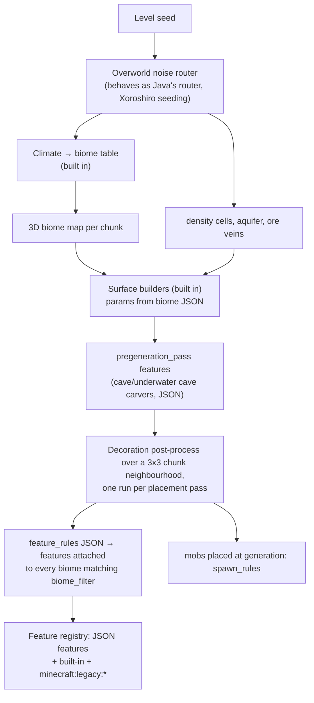
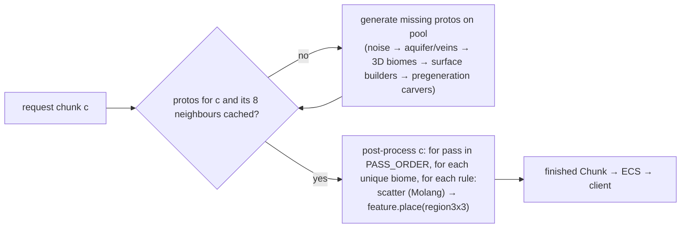

# Data-driven world: how BDS builds and ticks the overworld, and how unastar should

## 0. Summary

- **Terrain is not data in BDS, and that is fine.** No density-function or noise-router JSON ships anywhere in the BDS 1.26.51 install (`definitions/`, every `vanilla*/` pack). Yet the BDS reference world matches Java's noise router once unastar seeds it the Java way (below), so BDS terrain behaves as a port of Java's router. unastar's Java `worldgen_data` + build-time AOT codegen (`crates/unastar_noise`) is therefore the right data source for terrain. It is only seeded wrong.
- **Measured:** against a BDS-generated reference (seed 12345, 68 chunks) unastar matches **0.3 %** of terrain column heights today. Seeding the router noises the way Java's `RandomState` does (MD5 of `minecraft:<noise>`) lifts that to **84.4 % exact / 92.3 % within 2 blocks**, with every BDS water column also water in unastar. That one-file change was a throwaway experiment and has been reverted.
- **Everything above the terrain is pack data in BDS**, plus a fixed set of built-in behaviours keyed by identifier:
  - biomes come from `biomes` JSON (climate, tags, `surface_builder`, material adjustments, mountain parameters);
  - decoration comes from `feature_rules` + `features` JSON (267 rules, 290 features);
  - carvers are `*_carver_feature` JSON in `pregeneration_pass`;
  - mob spawning comes from `spawn_rules` JSON (58).
  The built-in side, counted from what the data references: the surface-builder types named by biome JSON, about 20 feature types, 65 feature identifiers with no JSON definition, 31 `minecraft:legacy:*` features, and the climate→biome table.
- **Ticking is built-in behaviour in BDS** (no pack data describes it), driven by block tags and states: crop growth, leaf decay, grass spread and the random-tick scheduler. Section 2.2 states the expected vanilla behaviour; each formula is confirmed by a BDS sweep before it is relied on.
  Time moved to **world clocks** in 26.x. BDS 1.26.51 sends `SyncWorldClocksPacket`, not `SetTime`: 0 `SetTime` against 54 `SyncWorldClocks` across 14 captured sessions (`tools/client-diff/conformance-report.md:121`).
- **Design (decisions resolved in §7):**
  - terrain stays Java-JSON → AOT codegen;
  - Bedrock pack data (biomes, feature_rules, features, spawn_rules) is normalised by `unastar-data` datagen; the schemas are generated as typed Rust, the vanilla data is embedded and decoded at startup, and generic Rust feature, surface-builder and spawn-condition implementations interpret it;
  - the BDS built-in and legacy features become Rust implementations registered under the same identifiers;
  - a 3×3 post-process stage gives cross-chunk decoration;
  - parity is gated by the committed BDS fixture.

## 1. Current unastar state

Evidence comes from two scout passes (2026-10-24) plus my own reads. Paths are relative to the repo root.

### 1.1 Pipeline

| Family | Source in repo | Parsed | Emitted | Used at runtime | Notes |
|---|---|---|---|---|---|
| noise params | `crates/unastar_noise/worldgen_data/noise/` (Java 1.21.x) | `build.rs:31` | `NOISE_PARAMS`, `NoiseRef` | `world/generator/density/types.rs:31-41` | **Wrong seeding:** `seed*31 + NoiseRef` (`types.rs:72-76`) instead of `RandomState.fromHashOf("minecraft:<name>")` |
| density functions / router | `worldgen_data/density_function`, `noise_settings/overworld.json` | yes | AOT straight-line Rust (`codegen/emitter/emitter_quote.rs`) | `terrain.rs:173-220` | Only the overworld is emitted. `base_3d_noise` is seeded `seed*31+1000` with hard-coded params (`types.rs:44-56`) |
| surface rule | `noise_settings/overworld.json` | yes | `build_vanilla_surface_rule` | `terrain.rs:55,337` | `noise_threshold`/`temperature` use **placeholder noises** (`codegen/emitter/surface_rule.rs:169-185,228-238`). Block-state properties are dropped (`:57-60`). The surface noise seed is a constant (`surface/system.rs:44-48`) |
| climate / biome lookup | hand-written `climate.rs`, `unastar_noise/src/biome_tables.rs` | n/a | n/a | `terrain.rs:73-76` | Sequential Xoroshiro seeding with no `shift` noise, a heuristic `depth` (`climate.rs:32-53,171-176`), and a simplified table instead of Java's parameter-point search |
| biome storage | `world/chunk.rs:445,532` | n/a | n/a | n/a | **One biome per chunk**, sampled at the centre at y=64 (`terrain.rs:340-342`). `to_bedrock_biome_id` maps 17 biomes, sends the rest to plains (`terrain.rs:122-143`), and gives Meadow the wrong ID (177 vs native 186) |
| Java biome features | `worldgen_data/biome/*.json` | names only | `BiomeFeatures`, `GenerationStep`, `ALL_PLACED_FEATURES` | **none** | `configured_feature/` and `placed_feature/` are never parsed |
| carvers | `worldgen_data/configured_carver/` | **no** | no | **no** | There are two dead implementations: `terrain.rs:347-861` (`#[allow(dead_code)]`, JavaRandom, pre-1.18) and `generator/carver/` (hard-coded configs, test-only) |
| structures | `worldgen_data/structure*` | no | no | no | `structures.rs` is `#![allow(dead_code)]` and computes positions only |
| Bedrock BP biomes | `unastar-data/data/vanilla_bp/behavior_pack/biomes` (87) | datagen keeps every component in `output/biomes.kdl` | codegen keeps id, identifier, climate, tags and component *names* (`codegen/src/biomes.rs:14-28`) | `registry/biome.rs` → `BiomeDefinitionList` only | `surface_builder`, `surface_material_adjustments` and `mountain_parameters` reach KDL but not Rust. The generator never reads unastar-data biomes |
| spawn_rules | `vanilla_bp/behavior_pack/spawn_rules` (58) | **no** | no | no | Not ingested |
| feature / feature_rules | absent from bedrock-samples | n/a | n/a | n/a | They ship with BDS instead (§2.3) |
| block states | protocolgen native `canonical_block_states.nbt` | runtime ranges only (`registry/block.rs`) | no per-state properties on `main` | n/a | VANILLA-ENTITIES (ctx_e2792b991296) is adding a `StateTable` plus `BlockEntry::state_value`/`with_state_value`. WORLD will consume that, not a second copy |

### 1.2 World ticking

| Item | State |
|---|---|
| `ChunkTickingState` / `TICKING` flag | Computed every tick (`world/ecs/systems.rs:774-821`), read by nothing |
| Random ticks, scheduled block ticks | Absent |
| Time of day | Absent. StartGame time is fixed, and there is no `SetTime` or `SyncWorldClocks` |
| Autosave | Absent. Dirty chunks are saved on unload (`systems.rs:688-724`) and at shutdown |
| Generation | One OS thread **per chunk** with a 16 MiB stack (`world/ecs/generation_worker.rs:92-109`). Measured in a **debug** build, single-threaded, turbo off: 68 chunks in 7.13–7.28 s, **about 105 ms/chunk**. The "300 ms" figure in comments is stale |

### 1.3 What the repo's own plans already decided
These come from `thoughts/shared/plans/*`, and the details are in the scout digest:
- Worldgen is compiled in, with no runtime datapacks (`2025-12-29-vanilla-worldgen-complete-java-parity.md:11-21,83`).
- The target is Java byte parity (`:63-75`).
- Features are placed = configured + modifiers, with simple features compiled and complex ones interpreted (`2025-01-02-feature-placement-system.md:29-33,96-119`).
- No parallel generation (`2026-01-02-worldgen-performance-optimization.md:50-56`).
- Block registry: string IDs as truth, vanilla runtime IDs kept, chunks keep `u32` IDs (`2026-01-04-block-registry-typestate-architecture.md:7-13,798`).

**This research changes two of those premises:**
1. **The truth is BDS, not Java.** BDS terrain is Java's (proven below), but BDS decoration, surface and carvers are Bedrock data plus Bedrock C++.
2. **"Parallel generation forbidden"** was a parity guard. Generation is a pure function of the seed, so a worker pool cannot change output.

## 2. BDS architecture (BDS 1.26.51 install, captures and reference world)

### 2.1 Pipeline

### 2.2 Evidence table

"Built in" means BDS ships no data for it. "To confirm" means the row states expected vanilla behaviour that a BDS fixture or sweep must confirm before unastar relies on it.

| Concern | BDS behaviour | Data or built in | Evidence |
|---|---|---|---|
| Terrain noise | Java-style noise router: density cells, aquifers, ore veins, Xoroshiro positional randoms | Built in (behaves as the Java port) | No density JSON in `definitions/` or any `vanilla*/__brarchive` of the install. The fixture matches Java's router at 84.4 % exact once seeded the Java way (§2.4) |
| Climate → biome | Climate parameters → biome table | Built in | Surface biome IDs in the fixture; Java's `multi_noise_biome_source_parameter_list/overworld.json` is the candidate table. To confirm: the fixture biome ratchet in W2 |
| Spawn point | Climate-guided spawn search; `SpawnY=32767` is stored and the real Y is resolved later | Built in | The reference world for seed 12345 has `SpawnX=103, SpawnZ=-28, SpawnY=32767`, `spawnradius=10` (level.dat). To confirm: the search must reproduce (103, −28) |
| Biome definitions | Biome documents loaded from the pack stack, one component per JSON key | **Data** (`biomes.brarchive` in 13 versioned vanilla packs; same schema as bedrock-samples `*.biome.json`) | Counted in the install; schema matches the vendored `vanilla_bp` biomes and Mojang's public biome documentation |
| Biome worldgen defaults | Some biome-tag feature defaults may be built in rather than shipped | To confirm | Fixture histograms (W7/W8) show whether any decoration is missing after all shipped rules run |
| Surface | Builder chosen per biome by `minecraft:surface_builder` (`type`, `top/mid/foundation/sea_floor/sea_material`, `sea_floor_depth`), plus `minecraft:surface_material_adjustments` and `minecraft:mountain_parameters` | Built-in algorithms, data parameters | Vendored biome JSON: 86/87 have `surface_builder` (types: `overworld` 72, `mesa` 6, `swamp` 3, `capped` 2, `frozen_ocean` 2, `the_end` 1), 17 have material adjustments. The install's biomes are re-counted after the owner-D1 pack bump |
| Feature rules | Rules from `definitions/feature_rules` + pack `feature_rules`; each rule attaches its feature to every biome matching `minecraft:biome_filter`, in its `placement_pass` | **Data** | Files counted in the install (§2.3); Mojang's public feature-rule documentation |
| Features | Features from `definitions/features` + pack `features`, one typed schema per feature type | **Data** for JSON feature types | Files counted in the install (§2.3); Mojang's public feature documentation |
| Built-in features | Identifiers referenced by `places_feature` that have no JSON definition (65), plus `minecraft:legacy:*` (31) | **Built in** | Set difference over the install's rules and features (§2.3) |
| Decoration run | Per placement pass, every unique biome in the chunk's 3D biome map runs its rules; scatter parameters are Molang (`variable.is_legacy` is set for legacy rules); a chunk is decorated with its 8 neighbours available | Built-in engine over data | Molang variables are read from the shipped rule JSON. To confirm: the 3×3 neighbourhood with a seam test against a BDS fixture |
| Carvers | JSON `minecraft:cave_carver_feature` / `underwater_cave_carver_feature` (`skip_carve_chance 15`, `height_limit 120`, `y_scale`, `floor_level`, `fill_with`, `replace_air_with`) placed by rules in `pregeneration_pass` | Built-in algorithm, data params | e.g. rule `minecraft:overworld_cave_carver_feature` → `minecraft:underground_cave_carver_feature` (install) |
| Spawn rules | Pack `spawn_rules` evaluated per spawn group by a built-in spawner, both at chunk generation and during play | **Data** + built-in spawner | 58 files in the vendored `vanilla_bp`; Mojang's public spawn-rule documentation |
| Random ticks (schedule) | Expected: `randomTickSpeed × floor(2.5 × (top non-empty sub-chunk index + 1))` positions per chunk per tick, drawn from one **global LCG** `r = r*3 + 1013904223`: x=`(r>>2)&15`, z=`(r>>10)&15`, y=`(r>>18) % (16×(top+1))` from the chunk floor; the water (extra block) layer is ticked too | Built in | To confirm: a BDS sweep (e.g. crop growth rate per chunk vs occupied height). The default `randomtickspeed` is 1 (public Bedrock game-rule docs) |
| Crop growth | Expected: grows one stage when brightness ≥ the crop's minimum light, growth < max and `nextInt(int(base / growthSpeed) + 1) == 0`; growth speed reads the 3×3 farmland and same-crop neighbours | Built in per block; tags are data | To confirm: a BDS crop-growth sweep (owner D4) |
| Leaf decay | Expected: only when `update_bit` is set and `persistent_bit` is not; decays if no log or wood block lies within 4 | Built in | `update_bit`/`persistent_bit` are public block states. To confirm: decay at distance 4 and 5 in a BDS sweep |
| Grass spread | Expected: if grass cannot survive, it reverts to dirt. Otherwise, if the brightness above is > 8, 4 tries at dx∈[-1,1], dy∈[-3,1], dz∈[-1,1] turn eligible dirt into grass | Built in | To confirm: a BDS sweep |
| Time | The overworld clock advances while the daylight-cycle game rule is on; clock state is sent with `SyncWorldClocksPacket` at join and whenever it changes | Built in | 0 `SetTime` vs 54 `SyncWorldClocks` in 14 captured BDS sessions (`conformance-report.md:121`). The periodic re-sync cadence needs a capture with the cycle running |
| Chunk save | Dirty loaded chunks are saved periodically, not only on unload | Built in | To confirm and measure the cadence from BDS (owner D4) |
| Client-visible data | `BiomeDefinitionListPacket` and `JigsawStructureDataPacket` on every join. `FeatureRegistryPacket` exists for client-side generation but BDS does not send it (`client-side-chunk-generation-enabled=false`) | n/a | `conformance-report.md:92,116` |

### 2.3 What BDS 1.26.51 actually ships (counted from the install)

**Feature rules (267 total).**
- Locations: `server/definitions/feature_rules` (120 files) and `feature_rules.brarchive` in 16 versioned `vanilla_*` packs.
- Placement passes: surface 109, after_surface 98, underground 37, first 11, before_surface 5, pregeneration 4, after_underground 2, before_underground 1.
- Biome filters use **only** `has_biome_tag`.
- `distribution` fields: 399 uniform, 12 triangle, 273 constants, and **165 Molang strings**.

**Features (290 total).**
- Locations: `definitions/features` (139) and `features.brarchive` in 23 packs.
- Types: scatter 79, aggregate 51, tree 35, single_block 27, ore 26, weighted_random 16, snap_to_surface 12, structure_template 10, growing_plant 7, vegetation_patch 7, search 4, fossil 2, cave_carver 2, multiface 2, surface_relative_threshold 2, sculk_patch 2, sequence 1, nether/underwater cave carver 1 each, geode 1, partially_exposed_blob 1, horizontal_tree_decoration 1.

**What `places_feature` points at:**
- 171 rules → JSON features.
- **65 → built-ins (no JSON definition):** cactus, reeds, clay, gravel, kelp, seagrass, coral*, ice_spike, ice_patch, melon, bamboo, huge_mushroom, desert_well, firefly bush, dripstone cluster and more.
- **31 → `minecraft:legacy:*`:** per-biome tree, flower and foliage selectors (`forest_tree_feature`, `jungle_tree_feature`, `flower_forest_flower_feature`, …), plus `emerald_ore_feature` and `ice_feature`.

**Versioning.** Rules and features exist in many versioned packs (`vanilla_1.17.0` … `vanilla_1.26.51`). The world's base game version selects the stack, and newer packs override older ones. Example: `minecraft:overworld_underground_coal_ore_feature` has `iterations: 0` in the newest copy. Each file carries a `format_version`, so loading must upgrade older shapes.

**Block names in features are pre-flattening.** Examples: `minecraft:log` with `old_log_type`, `minecraft:leaves` with `old_leaf_type`, `minecraft:grass`. Ingestion needs the block alias/upgrade table.

**Molang.** The distributions need only a small subset:
- `query.heightmap(x,z)`, `query.above_top_solid(x,z)`, `query.noise(x,z)`;
- `variable.worldx/worldz/originx/originz/is_legacy`;
- `math.random`, `math.max`, comparisons, `&&`, ternaries.

### 2.4 Measured parity

Tools:
- Fixture: `crates/unastar/tests/fixtures/bds_1_26_51_seed_12345.json`, 68 finalized chunks from three ticking areas, written by `examples/bds_worldgen_reference.rs`.
- Report: `examples/worldgen_parity_report.rs`.

| Metric (17 408 columns) | unastar `main` | + Java RandomState seeding (experiment) |
|---|---:|---:|
| Terrain height (noise / surface / vein blocks only), exact | 0.3 % | **84.4 %** |
| Terrain height within ±2 | 2.4 % | **92.3 %** |
| Mean absolute terrain error | 37.1 blocks | **1.33** |
| Surface height exact | 9.7 % | 88.1 % |
| Surface block match | 8.3 % | 81.3 % |
| Surface biome ID match | 0.0 % | 0.0 % (biome path untouched) |
| BDS water columns that are water in unastar | 1 440 / 14 150 | **14 150 / 14 150** |

What the experiment showed:
- **After seeding is fixed, most remaining surface mismatches come from biome selection.** BDS `grass_block`, `short_grass` and leaves sit over unastar `red_sandstone` (badlands rules fire), which means the climate path is still wrong.
- **Whole-chunk histograms show what is missing entirely.** BDS has diorite, andesite and granite blobs, gravel, clay, dirt, moss, every scattered ore, kelp, seagrass, plants, leaves and amethyst. unastar has none of them, because no features run.
- **The experiment** replaced `NoiseRegistry::new` seeding with `Xoroshiro128::from_seed(seed)` → `(lo,hi)`, then `from_state(md5("minecraft:"+name) ^ (lo,hi))` per noise. `BlendedNoise` used `md5("minecraft:terrain")`. The patch is saved outside the repo.

## 3. Gaps and risks

1. **Seeding and biome path.** This is the largest and cheapest fix (§2.4). Still to do:
   - the climate sampler must use the router's `temperature/vegetation/continents/erosion/depth/ridges` (with shift);
   - Java's parameter-point search must come from `multi_noise_biome_source_parameter_list/overworld.json` instead of `biome_tables.rs` heuristics;
   - biomes must be 3D (quart resolution);
   - a complete Java → Bedrock biome ID map is needed (e.g. `windswept_hills`→`extreme_hills`, `snowy_plains`→`ice_plains`, `old_growth_birch_forest`→`birch_forest_mutated`), generated from data with no `_ => plains` fallback.
2. **Surface.** BDS uses Bedrock surface builders configured by biome JSON, not Java surface rules.
   - unastar's Java surface rules also carry placeholder noises.
   - Each builder type named in biome JSON (`overworld`, `mesa`, `capped`, `frozen_ocean`, `swamp`, `the_end`, plus any extra type the install's biomes name) needs a Rust implementation matched to the fixture.
   - Resolved (WD2): port the BDS builders once W2 makes biomes right; the fixture decides each builder. Until then the Java rules with correct noise seeding stay in place as the explicit interim, not a silent fallback.
3. **Data source and licensing.**
   - BDS `features`/`feature_rules` are not in bedrock-samples. They live in the BDS install (`definitions/` + `.brarchive`).
   - Their licence class (Minecraft EULA) is the same as the already-vendored `vanilla_bp` and the protocolgen native dumps.
   - Resolved (WD1): they are ingested from the shared BDS install. The `.brarchive` reader is about 15 lines; the format is shown in §6.
   - The vendored `vanilla_bp` (biomes, spawn_rules) is bumped to 1.26.50 or newer first (owner D1), so pack data and install data describe the same version.
4. **Built-in behaviour that is not in any pack.** Each is hand-ported in Rust; every ported formula is pinned by a unit test and a BDS fixture:
   - 65 built-in features;
   - 31 legacy features (per-biome tree, forest foliage and flower selectors, …);
   - the surface builders;
   - the cave carver algorithm;
   - random-tick behaviours (crops, leaves, grass, saplings, sugar cane, cactus, kelp, …);
   - the spawner, and the world clocks.
   These are "data-shaped" (parameterised by tags and states), not data. Built-in numbers that BDS does not ship are measured from BDS with sweeps (owner D4).
5. **RNG parity for decoration.** Bedrock decoration uses its own per-chunk random plus each feature's RNG consumption order. Byte-exact feature placement needs that seeding derived from BDS output (fixture sweeps over single features). Resolved (WD4): ship statistically vanilla decoration first ("same rules, same density, different positions"); exact placement is a later slice.
6. **Cross-chunk decoration.** Expected vanilla behaviour: BDS decorates a chunk with its 3×3 neighbourhood available (to confirm with a seam test against a BDS fixture). unastar generates one chunk per request with no neighbours (`generation_worker.rs:106`). The feature pipeline needs:
   - a proto-chunk cache (terrain + surface + carvers);
   - a post-process step that runs once a chunk's 8 neighbours exist as protos;
   - a fixed placement-pass order.
7. **Block identity.** Feature JSON uses legacy names and states (`minecraft:log{old_log_type}`). This depends on the shared `StateTable` (ENTITIES) and on a block-upgrade alias table, which is a new data family. The weak "first canonical state" default is wrong for logs (`pillar_axis=x`).
8. **Molang.** A small subset is enough for feature rules (§2.3). Spawn rules need none; their filters are the shared filter language. Both should reuse the shared Molang/filter crate that ENTITIES leads, not a worldgen-local evaluator.
9. **Time protocol.** In 26.51 the time is the overworld world clock synced by `SyncWorldClocksPacket` (initialise registry on join, `SyncState` on change). "SetTime every 20 s" is not what BDS 1.26.51 does (captures above). Resolved (WD5): world clocks. The periodic re-sync cadence still needs a capture with the cycle running.
10. **Random-tick rate.** Expected BDS behaviour: `randomTickSpeed × floor(2.5 × non-empty sub-chunk height)` positions per chunk, spread over the whole occupied height (Java: 3 per section). The default randomTickSpeed is 1. To confirm with a BDS sweep before W11 ships.
11. **Performance.** Generic interpreted features are cheap next to terrain noise (about 105 ms/chunk debug). The real costs are:
    - one OS thread per chunk (`generation_worker.rs:92`);
    - the extra 3×3 proto ring.
    A bounded pool with 16 MiB stacks plus an LRU proto cache keeps the amortised cost at about one proto per chunk. Bevy is not involved: generation stays off-ECS.
12. **Versioned packs.** Feature and rule stacks depend on the world's base game version. unastar targets one version (1.26.51), so datagen should resolve the stack once and emit the final set, recording the source pack per row.

## 4. Proposed unastar design

### 4.1 Layers

| Layer | Source | Form | Owner crate |
|---|---|---|---|
| Noise router, aquifer, veins, climate, biome placement | Java `worldgen_data` (noise, density_function, noise_settings, `multi_noise_biome_source_parameter_list`) | Build-time AOT (as today) plus a generated MD5 table for `fromHashOf` | `unastar_noise` |
| Java→Bedrock biome map | generated from Java biome names × `unastar-data` biome identifiers, with an explicit alias table and a test that every Java overworld biome maps | embedded table | `unastar-data` (new family) |
| Bedrock biome worldgen params | BP biome JSON (`surface_builder`, `surface_material_adjustments`, `mountain_parameters`, tags, climate) | generated schema structs; data embedded, decoded at startup | `unastar-data` (extend biomes codegen) |
| Feature rules + features | BDS `definitions/` + `vanilla_*/__brarchive` resolved for 1.26.51 | `feature_rules.kdl`, `features.kdl` (normalised JSON per row, source pack recorded), embedded and decoded at startup into generated typed structs | `unastar-data` (new families) |
| Block alias/upgrade table | protocolgen / native data | embedded map, decoded at startup | `unastar-data` (new family) |
| Spawn rules | BP `spawn_rules` | `spawn_rules.kdl` → typed rows (conditions as shared filter AST) | `unastar-data` (new family) |
| Generic implementations | Rust | `FeatureType` impls (scatter, aggregate, sequence, weighted_random, single_block, ore, tree, snap_to_surface, search, growing_plant, vegetation_patch, multiface, surface_relative_threshold, cave_carver, …); `SurfaceBuilder` impls (one per builder type); built-in and legacy features registered by identifier | hand-written, each formula pinned by a unit test and a BDS fixture | `unastar/src/world/generator/{features,surface,carver}` |
| Molang + filters | shared | evaluator crate/module led by ENTITIES | shared |

**Build-time or runtime?** (WD3, owner D2)
- Schemas are generated at build time: one typed Rust struct/enum per data family. The vanilla data itself is embedded in the binary and decoded at startup: no I/O at generation time, and parity-testable.
- No per-entry Rust code is generated. Because the startup decoder produces the same structs a pack would, a later pack overlay loader (add-ons, custom features) deserialises the same shape into the same registry (owner D5). Section 4.4 shows the registry and overlay shape.

### 4.2 Generation pipeline (off-ECS, deterministic)

**Invariants:**
- The output of `generate(c)` depends only on (seed, c).
- Features read the 3×3 *proto* region and write into the 3×3 *decorated* region.
- Only the centre chunk is kept. Neighbours re-run their own origins when they post-process.
- `PASS_ORDER` is the BDS placement-pass list:
  `pregeneration, first, before_underground, underground, after_underground, before_surface, surface, after_surface`.

### 4.3 World ticking (ECS)

| Piece | ECS shape | Data it reads | Packets |
|---|---|---|---|
| `WorldClock` resource (overworld clock, time markers) | `ChunkSet`-adjacent system: `tick()` while `LevelRules.do_daylight_cycle`; `set_time/add_time/time()` for SURVIVAL's `/time` (agreed by message) | game rules (SURVIVAL's `LevelRules`) | StartGame time; `SyncWorldClocksPacket{InitializeRegistry}` at join, `{SyncState}` when dirty. SetTime stays only if a capture shows BDS sending it |
| Random-tick scheduler | system over chunks with `ChunkStateFlags::TICKING`; the LCG and count formula above, once a BDS sweep confirms them | `randomTickSpeed` from `LevelRules` | via block-change events |
| Block random-tick behaviours | `RandomTickBehaviour` keyed by block tag/identifier: `CropGrowth{max_growth, min_light, base}`, `LeafDecay{radius:4}`, `GrassSpread`, … (built in in BDS, so Rust here) | `StateTable` (ENTITIES), native block tags | `UpdateBlock` through the existing broadcast |
| Autosave | system every N ticks saving `ChunkStateFlags::DIRTY` chunks off-thread, then clearing DIRTY; N measured from BDS | config | none |
| Natural spawning | spawn-rule rows evaluated by a spawner system that hands spawn requests to ENTITIES' spawn API | `spawn_rules.kdl`, biome tags, light, game rules | ENTITIES' AddActor |

### 4.4 Plugins and custom packs

**Registries are keyed by identifier.**
- `FeatureRegistry: identifier → Arc<dyn FeatureInstance>`;
- `SurfaceBuilderRegistry: type → builder`;
- `RandomTickBehaviour: block identifier/tag → behaviour`.

Vanilla rows are registered at startup. Scope is vanilla only for now (owner D5), but a later pack loader (runtime JSON, same schema) or a WASM mod could register more rows or override them before the generator is frozen. This mirrors BDS's pack stack and fits the frozen-registry plan in `2026-01-04-block-registry-typestate-architecture.md`.

Growing the WIT plugin API (e.g. "register feature") is out of scope until the coordinator approves it.

### 4.5 Keeping "BDS is the truth" testable

- **Fixture.** The committed BDS fixture (68 chunks, seed 12345) becomes a test with ratcheting floors:
  - terrain height exact ≥ the measured value;
  - surface block and biome match ≥ the measured value;
  - per-block histogram L1 distance ≤ the measured value.
  A slice may only raise these numbers.
- **More fixtures** are regenerated with the shared BDS runtime (procedure in `examples/bds_worldgen_reference.rs`). Copy the world **before** opening it with bleveldb: opening rewrites the log into tables.
- **Pin each ported formula with a unit test and a BDS fixture**, e.g.:
  - the random-tick LCG sequence;
  - the crop chance at known neighbours;
  - leaf decay at distance 4 and 5;
  - the spawn finder giving (103, −28) for seed 12345.
- **Quirks.** Every odd BDS behaviour copied on purpose is logged in `thoughts/shared/research/bds-quirks.md` (owner D3).

## 5. Implementation plan (ordered slices)

| # | Slice | Size | Depends on | Test |
|---|---|---|---|---|
| W1 | `fromHashOf` MD5 table generated in `unastar_noise` codegen; Java `RandomState` seeding for every router noise, `BlendedNoise` and the surface/`noise_threshold` noises (also removes the placeholder noises) | S | — | Fixture: terrain exact ≥ 84 %, within ±2 ≥ 92 % (ratchet) |
| W2 | Climate from router functions (with shift + depth), Java parameter-point search from `multi_noise_biome_source_parameter_list` codegen, 3D quart biome storage + network encoding, generated Java→Bedrock biome map | M | W1, owner D1 (`vanilla_bp` ≥ 1.26.50) | Fixture surface-biome match (new ratchet); a unit test that every Java overworld biome maps |
| W3 | Default `kind="vanilla"` config + climate-guided spawn search + surface Y search (avoid water/leaves); vanilla `spawnradius` | S | W2 | Seed 12345 → spawn x,z = (103, −28); spawn column is solid and dry |
| W4 | BDS surface builders from biome-JSON params (new `unastar-data` schema fields), one builder type at a time; Java rules removed once every builder beats them on the fixture (WD2) | M–L | W2 | Fixture surface-block match ratchet |
| W5 | Generation pool (bounded, 16 MiB stacks) + proto cache + 3×3 post-process with `PASS_ORDER`; SuperFlat sub-chunk cache bug fix (`server/game/chunks.rs:162-176`) | M | W1 | Determinism: same chunk generated in any request order is identical. Seam test across chunk borders. Regression test for edit-after-re-request |
| W6 | `feature_rules` + `features` data families (BDS install → KDL, version-stack resolution, block alias table); `FeatureRegistry`; Molang subset via the shared evaluator | M | WD1, ENTITIES Molang | Datagen test: 267 rules / 290 features; every `places_feature` resolves to JSON, built-in or legacy, otherwise datagen fails |
| W7 | Feature types, part 1: ore, scatter, aggregate, sequence, weighted_random, single_block, search, snap_to_surface | M | W5, W6 | Fixture histograms: coal/iron/gold/redstone/lapis/diamond, diorite/andesite/granite, gravel, dirt within tolerance |
| W8 | Feature types, part 2: tree (trunk/canopy variants), growing_plant, vegetation_patch, multiface; legacy tree/flower selectors; built-ins in priority order (cactus, reeds, kelp, seagrass, clay, ice) | L | W7, ENTITIES `StateTable` | Fixture: leaves/logs/grass/flower counts, kelp/seagrass in ocean chunks |
| W9 | Carvers: one `cave_carver_feature` / `underwater_cave_carver_feature` implementation matched to the fixture; delete `terrain.rs:347-861` and `generator/carver/` | M | W5, W6 | Fixture: air/water volume below sea level; determinism |
| W10 | `WorldClock` + `SyncWorldClocks` + StartGame time; API for SURVIVAL's `/time` | S–M | SURVIVAL `LevelRules` | ECS test: join gets InitializeRegistry; `set_time` emits SyncState; the cycle stops when `do_daylight_cycle=false` |
| W11 | Random-tick scheduler (formula + LCG, confirmed by a BDS sweep) + crop/leaf/grass behaviours | M | ENTITIES `StateTable`, SURVIVAL `randomTickSpeed` | Unit: LCG positions, count for N sub-chunks; crop chance; leaf decay radius; grass spread/revert. BDS sweep for growth/decay rates |
| W12 | Periodic autosave of DIRTY chunks (cadence measured from BDS) | S | — | ECS test with a mock provider: dirty chunks saved after N ticks, flag cleared |
| W13 | `spawn_rules` data family + spawner (conditions over the shared filter AST); spawning itself through ENTITIES | L | ENTITIES (mobs, filters), W2 (biome tags), owner D1 | Unit tests per condition; statistical cap test |
| W14 | (later) Byte-exact decoration RNG, derived from BDS single-feature fixtures (WD4) | L | W7, W8 | Fixture: exact block positions for the pinned features |

W1→W2→W3 is the critical path for "a fresh world looks like BDS". W10–W12 are independent and can run in parallel with worldgen.

## 6. Notes for whoever implements

- **`.brarchive` format:**
  - header: 8-byte magic `7d 27 25 b1 a0 52 70 26`, u32 entry count, u32 version (1);
  - entries: 256 bytes each (u8 name length + 247-byte name + u32 offset + u32 size);
  - data: starts at `16 + count*256`, plain JSON with `//` comments.
- **BDS reference generation:** run the shared runtime with `level-type=DEFAULT`, `tickingarea add <from> <to> <name> true` from the console, wait at least 150 s, then `stop`. BDS does not persist every requested chunk; on the first pass about 50 % of areas were missing. The dumper skips and reports missing chunks.
- **Ownership edges:**
  - ENTITIES (ctx_e2792b991296): `StateTable`, Molang/filters, mob spawning.
  - SURVIVAL (ctx_96cb561fbefe): `LevelRules` (`do_daylight_cycle`, `random_tick_speed`) and `/time`.
  - Both were messaged on 2026-10-24.

## 7. World decisions (resolved)

The world-specific decisions (WD1–WD5) are resolved by taking each recommendation. All of them follow the owner's cross-area decisions D1–D5 in `thoughts/shared/plans/2026-10-24-data-driven-decisions.md`: pack pin 1.26.50+ (D1), schema codegen with embedded data decoded at startup (D2), copy BDS exactly and log quirks in `bds-quirks.md` (D3), measure built-in facts from BDS (D4), vanilla only with registries open for addon packs and WASM later (D5).

| # | Decision | Resolution | Follows |
|---|---|---|---|
| WD1 | Source of feature and feature_rules data | Ingest from the shared BDS install (`definitions/` + versioned `.brarchive`, Minecraft EULA like `vanilla_bp`). Java `placed_feature`/`configured_feature` are not used for decoration | D1, D3 |
| WD2 | Surface generation | Port the BDS surface builders, parameterised by biome JSON, after W2 makes biomes right; the fixture decides each builder. Java surface rules (seeding fixed) remain only until then | D3 |
| WD3 | Compile-time or runtime data | Compile vanilla in and add a runtime pack overlay later. Concretely: schemas are generated, the vanilla data is embedded and decoded at startup into those types, and an overlay feeds the same types before the registries freeze | D2, D5 |
| WD4 | Decoration RNG parity | Statistical decoration first (same rules, densities and shapes); exact placement later (W14), with the seeding derived from BDS fixtures | D3, D4 |
| WD5 | Time protocol | 26.x world clocks (`SyncWorldClocksPacket`), as BDS 1.26.51 does; no legacy `SetTime` loop unless a capture shows BDS sending it | D3 |
