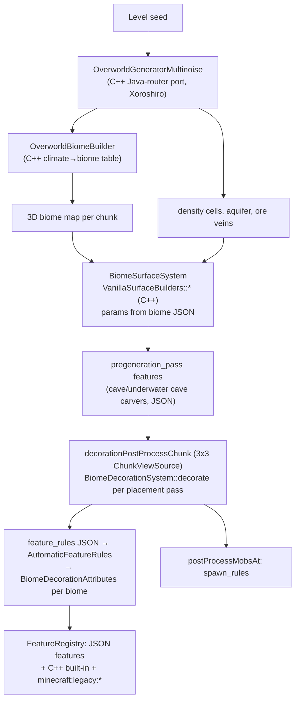
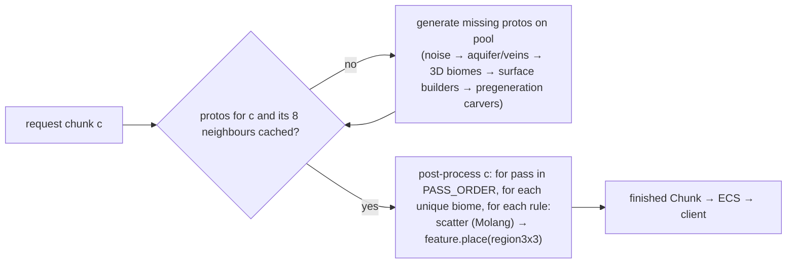

# Data-driven world: how BDS builds and ticks the overworld, and how unastar should

## 0. Summary

- **Terrain is not data in BDS, and that is fine.** BDS 1.26.51's multinoise overworld is a C++ port of Java's noise router (`OverworldGeneratorMultinoise`, `OverworldBiomeBuilder`, `XoroshiroPositionalRandomFactory`). No density-function JSON ships with BDS. unastar's Java `worldgen_data` + build-time AOT codegen (`crates/unastar_noise`) is therefore the right data source for terrain. It is only seeded wrong.
- **Measured:** against a BDS-generated reference (seed 12345, 68 chunks) unastar matches **0.3 %** of terrain column heights today. Seeding the router noises the way Java's `RandomState` does (MD5 of `minecraft:<noise>`) lifts that to **84.4 % exact / 92.3 % within 2 blocks**, with every BDS water column also water in unastar. That one-file change was a throwaway experiment and has been reverted.
- **Everything above the terrain is pack data in BDS**, plus a fixed set of C++ implementations keyed by identifier:
  - biomes come from `biomes` JSON (climate, tags, `surface_builder`, material adjustments, mountain parameters);
  - decoration comes from `feature_rules` + `features` JSON (267 rules, 290 features);
  - carvers are `*_carver_feature` JSON in `pregeneration_pass`;
  - mob spawning comes from `spawn_rules` JSON (58).
  The C++ side is: 8 surface-builder classes, about 20 feature types, 65 built-in features, 31 `minecraft:legacy:*` features, and the climate→biome table.
- **Ticking is hard-coded C++ in BDS**, driven by block tags and states:
  - `CropBlock::randomTick`, `DecayingBlocksUtil::_tryDecay<4>`, `GrassBlockBase::randomTick`;
  - the random-tick scheduler in `LevelChunk::tickImpl`.
  Time moved to a **world-clock registry** in 26.x. BDS 1.26.51 sends `SyncWorldClocksPacket`, not `SetTime`: 0 `SetTime` against 54 `SyncWorldClocks` across 14 captured sessions (`tools/client-diff/conformance-report.md:121`).
- **Recommended design:**
  - terrain stays Java-JSON → AOT codegen;
  - Bedrock pack data (biomes, feature_rules, features, spawn_rules) is normalised by `unastar-data` datagen into KDL artifacts and interpreted at runtime by generic Rust feature, surface-builder and spawn-condition implementations;
  - the BDS built-in and legacy C++ features become Rust implementations registered under the same identifiers;
  - a 3×3 post-process stage gives cross-chunk decoration;
  - parity is gated by the committed BDS fixture.

## 1. Current unastar state

Evidence comes from two scout passes (2026-10-24) plus my own reads. Paths are relative to the repo root.

### 1.1 Pipeline

| Family | Source in repo | Parsed | Emitted | Used at runtime | Notes |
|---|---|---|---|---|---|
| noise params | `crates/unastar_noise/worldgen_data/noise/` (Java 1.21.x) | `build.rs:31` | `NOISE_PARAMS`, `NoiseRef` | `world/generator/density/types.rs:31-41` | **Wrong seeding:** `seed*31 + NoiseRef` (`types.rs:72-76`) instead of `RandomState.fromHashOf("minecraft:<name>")` |
| density functions / router | `worldgen_data/density_function`, `noise_settings/overworld.json` | yes | AOT straight-line Rust (`codegen/emitter/emitter_quote.rs`) | `terrain.rs:173-220` | Only the overworld is emitted. `base_3d_noise` is seeded `seed*31+1000` with hard-coded params (`types.rs:44-56`) |
| surface rule | `noise_settings/overworld.json` | yes | `build_vanilla_surface_rule` | `terrain.rs:55,337` | `noise_threshold`/`temperature` use **placeholder noises** (`codegen/emitter/surface_rule.rs:169-185,228-238`). Block-state properties are dropped (`:57-60`). The surface noise seed is a constant (`surface/system.rs:44-48`) |
| climate / biome lookup | hand-written `climate.rs`, `unastar_noise/src/biome_tables.rs` | n/a | n/a | `terrain.rs:73-76` | Sequential Xoroshiro seeding with no `shift` noise, a heuristic `depth` (`climate.rs:32-53,171-176`), and a simplified table instead of Java's parameter-point search |
| biome storage | `world/chunk.rs:445,532` | n/a | n/a | n/a | **One biome per chunk**, sampled at the centre at y=64 (`terrain.rs:340-342`). `to_bedrock_biome_id` maps 17 biomes, sends the rest to plains (`terrain.rs:122-143`), and gives Meadow the wrong ID (177 vs native 186) |
| Java biome features | `worldgen_data/biome/*.json` | names only | `BiomeFeatures`, `GenerationStep`, `ALL_PLACED_FEATURES` | **none** | `configured_feature/` and `placed_feature/` are never parsed |
| carvers | `worldgen_data/configured_carver/` | **no** | no | **no** | There are two dead implementations: `terrain.rs:347-861` (`#[allow(dead_code)]`, JavaRandom, pre-1.18) and `generator/carver/` (hard-coded configs, test-only) |
| structures | `worldgen_data/structure*` | no | no | no | `structures.rs` is `#![allow(dead_code)]` and computes positions only |
| Bedrock BP biomes | `unastar-data/data/vanilla_bp/behavior_pack/biomes` (87) | datagen keeps every component in `output/biomes.kdl` | codegen keeps id, identifier, climate, tags and component *names* (`codegen/src/biomes.rs:14-28`) | `registry/biome.rs` → `BiomeDefinitionList` only | `surface_builder`, `surface_material_adjustments` and `mountain_parameters` reach KDL but not Rust. The generator never reads unastar-data biomes |
| spawn_rules | `vanilla_bp/behavior_pack/spawn_rules` (58) | **no** | no | no | Not ingested |
| feature / feature_rules | absent from bedrock-samples | n/a | n/a | n/a | They ship with BDS instead (§2.3) |
| block states | protocolgen native `canonical_block_states.nbt` | runtime ranges only (`registry/block.rs`) | no per-state properties on `main` | n/a | VANILLA-ENTITIES (ctx_e2792b991296) is adding a `StateTable` plus `BlockEntry::state_value`/`with_state_value`. WORLD will consume that, not a second copy |

### 1.2 World ticking

| Item | State |
|---|---|
| `ChunkTickingState` / `TICKING` flag | Computed every tick (`world/ecs/systems.rs:774-821`), read by nothing |
| Random ticks, scheduled block ticks | Absent |
| Time of day | Absent. StartGame time is fixed, and there is no `SetTime` or `SyncWorldClocks` |
| Autosave | Absent. Dirty chunks are saved on unload (`systems.rs:688-724`) and at shutdown |
| Generation | One OS thread **per chunk** with a 16 MiB stack (`world/ecs/generation_worker.rs:92-109`). Measured in a **debug** build, single-threaded, turbo off: 68 chunks in 7.13–7.28 s, **about 105 ms/chunk**. The "300 ms" figure in comments is stale |

### 1.3 What the repo's own plans already decided
These come from `thoughts/shared/plans/*`, and the details are in the scout digest:
- Worldgen is compiled in, with no runtime datapacks (`2025-12-29-vanilla-worldgen-complete-java-parity.md:11-21,83`).
- The target is Java byte parity (`:63-75`).
- Features are placed = configured + modifiers, with simple features compiled and complex ones interpreted (`2025-01-02-feature-placement-system.md:29-33,96-119`).
- No parallel generation (`2026-01-02-worldgen-performance-optimization.md:50-56`).
- Block registry: string IDs as truth, vanilla runtime IDs kept, chunks keep `u32` IDs (`2026-01-04-block-registry-typestate-architecture.md:7-13,798`).

**This research changes two of those premises:**
1. **The truth is BDS, not Java.** BDS terrain is Java's (proven below), but BDS decoration, surface and carvers are Bedrock data plus Bedrock C++.
2. **"Parallel generation forbidden"** was a parity guard. Generation is a pure function of the seed, so a worker pool cannot change output.

## 2. BDS architecture (lens + BDS 1.26.51 install)

### 2.1 Pipeline

### 2.2 Evidence table

| Concern | BDS mechanism | Data or C++ | Evidence |
|---|---|---|---|
| Terrain noise | `OverworldGeneratorMultinoise` (`_prepareHeights`, `generateDensityCellsForChunk`, `tryMakeAquifer`, `getXoroshiroPositionalRandomFactory`) | C++ (Java port) | RVAs `0x1832f30`, `0x18317b0`, `0x1830e70`, `0x1830f70`. No density JSON in `definitions/` or any `vanilla*/__brarchive` |
| Climate → biome | `OverworldBiomeBuilder::_populateBiomeArrays/_addSurfaceBiome/_addMidSlice/_addHighSlice/_addPeaks/_addLowSlice/_addUndergroundBiome` | C++ table | RVAs `0x1813a50`…`0x18242d0` |
| Spawn point | `OverworldGeneratorMultinoise::findSpawnPosition` → `SpawnClimateFinder::_findSpawnPositionDetailedResult` with two spawn-target points (continentalness "inland", weirdness ±[0.16,1]) and y=`0x7fff` (resolved later) | C++ | RVA `0x1832af0`. The reference world for seed 12345 has `SpawnX=103, SpawnZ=-28, SpawnY=32767`, `spawnradius=10` |
| Biome definitions | `BiomeRegistry::loadAllBiomeDocuments` → `BiomeJsonDocumentGlue` component glues (e.g. `MultinoiseGenerationRulesBiomeComponentGlue`, `SurfaceBuilderBiomeComponentGlue`, `SurfaceMaterialAdjustmentsBiomeComponentGlue`) | **Data** (`biomes.brarchive` in 13 versioned vanilla packs; same schema as bedrock-samples `*.biome.json`) | owner list `BiomeRegistry` (17 fns), `VanillaBiomes::initBiomes`/`initBiomeComponentGlue`/`initSurfaceBuilders` (RVAs `0xec7f30`, `0xec9dc0`, `0xecb400`) |
| Hard-coded biome worldgen defaults | `VanillaBiomes::initDefaultWorldGenComponents` embeds biome-tag filter JSON strings in C++ | C++ with data shape | RVA `0xecc300` (strings such as `has_biome_tag … "jungle" … != "mutated"`) |
| Surface | `BiomeSurfaceSystem::resolveBuilderImplementation` → `VanillaSurfaceBuilders::{OverworldDefault, Mesa, LegacyMesa, Capped, NoiseGradient, OceanFrozen, Swamp, TheEnd}`, configured per biome by `minecraft:surface_builder` (`type`, `top/mid/foundation/sea_floor/sea_material`, `sea_floor_depth`), `minecraft:surface_material_adjustments`, `minecraft:mountain_parameters` | C++ algorithms, data parameters | owner search `VanillaSurfaceBuilders` (8 owners). Biome JSON: 86/87 have `surface_builder`, 17 have material adjustments |
| Feature rules | `AutomaticFeatureRules` (Puv loader `SharedTypes::v1_21_20::AutomaticFeatureRulesData`) reads `definitions/feature_rules` + pack `feature_rules`; `attachAutomaticFeatures` adds `BiomeDecorationAttributes<ImplicitFeatures>` to every biome matching the rule's `minecraft:biome_filter` | **Data** | RVAs `0xaff51e0`, `0xaffaaa0` (string `"definitions/feature_rules"`) |
| Features | `FeatureRegistry::loadFromDefinitions` / `loadFromJsonData` / `_setupFeature`; typed parsers `FeatureLoading::_buildSchema<…>` | **Data** for JSON feature types | RVAs `0xb84b530`, `0xb84d500`, `0xb84cf70` |
| Built-in features | `VanillaFeatures::registerFeatureTypes` / `registerFeatures`, `FeatureRegistry::registerFeature<SeagrassFeature,…>`, `<FireflyBushClusterFeature,…>` | **C++** | RVAs `0x104d790`, `0x1087220`, `0x10a07d0`. The server binary's anonymous registration function (catalog 26.40, `0x81bcbc0`, 92 KB) holds the `minecraft:legacy:*` names |
| Decoration run | `OverworldGenerator::decorationPostProcessChunk(ChunkViewSource&)` → `OverworldGeneratorMultinoise::decorateWorldGenPostProcess` → for each placement pass `BiomeDecorationSystem::decorate` (every unique biome in the chunk's 3D biome map) → `decorateBiome` (Molang scatter params; sets `variable.is_legacy`) | C++ engine over data | RVAs `0x1827da0`, `0x182d4a0`, `0xac2b910`, `0xac2ae10` |
| Carvers | JSON `minecraft:cave_carver_feature` / `underwater_cave_carver_feature` (`skip_carve_chance 15`, `height_limit 120`, `y_scale`, `floor_level`, `fill_with`, `replace_air_with`) placed by rules in `pregeneration_pass` | C++ algorithm, data params | e.g. rule `minecraft:overworld_cave_carver_feature` → `minecraft:underground_cave_carver_feature` |
| Spawn rules | `ActorSpawnRuleGroup` ctor → `ActorSpawnRuleGroupAnon::getResources` (pack `spawn_rules`) → `MobSpawnRules` (`canSpawnInConditions`, `selectRandomHerd`, `addPermutation`); `SpawnGroupRegistry`; `BedrockSpawner::tick/spawnMobGroup/_spawnMobCluster`; `Spawner::spawnMobsForChunkGeneration` | **Data** + C++ spawner | RVAs `0x9c7de00`, `0xab9f9c0`, `0xa4e0760`, `0xab81d60` |
| Random ticks (schedule) | `LevelChunk::tickImpl`: count = `randomTickSpeed × floor(2.5 × (top non-empty sub-chunk index + 1))` per chunk per tick. Positions come from a **global LCG** `RANDVALUE = RANDVALUE*3 + 0x3c6ef35f`: x=`(r>>2)&15`, z=`(r>>10)&15`, y=`(r>>18) % (16×(top+1))` from the chunk floor. `Block::shouldRandomTick` → `Block::randomTick`; also the extra (water) layer via `BlockEvents` executors 7/8 | C++ | RVA `0xaf0dd80`. Constant `2.5f` at `0x10d9e1fa0` (`read_data`). randomTickSpeed is game-rule index `0x1a` |
| Crop growth | `CropBlock::randomTick`: if brightness ≥ `minLight`, growth < max and `rand.nextInt(int(base / CropUtils::getGrowthSpeed(...)) + 1) == 0`, then `setGrowth(growth+1)`. Growth speed reads the 3×3 farmland (`SupportsCrops` tag) and same-crop neighbours | C++ per block class; tags are data | RVAs `0xaabd250`, `0xaabd390` |
| Leaf decay | `LeavesBlock::randomTick` → `DecayingBlocksUtil::_tryDecay<4>`: only when `update_bit` is set and `persistent_bit` is not; scans ±4 for `LogAndStrippedLog` / `WoodAndStrippedWood` block-ID sets | C++ | RVAs `0xab0fe00`, `0xaac02b0` |
| Grass spread | `GrassBlockBase::randomTick`: if `!_canBeGrass(pos)`, revert to dirt. Else if raw brightness above > 8, make 4 tries at dx∈[-1,1], dy∈[-3,1], dz∈[-1,1] on dirt where `_canBeGrass` | C++ | RVA `0xaaf9d30` |
| Time | `Level::setTime/getTime` → `WorldClockRegistry` (`VanillaWorldClocks::OVERWORLD_CLOCK_NAME`); `WorldClockRegistryServer::tick` advances clocks while the daylight game rule is on and sends `SyncWorldClockState` / time markers when a clock is dirty; `sendInitializationToClient` at join. Clocks are registered in C++ (`VanillaWorldClocks::registerWorldClocks`) | C++ | RVAs `0xa584490`, `0xafaed50`, `0xafabe40`, `0xafb0310`, `0xafa87a0` |
| Chunk save | `ChunkSource::_saveDirtyChunks` saves loaded chunks where `LevelChunk::nonActorDataNeedsSaving(0,0)` (per-category dirty-tick counters). It is registered through `initializeWithLevelStorageManagerConnector` | C++ | RVAs `0xaef90e0`, `0xaf1dbb0`. The cadence is not yet measured |
| Client-visible data | `BiomeDefinitionListPacket` and `JigsawStructureDataPacket` on every join. `FeatureRegistryPacket` exists for client-side generation but BDS does not send it (`client-side-chunk-generation-enabled=false`) | n/a | `conformance-report.md:92,116` |

### 2.3 What BDS 1.26.51 actually ships (counted from the install)

**Feature rules (267 total).**
- Locations: `server/definitions/feature_rules` (120 files) and `feature_rules.brarchive` in 16 versioned `vanilla_*` packs.
- Placement passes: surface 109, after_surface 98, underground 37, first 11, before_surface 5, pregeneration 4, after_underground 2, before_underground 1.
- Biome filters use **only** `has_biome_tag`.
- `distribution` fields: 399 uniform, 12 triangle, 273 constants, and **165 Molang strings**.

**Features (290 total).**
- Locations: `definitions/features` (139) and `features.brarchive` in 23 packs.
- Types: scatter 79, aggregate 51, tree 35, single_block 27, ore 26, weighted_random 16, snap_to_surface 12, structure_template 10, growing_plant 7, vegetation_patch 7, search 4, fossil 2, cave_carver 2, multiface 2, surface_relative_threshold 2, sculk_patch 2, sequence 1, nether/underwater cave carver 1 each, geode 1, partially_exposed_blob 1, horizontal_tree_decoration 1.

**What `places_feature` points at:**
- 171 rules → JSON features.
- **65 → C++ built-ins:** cactus, reeds, clay, gravel, kelp, seagrass, coral*, ice_spike, ice_patch, melon, bamboo, huge_mushroom, desert_well, firefly bush, dripstone cluster and more.
- **31 → `minecraft:legacy:*`:** per-biome tree, flower and foliage selectors (`forest_tree_feature`, `jungle_tree_feature`, `flower_forest_flower_feature`, …), plus `emerald_ore_feature` and `ice_feature`.

**Versioning.** Rules and features exist in many versioned packs (`vanilla_1.17.0` … `vanilla_1.26.51`). The world's base game version selects the stack, and newer packs override older ones. Example: `minecraft:overworld_underground_coal_ore_feature` has `iterations: 0` in the newest copy. Loading also goes through Puv versioned loaders (`format_version` upgrade).

**Block names in features are pre-flattening.** Examples: `minecraft:log` with `old_log_type`, `minecraft:leaves` with `old_leaf_type`, `minecraft:grass`. Ingestion needs the block alias/upgrade table.

**Molang.** The distributions need only a small subset:
- `query.heightmap(x,z)`, `query.above_top_solid(x,z)`, `query.noise(x,z)`;
- `variable.worldx/worldz/originx/originz/is_legacy`;
- `math.random`, `math.max`, comparisons, `&&`, ternaries.

### 2.4 Measured parity

Tools:
- Fixture: `crates/unastar/tests/fixtures/bds_1_26_51_seed_12345.json`, 68 finalized chunks from three ticking areas, written by `examples/bds_worldgen_reference.rs`.
- Report: `examples/worldgen_parity_report.rs`.

| Metric (17 408 columns) | unastar `main` | + Java RandomState seeding (experiment) |
|---|---:|---:|
| Terrain height (noise / surface / vein blocks only), exact | 0.3 % | **84.4 %** |
| Terrain height within ±2 | 2.4 % | **92.3 %** |
| Mean absolute terrain error | 37.1 blocks | **1.33** |
| Surface height exact | 9.7 % | 88.1 % |
| Surface block match | 8.3 % | 81.3 % |
| Surface biome ID match | 0.0 % | 0.0 % (biome path untouched) |
| BDS water columns that are water in unastar | 1 440 / 14 150 | **14 150 / 14 150** |

What the experiment showed:
- **After seeding is fixed, most remaining surface mismatches come from biome selection.** BDS `grass_block`, `short_grass` and leaves sit over unastar `red_sandstone` (badlands rules fire), which means the climate path is still wrong.
- **Whole-chunk histograms show what is missing entirely.** BDS has diorite, andesite and granite blobs, gravel, clay, dirt, moss, every scattered ore, kelp, seagrass, plants, leaves and amethyst. unastar has none of them, because no features run.
- **The experiment** replaced `NoiseRegistry::new` seeding with `Xoroshiro128::from_seed(seed)` → `(lo,hi)`, then `from_state(md5("minecraft:"+name) ^ (lo,hi))` per noise. `BlendedNoise` used `md5("minecraft:terrain")`. The patch is saved outside the repo.

## 3. Gaps and risks

1. **Seeding and biome path.** This is the largest and cheapest fix (§2.4). Still to do:
   - the climate sampler must use the router's `temperature/vegetation/continents/erosion/depth/ridges` (with shift);
   - Java's parameter-point search must come from `multi_noise_biome_source_parameter_list/overworld.json` instead of `biome_tables.rs` heuristics;
   - biomes must be 3D (quart resolution);
   - a complete Java → Bedrock biome ID map is needed (e.g. `windswept_hills`→`extreme_hills`, `snowy_plains`→`ice_plains`, `old_growth_birch_forest`→`birch_forest_mutated`), generated from data with no `_ => plains` fallback.
2. **Surface.** BDS uses Bedrock surface builders configured by biome JSON, not Java surface rules.
   - unastar's Java surface rules also carry placeholder noises.
   - The 8 builder classes need a lens port: `OverworldDefault`, `Mesa`, `LegacyMesa`, `Capped`, `NoiseGradient`, `OceanFrozen`, `Swamp`, `TheEnd`.
   - Until then, Java rules with correct noise seeding are the fallback design, not a silent fallback: the choice is explicit (D2).
3. **Data source and licensing.**
   - BDS `features`/`feature_rules` are not in bedrock-samples. They live in the BDS install (`definitions/` + `.brarchive`).
   - Their licence class (Minecraft EULA) is the same as the already-vendored `vanilla_bp` and the protocolgen native dumps.
   - The user must approve ingesting them from the shared BDS runtime (D1). The `.brarchive` reader is about 15 lines; the format is shown in §6.
4. **Hard-coded C++ behaviour that is not in any pack.** Each must be hand-ported, with lens citations:
   - 65 built-in features;
   - 31 legacy features (`LegacyTreeFeature`, `LegacyForestFoliageFeature`, …);
   - 8 surface builders;
   - the cave carver algorithm;
   - random-tick behaviours (crops, leaves, grass, saplings, sugar cane, cactus, kelp, …);
   - the spawner, and the world clocks.
   These are "data-shaped" (parameterised by tags and states), not data.
5. **RNG parity for decoration.** Bedrock decoration uses its own per-chunk `Random` passed into `decorationPostProcessChunk`, plus each feature's RNG consumption order. Byte-exact feature placement needs that seeding reverse-engineered (start at `OverworldGenerator::decorationPostProcessChunk` `0x1827da0`). Without it, decoration is "same rules, same density, different positions" (D4).
6. **Cross-chunk decoration.** BDS decorates a chunk only through a 3×3 `ChunkViewSource`. unastar generates one chunk per request with no neighbours (`generation_worker.rs:106`). The feature pipeline needs:
   - a proto-chunk cache (terrain + surface + carvers);
   - a post-process step that runs once a chunk's 8 neighbours exist as protos;
   - a fixed placement-pass order.
7. **Block identity.** Feature JSON uses legacy names and states (`minecraft:log{old_log_type}`). This depends on the shared `StateTable` (ENTITIES) and on a block-upgrade alias table, which is a new data family. The weak "first canonical state" default is wrong for logs (`pillar_axis=x`).
8. **Molang.** A small subset is enough for feature rules (§2.3). Spawn rules need none; their filters are the shared filter language. Both should reuse the shared Molang/filter crate that ENTITIES leads, not a worldgen-local evaluator.
9. **Time protocol.** In 26.51 the time is the overworld `WorldClock` synced by `SyncWorldClocksPacket` (initialise registry on join, `SyncState` on change). "SetTime every 20 s" is not what BDS 1.26.51 does. The periodic re-sync cadence still needs a capture with the cycle running.
10. **Random-tick rate.** BDS: `randomTickSpeed × floor(2.5 × non-empty sub-chunk height)` positions per chunk, spread over the whole occupied height. Java: 3 per section. The default randomTickSpeed is 1 (game rule `0x1a`).
11. **Performance.** Generic interpreted features are cheap next to terrain noise (about 105 ms/chunk debug). The real costs are:
    - one OS thread per chunk (`generation_worker.rs:92`);
    - the extra 3×3 proto ring.
    A bounded pool with 16 MiB stacks plus an LRU proto cache keeps the amortised cost at about one proto per chunk. Bevy is not involved: generation stays off-ECS.
12. **Versioned packs.** Feature and rule stacks depend on the world's base game version. unastar targets one version (1.26.51), so datagen should resolve the stack once and emit the final set, recording the source pack per row.

## 4. Proposed unastar design

### 4.1 Layers

| Layer | Source | Form | Owner crate |
|---|---|---|---|
| Noise router, aquifer, veins, climate, biome placement | Java `worldgen_data` (noise, density_function, noise_settings, `multi_noise_biome_source_parameter_list`) | Build-time AOT (as today) plus a generated MD5 table for `fromHashOf` | `unastar_noise` |
| Java→Bedrock biome map | generated from Java biome names × `unastar-data` biome identifiers, with an explicit alias table and a test that every Java overworld biome maps | generated table | `unastar-data` (new family) |
| Bedrock biome worldgen params | BP biome JSON (`surface_builder`, `surface_material_adjustments`, `mountain_parameters`, tags, climate) | KDL → generated Rust structs | `unastar-data` (extend biomes codegen) |
| Feature rules + features | BDS `definitions/` + `vanilla_*/__brarchive` resolved for 1.26.51 | `feature_rules.kdl`, `features.kdl` (normalised JSON per row, source pack recorded) → generated `&'static` typed rows | `unastar-data` (new families) |
| Block alias/upgrade table | protocolgen / native data | KDL → generated map | `unastar-data` (new family) |
| Spawn rules | BP `spawn_rules` | `spawn_rules.kdl` → typed rows (conditions as shared filter AST) | `unastar-data` (new family) |
| Generic implementations | Rust | `FeatureType` impls (scatter, aggregate, sequence, weighted_random, single_block, ore, tree, snap_to_surface, search, growing_plant, vegetation_patch, multiface, surface_relative_threshold, cave_carver, …); `SurfaceBuilder` impls (8); built-in and legacy features registered by identifier | hand-written, lens-cited | `unastar/src/world/generator/{features,surface,carver}` |
| Molang + filters | shared | evaluator crate/module led by ENTITIES | shared |

**Build-time or runtime?**
- Vanilla data is compiled in, as `unastar_noise` and `unastar-data` already do: fast startup, no I/O at generation time, and parity-testable.
- The runtime types are the same structs the generated rows instantiate, so a later "pack overlay" loader (add-ons, custom features) can deserialise the same KDL/JSON shape into the same registry. Nothing is generated per feature as Rust *code*; only data rows are generated. Section 4.4 shows the registry and overlay shape.

### 4.2 Generation pipeline (off-ECS, deterministic)

**Invariants:**
- The output of `generate(c)` depends only on (seed, c).
- Features read the 3×3 *proto* region and write into the 3×3 *decorated* region.
- Only the centre chunk is kept. Neighbours re-run their own origins when they post-process, as in BDS.
- `PASS_ORDER` is BDS's pass list:
  `pregeneration, first, before_underground, underground, after_underground, before_surface, surface, after_surface`.

### 4.3 World ticking (ECS)

| Piece | ECS shape | Data it reads | Packets |
|---|---|---|---|
| `WorldClock` resource (overworld clock, time markers) | `ChunkSet`-adjacent system: `tick()` while `LevelRules.do_daylight_cycle`; `set_time/add_time/time()` for SURVIVAL's `/time` (agreed by message) | game rules (SURVIVAL's `LevelRules`) | StartGame time; `SyncWorldClocksPacket{InitializeRegistry}` at join, `{SyncState}` when dirty. SetTime stays only if a capture shows BDS sending it |
| Random-tick scheduler | system over chunks with `ChunkStateFlags::TICKING`; the BDS LCG and count formula above | `randomTickSpeed` from `LevelRules` | via block-change events |
| Block random-tick behaviours | `RandomTickBehaviour` keyed by block tag/identifier: `CropGrowth{max_growth, min_light, base}`, `LeafDecay{radius:4}`, `GrassSpread`, … (C++ in BDS, so Rust here) | `StateTable` (ENTITIES), native block tags | `UpdateBlock` through the existing broadcast |
| Autosave | system every N ticks saving `ChunkStateFlags::DIRTY` chunks off-thread, then clearing DIRTY | config | none |
| Natural spawning | `MobSpawnRules` rows evaluated by a spawner system (`BedrockSpawner::tick` shape) that hands spawn requests to ENTITIES' spawn API | `spawn_rules.kdl`, biome tags, light, game rules | ENTITIES' AddActor |

### 4.4 Plugins and custom packs

**Registries are keyed by identifier.**
- `FeatureRegistry: identifier → Arc<dyn FeatureInstance>`;
- `SurfaceBuilderRegistry: type → builder`;
- `RandomTickBehaviour: block identifier/tag → behaviour`.

Vanilla rows are registered at startup. A later pack loader (runtime JSON, same schema) would register more rows or override them before the generator is frozen. This mirrors BDS's pack stack and fits the frozen-registry plan in `2026-01-04-block-registry-typestate-architecture.md`.

Growing the WIT plugin API (e.g. "register feature") is out of scope until the coordinator approves it.

### 4.5 Keeping "BDS is the truth" testable

- **Fixture.** The committed BDS fixture (68 chunks, seed 12345) becomes a test with ratcheting floors:
  - terrain height exact ≥ the measured value;
  - surface block and biome match ≥ the measured value;
  - per-block histogram L1 distance ≤ the measured value.
  A slice may only raise these numbers.
- **More fixtures** are regenerated with the shared BDS runtime (procedure in `examples/bds_worldgen_reference.rs`). Copy the world **before** opening it with bleveldb: opening rewrites the log into tables.
- **Lens citations** (symbol + RVA) go in doc comments for every ported C++ formula. Unit tests pin those formulas, e.g.:
  - the random-tick LCG sequence;
  - the crop chance at known neighbours;
  - leaf decay at distance 4 and 5;
  - the spawn finder giving (103, −28) for seed 12345.

## 5. Implementation plan (ordered slices)

| # | Slice | Size | Depends on | Test |
|---|---|---|---|---|
| W1 | `fromHashOf` MD5 table generated in `unastar_noise` codegen; Java `RandomState` seeding for every router noise, `BlendedNoise` and the surface/`noise_threshold` noises (also removes the placeholder noises) | S | — | Fixture: terrain exact ≥ 84 %, within ±2 ≥ 92 % (ratchet) |
| W2 | Climate from router functions (with shift + depth), Java parameter-point search from `multi_noise_biome_source_parameter_list` codegen, 3D quart biome storage + network encoding, generated Java→Bedrock biome map | M | W1 | Fixture surface-biome match (new ratchet); a unit test that every Java overworld biome maps |
| W3 | Default `kind="vanilla"` config + `SpawnClimateFinder` port + surface Y search (avoid water/leaves); vanilla `spawnradius` | S | W2 | Seed 12345 → spawn x,z = (103, −28); spawn column is solid and dry |
| W4 | Surface decision (D2). Either port the BDS surface builders from biome-JSON params (new `unastar-data` codegen fields) or keep Java rules | M–L | W2, D2 | Fixture surface-block match ratchet |
| W5 | Generation pool (bounded, 16 MiB stacks) + proto cache + 3×3 post-process scaffold with `PASS_ORDER`; SuperFlat sub-chunk cache bug fix (`server/game/chunks.rs:162-176`) | M | W1 | Determinism: same chunk generated in any request order is identical. Seam test across chunk borders. Regression test for edit-after-re-request |
| W6 | `feature_rules` + `features` data families (BDS install → KDL, version-stack resolution, block alias table); `FeatureRegistry`; Molang subset via the shared evaluator | M | D1, ENTITIES Molang | Datagen test: 267 rules / 290 features; every `places_feature` resolves to JSON, built-in or legacy, otherwise datagen fails |
| W7 | Feature types, part 1: ore, scatter, aggregate, sequence, weighted_random, single_block, search, snap_to_surface | M | W5, W6 | Fixture histograms: coal/iron/gold/redstone/lapis/diamond, diorite/andesite/granite, gravel, dirt within tolerance |
| W8 | Feature types, part 2: tree (trunk/canopy variants), growing_plant, vegetation_patch, multiface; legacy tree/flower selectors; built-ins in priority order (cactus, reeds, kelp, seagrass, clay, ice) | L | W7, ENTITIES `StateTable` | Fixture: leaves/logs/grass/flower counts, kelp/seagrass in ocean chunks |
| W9 | Carvers: one `cave_carver_feature` / `underwater_cave_carver_feature` implementation ported from lens; delete `terrain.rs:347-861` and `generator/carver/` | M | W5, W6 | Fixture: air/water volume below sea level; determinism |
| W10 | `WorldClock` + `SyncWorldClocks` + StartGame time; API for SURVIVAL's `/time` | S–M | SURVIVAL `LevelRules` | ECS test: join gets InitializeRegistry; `set_time` emits SyncState; the cycle stops when `do_daylight_cycle=false` |
| W11 | Random-tick scheduler (BDS formula + LCG) + crop/leaf/grass behaviours | M | ENTITIES `StateTable`, SURVIVAL `randomTickSpeed` | Unit: LCG positions, count for N sub-chunks; crop chance; leaf decay radius; grass spread/revert |
| W12 | Periodic autosave of DIRTY chunks (cadence from lens `ChunkSource::_saveDirtyChunks` caller) | S | — | ECS test with a mock provider: dirty chunks saved after N ticks, flag cleared |
| W13 | `spawn_rules` data family + spawner (conditions over the shared filter AST); spawning itself through ENTITIES | L | ENTITIES (mobs, filters), W2 (biome tags) | Unit tests per condition; statistical cap test |

W1→W2→W3 is the critical path for "a fresh world looks like BDS". W10–W12 are independent and can run in parallel with worldgen.

## 6. Notes for whoever implements

- **`.brarchive` format:**
  - header: 8-byte magic `7d 27 25 b1 a0 52 70 26`, u32 entry count, u32 version (1);
  - entries: 256 bytes each (u8 name length + 247-byte name + u32 offset + u32 size);
  - data: starts at `16 + count*256`, plain JSON with `//` comments.
- **BDS reference generation:** run the shared runtime with `level-type=DEFAULT`, `tickingarea add <from> <to> <name> true` from the console, wait at least 150 s, then `stop`. BDS does not persist every requested chunk; on the first pass about 50 % of areas were missing. The dumper skips and reports missing chunks.
- **Ownership edges:**
  - ENTITIES (ctx_e2792b991296): `StateTable`, Molang/filters, mob spawning.
  - SURVIVAL (ctx_96cb561fbefe): `LevelRules` (`do_daylight_cycle`, `random_tick_speed`) and `/time`.
  - Both were messaged on 2026-10-24.

## 7. Decisions needed from the user

| # | Decision | Options | Recommendation |
|---|---|---|---|
| D1 | Source of feature and feature_rules data | (a) ingest from the shared BDS install (`definitions/` + versioned `.brarchive`), Minecraft EULA like `vanilla_bp`; (b) Java `placed_feature`/`configured_feature` already in the repo (Java-looking decoration) | (a): it is the BDS truth |
| D2 | Surface generation | (a) port BDS surface builders, parameterised by biome JSON; (b) keep Java surface rules, with seeding fixed | (a), after W2 makes biomes right; the fixture decides |
| D3 | Compile-time or runtime data | (a) compile vanilla in (generated rows) and add a runtime pack overlay later; (b) load BP JSON at runtime from day one | (a) |
| D4 | Decoration RNG parity | (a) reverse-engineer Bedrock's decoration `Random` seeding and consumption so placement is byte-exact; (b) statistically vanilla (same rules, densities and shapes) | (b) first, (a) as a later slice if parity tests need it |
| D5 | Time protocol | (a) 26.x world clocks (`SyncWorldClocksPacket`), as BDS 1.26.51 does; (b) legacy `SetTime` loop | (a) |
